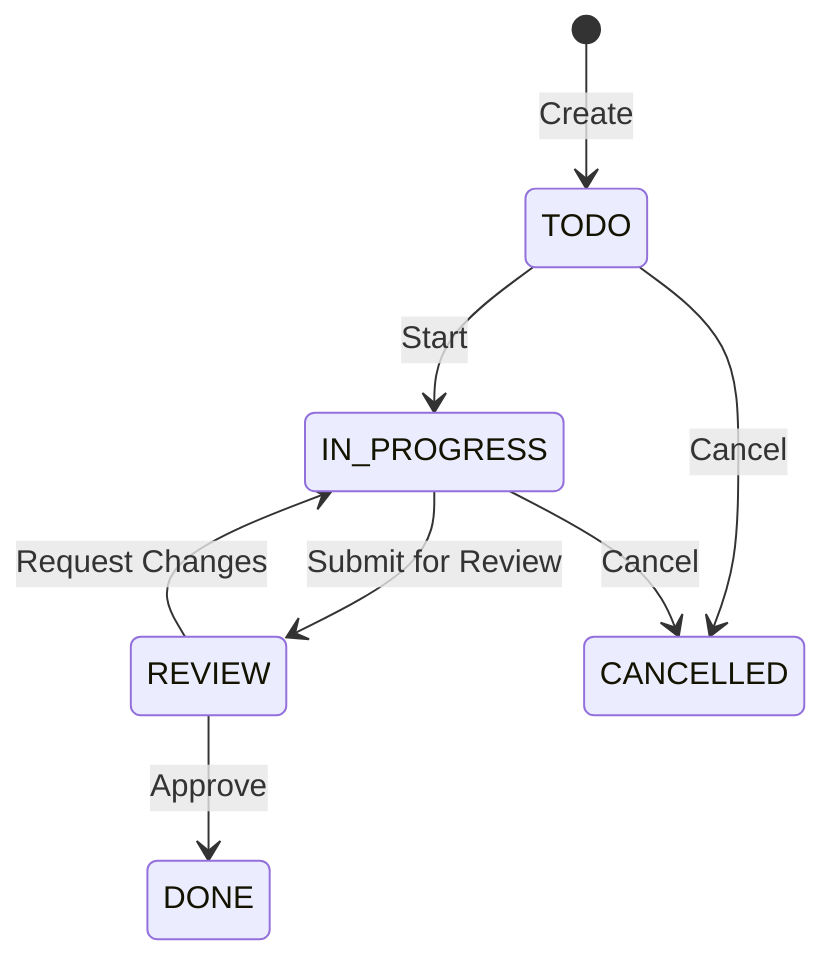

# Projects

The Projects module provides project planning and task tracking with Kanban-style boards.

## Key Features

### Project Management
- Create projects with descriptions, start/end dates, and budgets
- Organize projects by category or department
- Track project status and progress

### Task Management

- Create tasks within projects
- Assign tasks to team members
- Set priorities (Low, Medium, High, Urgent)
- Track estimated vs actual hours

### Kanban Board
Visual task management:
- Drag-and-drop tasks between columns (TODO → In Progress → Review → Done)
- Filter by assignee, priority, or label
- Quick-add tasks directly on the board

### Milestones
Mark key project checkpoints:
- Define milestones with target dates
- Link tasks to milestones
- Track milestone completion percentage

## Navigation

| Page | Path | Permission |
|------|------|-----------|
| Projects Desk | `/projects` | `project.view` |
| Projects | `/projects/list` | `project.view` |
| Tasks | `/projects/tasks` | `task.view` |
| Dashboard | `/projects/dashboard` | `project.view` |

## Permissions

| Permission | Description |
|-----------|-------------|
| `project.view` | View projects |
| `project.create` | Create projects |
| `project.update` | Edit projects |
| `task.view` | View tasks |
| `task.create` | Create tasks |
| `task.update` | Edit and move tasks |
| `task.assign` | Assign tasks to users |
