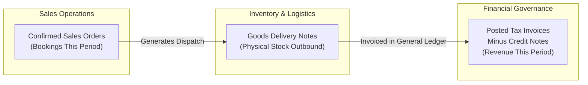
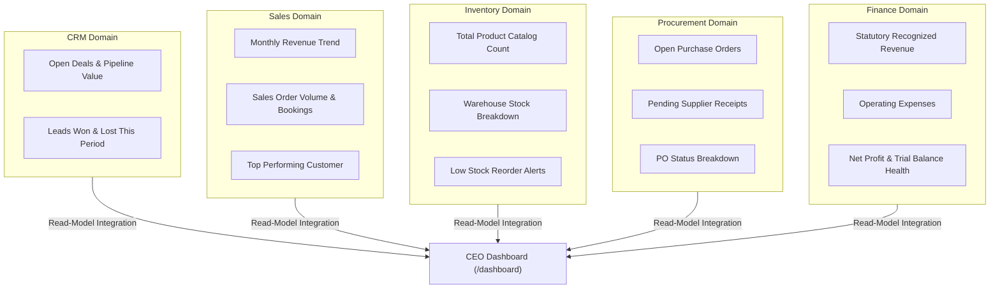

# Reporting

<div class="storyline-breadcrumb">Executive Command Cockpit across <strong>Order to Cash (O2C)</strong>, <strong>Procure to Pay (P2P)</strong> &amp; <strong>Financial Governance</strong></div>

> The executive command cockpit of TenArm BES, unifying sales revenue, active pipeline opportunities, warehouse stock valuation, purchasing commitments, and statutory profit into one synchronized leadership dashboard.

While departmental teams utilize dedicated operational dashboards—such as the **Sales Dashboard** (`/sales/dashboard`), **CRM Pipeline** (`/crm/pipeline`), **Inventory Dashboard** (`/inventory/dashboard`), **Procurement Dashboard** (`/procurement/dashboard`), and **Finance Dashboard** (`/finance/dashboard`)—to manage daily transactions, the **Reporting** module hosts the cross-domain consolidated view: the **CEO Dashboard** (`/dashboard`).

It answers the five foundational leadership questions in a single screen:
1. **Commercial Velocity**: What is our recognized statutory revenue and operational sales bookings this month?
2. **Growth Pipeline**: How much qualified demand is currently maturing across our deal pipeline?
3. **Supply Chain Health**: How many products are stocked across our warehouses, and how many are approaching critical reorder levels?
4. **Procurement Commitments**: What are our active supplier purchase orders and pending inbound goods receipts?
5. **Financial Health & Accounting Integrity**: What is our net operating profit, and does the double-entry general ledger trial balance reconcile?

---

## Workspace Ergonomics

The Reporting console is designed for high-level strategic review, board presentations, and instant operational drill-down:

- **Multi-Tab Desk**: Executives can keep the **CEO Dashboard** open in Tab 1 while drilling down into granular operational registers in Tabs 2 and 3 (e.g., examining a specific quote in the **Sales Desk** or reviewing account schedules in the **General Ledger**). Switching between workspace tabs preserves selected operational months, accounting periods, and scroll offsets without re-fetching data.
- **Synchronized Period Controls**: Selecting an accounting period (such as `June 2026 [OPEN]`) automatically aligns the operational month (`2026-06`), ensuring that sales order bookings, procurement orders, and general ledger journal postings reflect an identical timeframe.
- **One-Click Domain Drill-Down**: Every key performance card and departmental mini-panel features direct navigation (`View →`) to the respective module's full operational desk, allowing leaders to transition instantly from macro-level insights to line-item execution.
- **Fault-Tolerant Panel Isolation**: Reporting interfaces with domain applications through an isolated soft-dependency architecture. If a specific department module is uninstalled, disabled for the tenant, or undergoing maintenance, its respective panel displays a clean empty state while all other panels continue updating in real time.

---

## Core Reporting Concepts

### Statutory Recognized Revenue vs. Operational Sales Bookings

A frequent source of confusion in enterprise reporting is the divergence between commercial order intake and realized accounting turnover. TenArm BES strictly distinguishes between these two figures:



- **Operational Bookings (`Bookings`)**: The cumulative total monetary value of confirmed Sales Orders formally booked during the selected operational month. It represents commercial sales velocity and customer demand commitment.
- **Statutory Recognized Revenue (`Revenue This Period`)**: Governed strictly by statutory accounting standards (such as Ind AS 115 and tax invoicing compliance). Recognized revenue reflects posted commercial tax invoices minus credit notes in the General Ledger. 

Because sales orders may be booked weeks or months prior to physical delivery and final customer billing, **Bookings** and **Revenue** will naturally differ during periods of high growth or extended fulfillment lead times. The CEO Dashboard displays both side-by-side to give executives an uncompromised view of both commercial momentum and realized statutory revenue.

### Trial Balance Integrity Check

Double-entry bookkeeping mandates that the sum of debit balances must equal the sum of credit balances across all active general ledger accounts. Under the **Net Profit** indicator, the dashboard provides continuous real-time ledger auditing:
- **`Books balanced`**: The general ledger trial balance reconciles perfectly with zero mathematical discrepancy.
- **`Out of balance`**: Highlights that total debits do not match total credits for the selected accounting period, signaling unposted adjustments, journal validation exceptions, or asynchronous ledger processing backlogs that require finance review.
- **`No period selected`**: Displayed when no financial accounting period matches the active operational filter.

### Period Control: Operational vs. Financial

TenArm BES bridges calendar-based operational tracking with governance-mandated financial periods:
- **Operational Period (`Op Period`)**: Filtered by calendar month in `YYYY-MM` format (e.g., `2026-11`). This drives transaction counts and summaries for Sales Orders, CRM Leads, and Purchase Orders.
- **Financial Accounting Period**: Governed by the organization's official accounting fiscal calendar. Periods carry explicit governance statuses:
  - `[OPEN]`: Active accounting period permitting new journal entries, invoicing, and vendor bill posting.
  - `[CLOSED]`: Locked fiscal period where postings are frozen for audit integrity.
  - **Auto (First Open)**: Default mode that automatically identifies and selects the earliest currently open financial period.

---

## Cross-Domain Data Consolidation

The CEO Dashboard acts as an executive composite read model. It queries data across five core domains:



---

## The CEO Dashboard (`/dashboard`)

Access the executive dashboard from the primary navigation sidebar under **Insights → CEO Dashboard** (`/dashboard`).

```
┌────────────────────────────────────────────────────────────────────────────────────────────────────────┐
│ CEO Dashboard                                                    [ 2026-11 ] [ Auto (First Open) ▾ ]   │
│ Key Performance Indicators · Period: 2026-11 · Powered by the Projection Engine                       │
├─────────────────┬─────────────────┬──────────────────┬─────────────────┬───────────────────────────────┤
│ REVENUE THIS    │ OPEN PIPELINE   │ TOTAL PRODUCTS   │ OPEN PURCHASE   │ NET PROFIT                    │
│ $1,250,000.00   │ $3,450,000.00   │ 1,420            │ 18              │ $184,200.00                   │
│ 42 orders ·     │ 28 open deals   │ 6 low stock      │ 4 pending       │ Books balanced                │
│ Bookings: $1.4M │                 │                  │ receipts        │                               │
├─────────────────┼─────────────────┼──────────────────┼─────────────────┼───────────────────────────────┤
│ 🎯 Pipeline     │ 🛒 Sales        │ 📦 Inventory     │ 🛍 Procurement   │ 📊 Finance                    │
│ Open: 28        │ 2026-09: $980k  │ Main: 850 SKUs   │ APPROVED: 8     │ Revenue:  $1,250,000.00       │
│ Value: $3.45M   │ 2026-10: $1.15M │ West: 420 SKUs   │ SENT: 6         │ Expenses: $1,065,800.00       │
│ Leads: 54       │ 2026-11: $1.25M │ East: 150 SKUs   │ RECEIVED: 4     │ Net Profit: $184,200.00       │
│ 12 won · 4 lost │ Top: Acme Corp  │ Alerts: 6        │                 │                               │
│ [ View → ]      │ [ View → ]      │ [ View → ]       │ [ View → ]      │ [ View → ]                    │
└─────────────────┴─────────────────┴──────────────────┴─────────────────┴───────────────────────────────┘
```

### Dashboard Header & Period Selectors

Located in the top right of the executive header:
- **`Op Period (YYYY-MM)`**: An interactive month selector. Entering or choosing a month (e.g. `2026-11`) recalculates all operational metrics.
- **Finance Period Dropdown**: A categorized dropdown menu displaying all registered accounting periods with their live status (e.g., `November 2026 [OPEN]`, `October 2026 [CLOSED]`). Selecting an explicit period instantly synchronizes the operational month filter. Selecting **Auto (First Open)** defaults to the active open financial period.
- **`Updating…` Indicator**: Appears adjacent to the selectors while the dashboard recalculates figures across modules.

---

### The 5 Executive Pulse Cards

At the top of the desk, five standardized KPI cards provide at-a-glance health metrics. Clicking any card navigates directly to the underlying operational module:

| Pulse Card | Primary Value | Sub-Text Breakdown | Visual Accent | Click Navigation Target |
|---|---|---|---|---|
| **Revenue This Period** | Statutory recognized revenue for the period (posted tax invoices minus credit notes). | `${orders} orders · Bookings: ${bookings}` (or `${orders} orders` if bookings match). | Primary Blue | **Sales Dashboard** (`/sales/dashboard`) |
| **Open Pipeline** | Total cumulative monetary value of all unclosed opportunities in CRM. | `${deals} open deals` active across pipeline stages. | Info Cyan | **CRM Pipeline Desk** (`/crm/pipeline`) |
| **Total Products** | Total active product SKUs registered in the inventory catalog. | `${count} low stock` items currently at or below their reorder threshold. | Success Green | **Inventory Dashboard** (`/inventory/dashboard`) |
| **Open Purchase Orders** | Total count of supplier purchase orders currently active (not cancelled or completed). | `${count} pending receipts` awaiting warehouse inbound delivery. | Warning Amber | **Procurement Dashboard** (`/procurement/dashboard`) |
| **Net Profit** | Bottom-line operating profit (Total Revenue minus Total Operating Expenses). | Ledger audit indicator: `Books balanced`, `Out of balance`, or `No period selected`. | Green if $\ge 0$, Red if $< 0$ | **Finance Dashboard** (`/finance/dashboard`) |

---

### The 5 Departmental Summary Panels

Positioned directly below the pulse cards, five dedicated summary panels consolidate domain-specific operational health. Each panel features a **View** button with an arrow (`View →`) linking directly to that department's operational cockpit:

#### 1. Pipeline Panel (`Target` Icon)
- **Open deals**: Total number of ongoing sales opportunities in CRM.
- **Pipeline value**: Total expected deal value currently progressing through sales stages.
- **Leads this period**: Total new prospective customer leads logged during the selected operational month.
- **Conversion Footnote**: Displays `${won} won · ${lost} lost this period`, tracking win/loss conversion ratios.
- **Navigation**: Click **View** to open the visual drag-and-drop **CRM Pipeline Desk** (`/crm/pipeline`).

#### 2. Sales Panel (`ShoppingCart` Icon)
- **Trailing 3-Month Trend**: Displays chronological revenue performance over the last three monthly cycles (e.g., `2026-09`, `2026-10`, `2026-11`), allowing leaders to detect quarterly growth trajectories.
- **Top Customer**: Highlights the leading counterparty account by invoiced volume during the active cycle (`Top: Acme Corp`).
- **Empty State**: Displays `No sales data yet` if no sales orders or invoices exist for the selected timeframe.
- **Navigation**: Click **View** to open the **Sales Dashboard** (`/sales/dashboard`).

#### 3. Inventory Panel (`Boxes` Icon)
- **Warehouse Summary**: Itemized distribution of active product lines across individual stocking locations (e.g., `Main Warehouse: 850 products`, `Transit Depot: 420 products`).
- **Low Stock Footnote**: Displays `Low stock alerts: ${count}`, highlighting products that require immediate replenishment.
- **Navigation**: Click **View** to open the **Inventory Dashboard** (`/inventory/dashboard`).

#### 4. Procurement Panel (`ShoppingBag` Icon)
- **Status Breakdown**: Clear operational tally of Purchase Orders grouped by their current lifecycle state (such as `DRAFT`, `APPROVED`, `SENT`, or `RECEIVED`).
- **Empty State**: Displays `No POs yet` when no purchasing commitments have been initiated for the period.
- **Navigation**: Click **View** to open the **Procurement Dashboard** (`/procurement/dashboard`).

#### 5. Finance Panel (`BarChart3` Icon)
- **Revenue**: Total recognized operating revenue for the financial accounting period (`text-positive`).
- **Expenses**: Total recognized operational and cost-of-goods-sold expenses (`text-negative`).
- **Net Profit**: Consolidated bottom-line margin with dynamic profit/loss coloring.
- **Empty State**: Displays `No posted journals yet` if no accounting entries have been committed for the period.
- **Navigation**: Click **View** to open the comprehensive **Finance Dashboard** (`/finance/dashboard`).

---

## How to Use the CEO Dashboard

### Conducting a Monthly Executive Review

1. Navigate to **Insights → CEO Dashboard** (`/dashboard`).
2. Verify the active timeframe in the top header. If reviewing a past or future month, click the **Op Period (YYYY-MM)** field and select the desired calendar month.
3. Observe the five top-line pulse cards:
   - Compare **Revenue This Period** against **Bookings** to evaluate the gap between commercial demand and physical billing.
   - Inspect **Open Pipeline** to confirm healthy sales coverage for upcoming quarters.
   - Review **Net Profit** and verify that the ledger health indicator confirms **`Books balanced`**.
4. Scan the departmental panels:
   - Check the **Sales** panel to evaluate revenue momentum over the trailing three months.
   - Inspect the **Inventory** panel for any spike in **Low stock alerts**.
   - Review the **Procurement** panel to ensure that incoming purchase orders align with replenishment needs.
5. If an anomaly requires deeper operational investigation, click the **View** button on that specific panel to jump straight to the underlying department desk.

### Aligning Operational Months with Accounting Periods

When an enterprise operates on non-calendar fiscal periods or closes accounting books on specific cutoff schedules:
1. Click the **Finance Period** dropdown menu.
2. Select the specific accounting period (e.g. `October 2026 [CLOSED]` or `November 2026 [OPEN]`).
3. Notice that the **Op Period (YYYY-MM)** input updates automatically to reflect the start date of that financial period.
4. The dashboard reloads instantly, displaying operational bookings, warehouse counts, and purchasing activity aligned with that exact financial cycle.

---

## If Something Goes Wrong (Common Validation & Guard Errors)

| What you see (Toast / Banner / Status) | Why it happens | How to fix it in the workspace |
|---|---|---|
| **"Failed to Load Dashboard"** banner with **Retry** button | Network interruption, transient session timeout, or temporary database connectivity issue. | Click **Retry** on the error card. If the error persists, verify your network connectivity or sign out and back in to refresh your tenant session. |
| **`Out of balance`** under Net Profit | Total debit amounts do not match total credit amounts in the General Ledger for the selected accounting period. | Click the **Net Profit** card or the **Finance** panel **View** button to open the **Finance Dashboard** (`/finance/dashboard`). Inspect the **Trial Balance** report for unposted or unbalanced draft journal entries. |
| **`No period selected`** under Net Profit | The selected operational month does not correspond to an existing or open financial accounting period. | Open the **Finance Period** dropdown and select an explicit period (e.g., `November 2026 [OPEN]`), or navigate to **Finance → Periods** to generate and open the missing accounting period. |
| **`No sales data yet`** in Sales panel | No sales orders or finalized tax invoices have been posted in the selected month. | Verify the selected period filter. If you are reviewing a new operating cycle, new sales orders will automatically populate this panel once confirmed on the **Sales Desk**. |
| **`No POs yet`** in Procurement panel | No purchase orders have been drafted or approved during this operating month. | Confirm the period filter. When purchasing teams raise requisitions and issue purchase orders in **Procurement**, counts will automatically appear. |
| **`No posted journals yet`** in Finance panel | No general ledger transactions, invoices, or expense vouchers have been posted to the selected accounting period. | Ensure commercial invoices and bills have been posted in **Finance**. Once journal vouchers are committed, revenue, expenses, and net profit will reflect immediately. |
| **Discrepancy between Revenue and Bookings** | Sales orders represent commercial commitments (`Bookings`), while statutory revenue reflects finalized posted tax invoices (`Revenue`). | This is standard accounting practice. Orders booked but awaiting warehouse dispatch or customer billing appear in Bookings but not yet in Recognized Revenue. Check the **Sales Orders** list to track orders pending shipment. |
| **Discrepancy between Pipeline and Won Leads** | Opportunities in CRM may span multiple months, while won/lost lead figures track events occurring strictly within the selected month. | Use the **CRM Pipeline Desk** (`/crm/pipeline`) to review deal closing dates and pipeline stage velocity. |

---

## Cross-Module Integrations

The Reporting module serves as the central analytical aggregator across the following TenArm BES modules:

| Module | What the CEO Dashboard Reads | Operational Drill-Down Target |
|---|---|---|
| **CRM** | Active deal count, total pipeline monetary valuation, newly acquired leads, and won/lost win rates for the period. | [CRM Pipeline](./crm.md) (`/crm/pipeline`) |
| **Sales** | Confirmed sales order count, total operational bookings, trailing 3-month revenue trend, and top customer account by revenue. | [Sales Dashboard](./sales.md) (`/sales/dashboard`) |
| **Inventory** | Total active product catalog count, low-stock reorder warnings, and warehouse-by-warehouse stock distributions. | [Inventory Dashboard](./inventory.md) (`/inventory/dashboard`) |
| **Procurement** | Active supplier purchase order count, inbound receipts awaiting warehouse delivery, and PO status distribution. | [Procurement Dashboard](./procurement.md) (`/procurement/dashboard`) |
| **Finance** | Recognized statutory revenue, total operating expenses, consolidated net profit, and general ledger trial balance reconciliation status. | [Finance Dashboard](./finance.md) (`/finance/dashboard`) |

---

## Permissions & Access Control

Access to the consolidated CEO Dashboard is protected by dedicated role-based security permissions:

| Permission Code | Screen / Feature Unlocked | Typical Roles Assigned |
|---|---|---|
| `reporting.dashboard.view` | Access to the **CEO Dashboard** (`/dashboard`) and execution of cross-domain analytics consolidation. | Chief Executive Officer (CEO), Chief Financial Officer (CFO), Managing Director, Executive Operations Lead |
| `sales.dashboard.view` | Unlocks drill-down navigation from the Revenue card and Sales panel into `/sales/dashboard`. | Sales Director, Commercial Lead |
| `crm.pipeline.view` | Unlocks drill-down navigation from the Pipeline card and CRM panel into `/crm/pipeline`. | Head of Sales, Business Development Lead |
| `inventory.dashboard.view` | Unlocks drill-down navigation from the Total Products card and Inventory panel into `/inventory/dashboard`. | Supply Chain Director, Warehouse Manager |
| `procurement.dashboard.view` | Unlocks drill-down navigation from the Open POs card and Procurement panel into `/procurement/dashboard`. | Chief Procurement Officer (CPO), Purchasing Lead |
| `finance.dashboard.view` | Unlocks drill-down navigation from the Net Profit card and Finance panel into `/finance/dashboard`. | Financial Controller, Head of Accounts |
