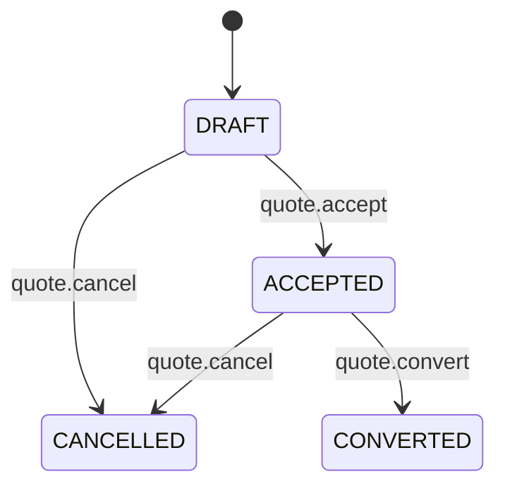
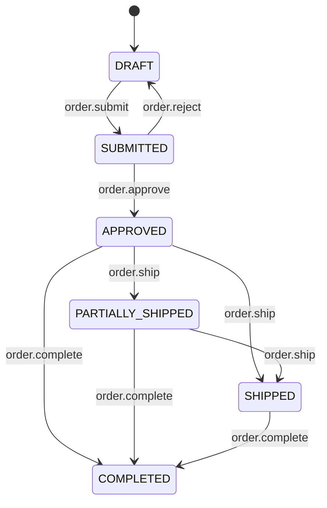

> One sentence: Manage the complete quote-to-order-to-shipment lifecycle, including commercial commitments, physical fulfillment, and customer billing.

## Overview
The Sales module is the commercial heart of TenArm BES, handling the creation and conversion of Quotations, the processing and fulfillment of Sales Orders, and managing unified customer deal streams. It bridges the gap between CRM opportunities and physical inventory dispatches, ensuring tight control over pricing, tax, stock reservation, and billing.

## Quotations

### What It Does
Generates formal pricing proposals for customers, supporting per-line taxation, freight, and validity tracking before conversion into an actual sales order.

### Status Lifecycle

| Status | What It Means | What You Can Do |
|--------|--------------|-----------------|
| `DRAFT` | The quote is actively being prepared or negotiated. | Edit lines, adjust prices, cancel, or accept. |
| `ACCEPTED` | The customer has agreed to the pricing and terms. | Convert to a sales order or cancel if withdrawn. |
| `CONVERTED` | The quote has successfully become a sales order. | View historical context; no further changes. |
| `CANCELLED` | The quote is permanently voided. | View for historical record. |

### Key Fields
| Field | Required | Notes |
|-------|----------|-------|
| `quote_number` | Yes | Unique identifier for the quotation. |
| `customer_party_id` | Yes | The customer receiving the proposal. |
| `freight_amount` | Yes | Freight charges applied to the quote. |
| `freight_paid_by` | Yes | Who is responsible for freight (e.g., SHIPPER, CONSIGNEE). |
| `valid_until` | No | Expiration date of the quoted prices. |

### How To Convert a Quotation
1. Navigate to **Sales → Quotations**
2. Select the `ACCEPTED` quotation you wish to convert.
3. Click the **Convert to Order** action.
4. Fill in: Delivery policy and any final adjustments, then confirm.

### Things to Know
- Taxes are calculated strictly per-line to support complex multi-product tax treatments.
- AI cron scans can identify live quoted demand on specific products (`quote.scan_live_demand`).

---

## Sales Orders

### What It Does
Captures the confirmed commercial agreement with a customer, driving inventory reservation, fulfillment, logistics, and subsequent invoicing.

### Status Lifecycle

| Status | What It Means | What You Can Do |
|--------|--------------|-----------------|
| `DRAFT` | Order is being entered and validated. | Edit lines, check live stock, or submit. |
| `SUBMITTED` | Order is locked and awaiting credit/dispatch approval. | Approve or reject back to draft. |
| `APPROVED` | Order is commercially approved. | Reserve warehouse stock, assign lots, or ship. |
| `PARTIALLY_SHIPPED` | Some, but not all, items have been dispatched. | Continue shipping remaining lines or complete. |
| `SHIPPED` | Physical fulfillment is entirely completed. | Await delivery confirmation or mark completed. |
| `COMPLETED` | Order is fully fulfilled and financially settled. | View only. |

### Key Fields
| Field | Required | Notes |
|-------|----------|-------|
| `order_number` | Yes | Unique identifier for the order. |
| `customer_party_id` | Yes | The buying customer. |
| `delivery_policy` | Yes | Controls dispatch rules (e.g., `SHIP_COMPLETE` vs `PARTIAL_ALLOWED`). |
| `discount_amount` | Yes | Total discount applied at the header level. |

### How To Fulfill a Sales Order
1. Navigate to **Sales → Orders** (or **Sales → Sales Desk**)
2. Open an `APPROVED` order from the queue.
3. Use the **Command Desk** to **Reserve Stock** for order lines.
4. Click **Ship Order** to generate a delivery note and record physical dispatch.

### Things to Know
- You cannot ship an order line unless stock has been allocated or reserved (`order.reserve`).
- Backordered lines can be split off into a separate child order (`order.split_partial`) to unblock available items for immediate shipment.
- Settlement status (Payment) is derived in real-time by inspecting linked Finance invoices and advance cash receipts.

---

## Integrations

| Module | When | What Happens |
|--------|------|-------------|
| **Inventory** | Order is reserved or shipped | Real-time stock checks (`order.validate_stock`), yard lot allocation, and physical dispatch adjustments. |
| **Finance** | Order is approved/shipped | Triggers billing candidates. Snapshots order headers and lines (`order.get_billing_snapshot`) to generate AR Tax Invoices. |
| **Finance** | Customer Detail View | Real-time rollups of unpaid invoices, collected advances (Record Advance), and AR capital exposure. |
| **CRM** | Quotation is accepted/cancelled | Emits `QuotationAccepted` and `QuotationCancelled` events to synchronize the related CRM Opportunity via `OpportunityQuoteSyncProjection`. |

## Permissions
| Permission | What It Unlocks |
|-----------|----------------|
| `order.view` | View orders, order register, and list pending dispatch. |
| `order.create` | Create new sales orders in DRAFT state. |
| `order.update` | Modify DRAFT orders and adjust line allocations. |
| `order.submit` | Lock DRAFT order and submit for approval. |
| `order.approve` | Commercially approve or reject submitted orders. |
| `order.reserve` | Reserve yard stock against approved orders. |
| `order.ship` | Dispatch reserved inventory to the customer. |
| `quote.view` | View quotations and live product demand. |
| `quote.create` | Create and author proposals. |
| `quote.accept` | Accept customer approval on a quote. |
| `quote.convert` | Convert accepted quotes into sales orders. |
| `sales.dashboard.view` | Access the executive sales dashboard metrics. |
