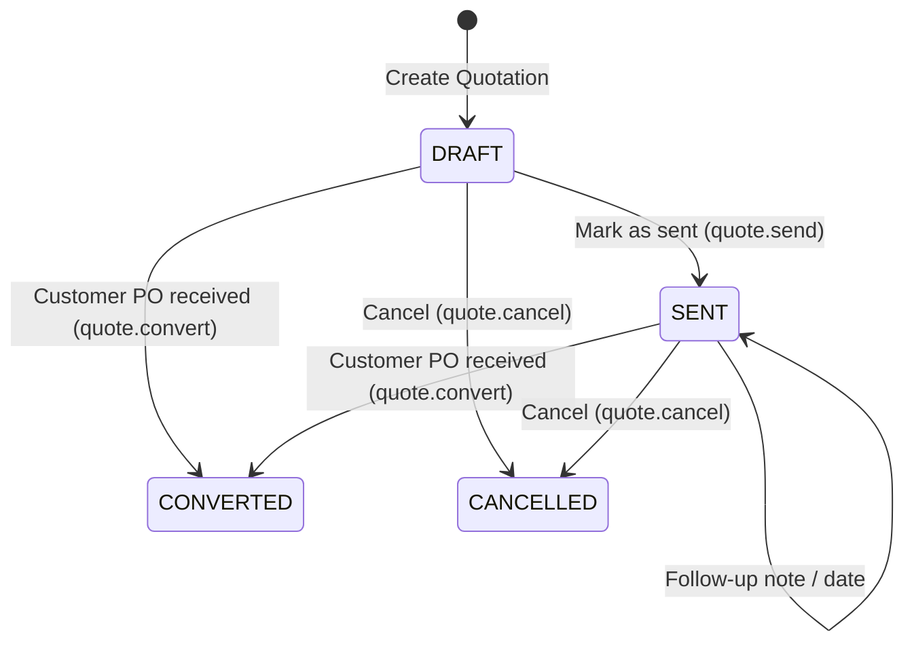
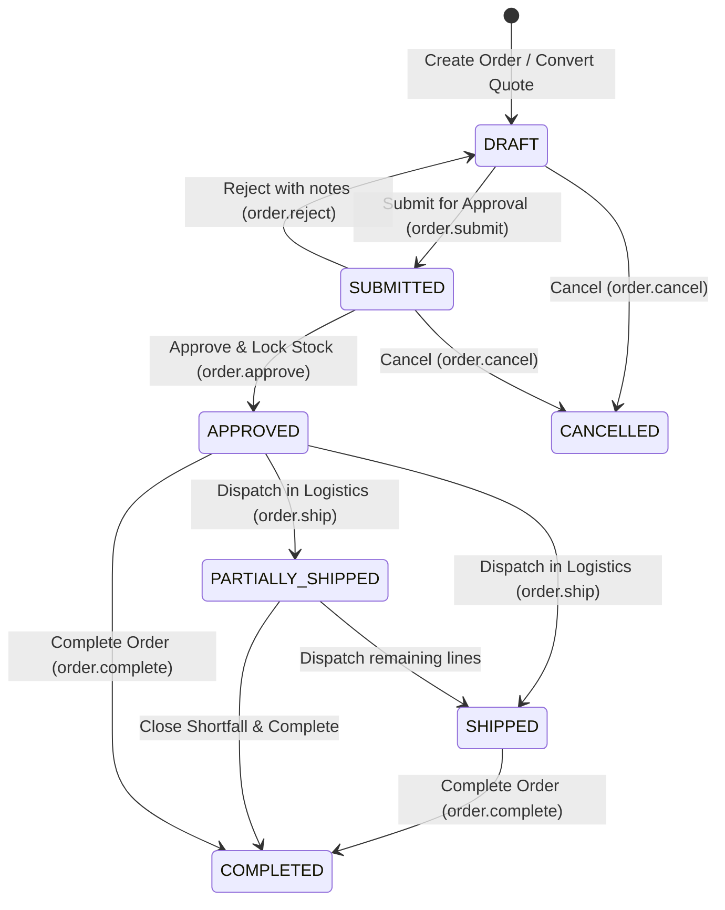

# Sales

<div class="storyline-breadcrumb">Part of the <strong>Order to Cash (O2C)</strong> Storyline: Steps 3 &amp; 4 of 6 (Quotation &amp; Sales Order)</div>

> The commercial and fulfillment engine of TenArm BES, orchestrating customer deal pricing, competitive demand scanning, quotation lifecycles, sales order commitments, warehouse stock reservations, delivery note dispatches, and financial invoice generation.

The Sales module serves as the primary commercial hub of TenArm BES. It bridges prospective opportunities from CRM with physical fulfillment in Inventory and billing in Finance. From the high-speed live negotiation cockpit on the **Sales Desk** through formal **Quotations**, multi-tier **Sales Orders**, and the proactive **Backorders Desk**, every commercial commitment is synchronized with live inventory availability and customer credit limits.

---

## Workspace Ergonomics

The Sales workspace is engineered for fast-paced commercial negotiations, high-throughput order entry, and zero lost customer context:

- **Multi-Tab Desk**: Sales representatives and order administrators can open up to 3 independent sales tabs simultaneously (e.g. keeping the **Sales Desk** open while referencing an active **Sales Order Storyline** and reviewing a customer's profile in **Customer 360**). Switching tabs preserves table filters, search terms, pagination offsets, and uncommitted form edits without reloading.
- **Draft Auto-Save**: Uncommitted deal structures, product carts, customer selections, freight amounts, and custom notes on the Sales Desk (`sales_desk_cart`) are continuously preserved locally. The active tab header displays a dirty dot indicator (`•`) until the deal is locked into a document or explicitly cleared.
- **Quick-Peek Slide-Out**: Clicking any linked customer name, order number, quotation ID, or inventory lot opens an inspection drawer from the right edge of the screen, allowing users to verify credit limits, customer payment terms, or lot test certificates without interrupting active customer negotiations.

---

## Core Sales Concepts

### Live Deal Pricing & Profitability Margin
The **Sales Desk** provides real-time margin visibility during customer phone calls and desk negotiations. As product lines and negotiated prices are typed in, the desk compares proposed prices against the booked moving average cost (`avg_cost`) from Inventory. Visual indicators instantly highlight line-level and total gross margins, protecting profitability before commitments are finalized.

Organizational pricing operates under one of two tenant settings:
- **Rate Per Deal (`RATE_PER_DEAL`)**: The standard default pricing model. Every line is negotiated at a clean net agreed rate. Discounts are prohibited and the discount column is hidden across quotes and orders.
- **List Price With Discount (`LIST_PRICE_WITH_DISCOUNT`)**: Enables list price anchoring with explicit line-level percentage and cash discounts.

### Three Stages of Stock Commitment (ATP)
To balance sales velocity with inventory integrity, stock reservation progresses through three controlled stages:
1. **Soft Qualification (`Feasible · Qualified`)**: When preparing a quote or draft order, clicking **Validate & Qualify Stock** queries Available-to-Promise (ATP) inventory. A temporary soft hold is placed to verify feasibility without permanently locking stock against other sales reps.
2. **Firm Reservation (`RESERVED`)**: When a sales order is formally **Approved**, the server converts soft holds into firm, hard-allocated warehouse reservations. Reserved inventory cannot be allocated to or shipped by any other order.
3. **Backordered Shortfall (`BACKORDERED`)**: If available stock is insufficient to cover line quantities at the time of quotation conversion or order approval, affected lines transition to `BACKORDERED`. Backorders are immediately visible on the central Backorders Desk and procurement sourcing rails.

### Live Demand Radar & Contention Monitoring
When multiple sales reps quote the same fast-moving warehouse items simultaneously, the **Live Quoted Demand Radar** automatically flags inventory contention. Both the Sales Desk and Quotation Storyline display a real-time contention banner:
```
Live Quoted Demand Radar: 3 active competing quotations across these SKUs (1,200 units). Close promptly to protect inventory!
```
This ambient intelligence alerts commercial teams to close accepted deals promptly before competing orders consume physical stock.

### Split Partial Orders
When customer orders contain a mix of immediately available inventory and backordered items, shipping policies dictate fulfillment:
- **Ship Complete**: Holds the entire order until 100% of items are landed in the warehouse.
- **Partial Allowed**: Permits immediate dispatch of available lines.

To prevent stalled orders and streamline logistics, sales leads can trigger **Split Order** (`SplitOrderModal`). This automatically extracts backordered lines into an independent child order (e.g. `#SO-2024-0042-1`) while leaving available lines on the parent order ready for immediate delivery note creation and dispatch.

### Sequential Delivery Notes & Logistics Dispatches
Physical fulfillment is tracked through sequential shipments. Shipping reserved lines generates a numbered **Goods Delivery Note (Challan)** capturing vehicle numbers, carrier details, driver contacts, discrete counts, and secondary catch-weight tonnage.

### Accounts Receivable & Invoicing Bridge
Sales orders link seamlessly with Finance:
- **Credit Limit Checks**: Submitting an order verifies the customer's total exposure (unpaid invoices + active orders) against approved credit limits.
- **Customer Advances**: Unapplied deposits held by the customer can be applied directly to active sales orders with a single click (**Apply to Order**).
- **One-Click Invoicing**: Once goods are dispatched, clicking **Invoice Dispatch** or **Raise Invoice** generates a draft tax invoice in Finance pre-populated with exact shipped quantities and contract prices.

---

## Core Screens & Workflows

### 1. Sales Desk (`/sales/desk`)

**What it does** — The dedicated sales negotiation companion. A unified split-screen workstation combining catalog search, real-time stock balances, customer credit standing, historical pricing memory, and live margin calculations.

```
┌──────────────────────────────────────┬────────────────────────────────────────────────────────┐
│ CATALOG SEARCH & ATP                 │ THE DEAL (Sales Order / Quotation)                     │
│ 🔍 Search SKU, description, barcode  │ Mode: [ Quotation ] [ Sales Order ]  Validity: [30 D]  │
│                                      ├────────────────────────────────────────────────────────┤
│ • Product A — 450 MT Available (ATP) │ 👤 Customer Commercial Profile & Credit Exposure       │
│   Last Quoted: $540 · Avg Cost: $480 │    Tax Treatment: Inter-State IGST · Freight: Prepaid  │
│   [+ Add to Deal]                    ├────────────────────────────────────────────────────────┤
│                                      │ 📦 Deal Lines & Margin Cockpit                         │
│ • Product B — 120 Units Available    │    Line 1: 50 MT @ $550/MT  Margin: +14.5% ✅          │
│   Contention: 2 active quotes        │    Line 2: 20 MT @ $610/MT  Margin: +18.2% ✅          │
│   [+ Add to Deal]                    │ Total: $39,700  [ Lock & Create Order ]                │
└──────────────────────────────────────┴────────────────────────────────────────────────────────┘
```

**Key Features & Controls**
- **Mode Toggle (`Quotation` vs `Sales Order`)**: Switch between proposing prices on a quotation or taking a firm sales order directly.
- **Quote Validity Selector**: When drafting quotations, configure the validity window: `7 Days (Volatile)`, `15 Days`, `30 Days (Standard)`, or `60 Days`.
- **Customer Commercial Card**: Select an active customer account. The card immediately displays total credit limits, current outstanding Accounts Receivable, payment terms, tax code treatments, freight amount, freight payment terms (`Prepaid`, `Collect`, `Free`), delivery policy (`Partial Allowed` vs `Ship Complete`), and deal notes.
- **Catalog Search Section**: Search products by code, description, or category. Displays on-hand inventory, Available-to-Promise (ATP) stock across warehouses, booked average unit costs, and historical rates quoted to this specific customer.
- **Deal Pricing Cockpit**: Set negotiated quantities and rates. Displays line-by-line gross margins and overall deal profitability in real time.
- **Bulk Warehouse Adjuster**: Quickly reassign all items in the cart to a single fulfilling warehouse with one click.
- **Quick Links**:
  - `View Stock`: Opens warehouse inventory balances in a new workspace tab.
  - `View Customers`: Opens the customer directory in a new tab.
  - `Clear Deal`: Clears the uncommitted deal cart and resets the desk.
  - `Cancel Editing`: When editing an existing draft quote or order, discards changes and exits edit mode without burning document numbers.

**How to Negotiate and Lock a Deal**
1. Navigate to **Sales → Sales Desk** (`/sales/desk`).
2. Select the mode: Click **Quotation** or **Sales Order**.
3. In **Step 1: Customer & Commercial Terms**, select the customer account. Review their outstanding balance and credit standing.
4. From the left-hand **Product Catalog**, search for items and click **+ Add to Deal**.
5. In **Step 2: Products & Pricing**, enter the negotiated **Rate** and **Quantity** (and **Catch-Weight Tonnage** if applicable) for each line.
6. Verify the line margin percentage indicator and total deal summary.
7. Click **Lock & Create Order** (or **Lock & Create Quote**). The deal is immediately assigned a sequential document number.

---

### 2. Quotations (`/sales/quotations` & `/sales/quotations/:id`)

**What it does** — Central management of customer commercial proposals, validity windows, follow-up logs, and conversion into confirmed sales orders upon PO receipt.

**Lifecycle & States**



| State | What It Means | What You Can Do Next |
|---|---|---|
| `DRAFT` | Proposal is being authored or revised on the Sales Desk. | Edit lines, adjust rates, mark as sent, convert upon PO receipt, or cancel. |
| `SENT` | Formally issued to the customer; awaiting purchase order confirmation. | Record follow-up dates, log review notes, convert to order, or cancel. |
| `CONVERTED` | Customer purchase order received; successfully transformed into a Sales Order. | View converted sales order link; document is locked and archived. |
| `CANCELLED` | Proposal rejected by customer, pricing lapsed, or deal abandoned. | Historical record only; lines and soft reservations released. |

**Key Fields & Information**

| Field | Required | Description & Validation |
|---|:---:|---|
| Quote # | Auto | Sequential document identifier (e.g. `QT-2024-0012`). |
| Customer | ✅ | Commercial buyer account selected from active customer directory. |
| Validity Window | ✅ | Valid until date. Lapsed quotations display an expired warning badge. |
| Delivery Policy | ✅ | Fulfillment preference: `Partial Allowed` or `Ship Complete`. |
| Freight Terms | ✅ | Freight amount and payment responsibility (`Prepaid`, `Collect`, `Free`). |
| Tax Treatment | ✅ | Tax registration, jurisdiction region, and applied tax codes. |

**View Modes & Controls**
- **Command Desk (Split View)**: Sticky left-hand queue showing quotations with search, status filters, totals, and line counts. Clicking any quote loads the full **Quotation Storyline** on the right.
- **Table Mode**: Standard tabular view with search, status dropdown, sorting, and keyset pagination.
- **Action Buttons in Storyline**:
  - `+ New Quotation`: Opens the Sales Desk in quote mode.
  - `PDF Proposal`: Downloads an official branded quotation PDF.
  - `Edit Quote`: Re-opens the quotation draft on the Sales Desk for pricing adjustments.
  - `Mark as sent` / `Follow-up`: Opens the follow-up dialog. Records the date sent, next scheduled follow-up date, and notes on customer discussions.
  - `Customer PO received`: Opens the conversion dialog to turn the quote into a confirmed Sales Order.
  - `Cancel`: Voids the proposal with a cancellation reason.

**How to Convert a Quotation to a Sales Order**
1. Navigate to **Sales → Quotations** (`/sales/quotations`).
2. Locate the quotation in `DRAFT` or `SENT` status.
3. Click **Customer PO received** (`quote-convert-btn`).
4. In the **Accept Customer PO & Convert to Sales Order** modal:
   - Enter the customer's official **Purchase Order Number** (`customer_po_number`).
   - Enter the **PO Date** (`customer_po_date`).
   - (Optional) Click **Attach PO Document** to upload the customer's PO PDF or scan.
   - Confirm the **Delivery Policy** (`Ship Complete` vs `Partial Allowed`).
5. Click **Convert & Reserve Inventory**.
6. The quotation converts to `CONVERTED`, a new Sales Order is generated, soft stock reservations are placed, and the workspace redirects directly to the new order.

---

### 3. Sales Orders (`/sales/orders` & `/sales/orders/:id`)

**What it does** — The central register of confirmed commercial agreements, governing multi-tier approvals, yard lot reservations, logistics dispatches, delivery notes, and invoicing.

**Lifecycle & States**



| State | What It Means | What You Can Do Next |
|---|---|---|
| `DRAFT` | Order entered; undergoing line and warehouse assignment. | Edit lines, qualify ATP stock, submit for approval, or cancel. |
| `SUBMITTED` | Order locked; awaiting management credit and commercial sign-off. | Authorized managers can Approve or Reject back to draft. |
| `APPROVED` | Commercially confirmed; stock is firmly reserved in warehouse yards. | Split order, reserve additional arriving stock, or dispatch shipments. |
| `PARTIALLY_SHIPPED` | One or more delivery notes issued; remaining items awaiting dispatch. | Ship remaining lines, split backorders, or force-complete shortfall. |
| `SHIPPED` | 100% of ordered quantities have been dispatched through logistics. | Generate final invoices; mark order completed. |
| `COMPLETED` | Physical fulfillment finished and commercial commitments fulfilled. | Fully archived; view fulfillment and invoice audit trail. |
| `CANCELLED` | Order voided before fulfillment. | Permanent audit record; all stock reservations released. |

**The Order Storyline Sections**

The Order Storyline provides an integrated end-to-end view of the order lifecycle:

1. **Header & Document Bar**:
   - Displays Order Number, current status badge, document revision version (`v1`, `v2` for OCC audit), and creation date.
   - **Customer Link**: Click the customer name to open the Customer 360 profile in Quick-Peek or a new tab.
   - **Customer PO Badge**: Displays the customer's PO number and date. If a file was uploaded during quotation conversion, clicking the badge downloads the PO document.
   - **Delivery Policy & Fulfillment Date**: Shows `Partial allowed` or `Ship complete`, alongside estimated fulfillment dates computed from stock holds and inbound procurement ETAs.
   - **Split Child Badge**: Indicates if this order was split from a parent order.

2. **Items & Stock Allocation Section**:
   - Line items table showing catalog SKU, description, fulfilling warehouse, ordered quantity, and unit price.
   - For catch-weight items, displays both discrete piece counts and secondary weight metric (e.g. `MT`).
   - **Reservation Status Badges**:
     - `RESERVED` (Green): Firmly held in the warehouse.
     - `PRE_RESERVED` (Blue): Soft hold placed during qualification.
     - `BACKORDERED` (Amber): Stock shortfall; awaiting inbound PO replenishment.
     - `SHIPPED` (Purple): Quantity dispatched under a delivery note.
   - **Allocation Helper (`AllocationHelperModal`)**: For catch-weight products, operators can click to pick specific warehouse yard lots matching required lengths, widths, and weight tolerances.
   - **Line Adjustment Drawer (`OrderLineAdjustmentDrawer`)**: Modify line price, quantity, or warehouse allocation on draft orders.

3. **Fulfillment Section**:
   - Visual progress bar showing shipped tonnage vs total ordered tonnage (e.g. `24.5 / 50.0 MT (49%)`).
   - `Reserve Stock`: For approved orders with backorders, checks the warehouse for newly landed stock and converts backorders to firm reservations.
   - `Dispatch in Logistics`: Opens logistics dispatch dialog to issue delivery notes.
   - **Shipment List**: Shows every physical dispatch with delivery note number, date, carrier vehicle number, and net weight.
     - `Challan PDF`: Downloads the official Goods Delivery Note.
     - `View in Logistics`: Opens the shipment in the Logistics module.
     - `Invoice Dispatch`: Directly generates a draft Accounts Receivable invoice for this shipment.

4. **Financials Section**:
   - Real-time billing summary: Paid amount vs Order Gross, remaining balance due, and excess account credit.
   - **Customer Advance Callout**: If the customer has unapplied advance payments, an alert prompts: `Customer Advance: REC-2024-0015 ($5,000.00)`. Clicking **Apply to Order** links the deposit immediately.
   - `Raise Invoice`: Creates a draft invoice in Finance for unbilled dispatches.
   - `Record Payment` / `Record Advance`: Launches payment collection modal.
   - List of active invoices with payment status chips (`UNPAID`, `PARTIAL`, `PAID`).

**How to Process an Order from Submission to Dispatch**
1. **Submit Order**: Open the draft order in the Storyline. Click **Validate & Qualify Stock** to verify warehouse availability. Once qualified, click **Submit for Approval**.
2. **Approve Order**: A designated manager reviews terms and credit standing. Click **Approve & Lock Stock**. Stock reservations become firm. (Note: Self-approval is prevented by governance rules).
3. **Dispatch Goods**: Under the **Fulfillment** section, click **Dispatch in Logistics**. Enter vehicle details, driver phone, dispatched pieces, and scale weights. Click **Confirm Dispatch**.
4. **Issue Challan & Invoice**: Download the delivery note via **Challan PDF**. Under **Financials**, click **Raise Invoice** (or **Invoice Dispatch**) to generate the draft tax invoice in Finance.
5. **Complete Order**: Once all shipments are dispatched and invoiced, click **Complete Order**.

---

### 4. Sales Backorders Desk (`/sales/backorders`)

**What it does** — Central operational cockpit tracking customer fulfillment shortfalls, inbound supply arrival dates, and warehouse stock matching.

**Key Features & Highlights**
- **Fulfillment KPI Cards**:
  - `Open Shortfall Lines`: Total unfulfilled line items across all open orders.
  - `Affected Orders`: Number of distinct customer commitments impacted by stockouts.
  - `Shortfall SKUs`: Count of distinct products requiring replenishment.
  - `Total Shortfall Units`: Aggregated missing quantity across all orders.
- **Supply Inbound Pegging**:
  - Automatically identifies whether an inbound Purchase Order in Procurement covers the shortfall.
  - Badges display linked purchase orders (e.g. `PO-2024-0089 · Supply ETA: 2024-11-20`) or warn `No PO Linked`.
- **Action Controls**:
  - `Match Stock`: Re-queries warehouse inventory in real time. If newly arrived stock is detected, it alerts: *"Stock Match Available! Order #SO-2024-0042 has sufficient inventory to fulfill line #1"*.
  - `Split`: Launches the **Split Order** modal to split backordered lines into a child order so landed items can ship immediately.
  - `All Orders`: Navigates to the full sales orders queue.

---

### 5. Customers & Customer 360 (`/sales/customers` & `/sales/customers/:id`)

**What it does** — Comprehensive directory and 360-degree relationship view of commercial buyers, credit limits, tax registrations, and unified transaction streams.

**Customer Directory (`/sales/customers`)**
- **Pulse Metric Cards**: Tracks Total Accounts, Active Buyers eligible for fast dispatch, Tax Registered businesses, and State Territories.
- **Filter Toolbar**: Instant search across customer name, customer code, Tax ID (GST/VAT), or email. Filter pills toggle between All Accounts, Active Buyers, and Tax Registered.
- **Actions**:
  - `+ Add Customer`: Opens customer creation modal (`CUSTOMER_FIELDS`: Code, Name, Email, Phone, Address, Tax ID, Tax Region).
  - `Export CSV`: Exports filtered customer master data.

**Customer 360 Detail View (`/sales/customers/:id`)**
- **Header Profile**: Displays business name, active status badge, internal code, Tax ID, region, phone, and email.
  - `Edit Profile`: Update address, phone, or tax registration details.
  - `Statement`: Generates a customer Statement of Account PDF covering open balances and ledger transactions.
  - `Collect Advance`: Opens modal to record upfront cash/bank deposits before taking orders.
  - `Fast Quote / Order`: Launches the Sales Desk with this customer pre-selected.
- **Financial Ribbon**: Instant overview of Total Outstanding AR, Unapplied Advance Held, Active In-Flight Deals, Lifetime Revenue, and Unpaid Invoices Count.
- **Living Deal Stream**: Unified chronological feed combining quotations, orders, shipments, and invoices. Interactive pills filter by:
  - `All Engagements`: Complete chronological commercial history.
  - `Needs Action`: Surfaces draft orders pending submission, orders awaiting credit approval, and overdue invoices.
  - `Active Shipments`: Orders currently undergoing warehouse dispatch.
  - `Proposals`: Open, unexpired quotations awaiting customer POs.
  - `Settled Accounts`: Fully fulfilled and paid commitments.

---

### 6. Sales Dashboard (`/sales/dashboard`)

**What it does** — Executive and operational analytics monitoring monthly revenue velocity, order volumes, physical tonnage, and allocation integrity.

**Key Metrics & Visualizations**
- **Period Filter**: Month selector (`YYYY-MM`) defaulting to the current calendar month.
- **Pulse KPI Cards**:
  - `Revenue`: Total net sales revenue booked this period.
  - `Total Orders`: Count of placed sales orders.
  - `Total Tonnage`: Physical tonnage (MT) ordered and shipped.
  - `Avg Price / MT`: Average revenue realization per metric ton.
  - `Unconfirmed Lines`: Number of order lines lacking firm warehouse stock holds (flags action needed).
- **Revenue Trend Chart**: 6-month area chart visualizing revenue progression and seasonal trends.
- **Top Customers Table & Chart**: Bar chart and ranked table detailing high-volume customer accounts and revenue contributions.
- **Order Register (`Order Register`)**: Launches comprehensive historical order register modal with multi-field search and CSV export capabilities.

---

## If Something Goes Wrong (Common Validation & Guard Errors)

| What you see (Toast / Banner) | Why it happens | How to fix it in the workspace |
|---|---|---|
| **"Submitter cannot approve their own order"** | Separation of duties governance rule: the user who submitted the sales order is prohibited from approving it. | Have a different authorized manager with `order.approve` permissions open the order and click **Approve & Lock Stock**. |
| **"Discount is not permitted under Rate-Per-Deal pricing style"** | The tenant is configured for `RATE_PER_DEAL`, where all prices are quoted as clean net agreed rates. | Clear the discount field and adjust the **Rate** directly on the Sales Desk line, or request an administrator switch settings to `LIST_PRICE_WITH_DISCOUNT`. |
| **"Customer PO number is required to convert quotation"** | Converting a quote requires the customer's formal acceptance reference. | In the conversion modal, enter the customer's PO reference in **Customer PO Number** before confirming. |
| **"Quotation validity expired — revise it before taking the order"** | The quotation's `valid_until` date has passed; prices may no longer reflect current costs or market rates. | Click **Edit Quote** to load the proposal back onto the Sales Desk, review product costs/margins, update validity dates, and re-issue. |
| **"Cannot cancel order with recorded shipments"** | An order cannot be cancelled if physical goods have already been dispatched under delivery notes. | Open the linked shipments in Logistics. Revert or void the dispatches first, or use **Close Shortfall & Complete** to finalize remaining unshipped items. |
| **"Credit limit exceeded for customer"** | Total outstanding AR invoices plus the current order value exceeds the customer's approved credit limit. | Request an advance deposit via **Collect Advance**, have Finance record customer payments against open invoices, or request a credit override. |
| **"Cannot ship line: Stock reservation required"** | Attempting to dispatch an order line that is in `NONE` or `BACKORDERED` reservation status. | Ensure the order is in `APPROVED` status. Click **Reserve Stock** to secure landed inventory before generating delivery notes. |
| **"Order is not in DRAFT status — line allocations cannot be modified"** | Lot allocation changes (`AllocationHelperModal`) can only be executed while an order is in `DRAFT`. | If revisions are necessary, have an approver click **Reject** (with notes) to return the order to `DRAFT` for re-allocation. |
| **"This order has unshipped backordered items"** | Attempting to click **Complete Order** while some line items remain unfulfilled. | To close the order without fulfilling remaining items, click **Close Shortfall & Complete**, or split open items using **Split Order**. |
| **"Record has been modified by another user (OCC Conflict)"** | Another user updated the quotation or order while you had it open on screen. | Review the **Conflict Resolution Drawer** comparing your changes with the latest server state, select the desired version, and re-apply. |

---

## Integrations

| Integrated Module | When & Where | What Happens Automatically |
|---|---|---|
| **Inventory** | Quotation qualification, order approval, dispatch | Validates live ATP inventory (`order.validate_stock`), converts soft holds to firm yard lot reservations, and decrements warehouse balances upon delivery note confirmation. |
| **Finance** | Order fulfillment & customer payments | Dispatches surface as billing candidates. One-click invoicing creates draft AR Tax Invoices (`financeApi.createInvoice`). Advances and cash receipts link directly to order settlement. |
| **Logistics** | Goods dispatch & carrier tracking | Dispatches generate official Goods Delivery Notes (Challan PDFs) capturing vehicle numbers, driver details, and catch-weight scale readings. |
| **CRM** | Quotation creation and conversion | Synchronizes proposal status and agreed contract values back to CRM Opportunity stages (`OpportunityQuoteSyncProjection`). |
| **Procurement** | Backorder shortfall detection | Open customer shortfalls on the Backorders Desk link directly to vendor sourcing rails, enabling buyers to raise replenishment POs with one click. |
| **AI Insights** | Background ambient scanning | Evaluates active quotations to compute **Demand Radar** inventory contention across sales reps and forecasts fulfillment delivery dates. |

---

## Permissions Reference

| Permission | What It Unlocks in the Workspace |
|---|---|
| `order.view` | View sales orders queue, Order Storyline, Order Register, and Backorders Desk. |
| `order.create` | Draft and lock new sales orders on the Sales Desk. |
| `order.update` | Edit draft orders, modify line quantities/rates, and split partial orders. |
| `order.submit` | Validate stock feasibility and submit draft orders for management approval. |
| `order.approve` | Authorize submitted orders, convert soft holds to firm reservations, or reject with notes. |
| `order.reserve` | Manually check warehouse stock and reserve inventory for backordered lines. |
| `order.ship` | Issue delivery notes and record physical dispatches in Logistics. |
| `order.complete` | Finalize fulfilled orders and close out remaining backorder shortfalls. |
| `order.cancel` | Void draft or submitted orders and release warehouse inventory holds. |
| `order.release_line_reservation` | Release specific yard lot allocations back into open warehouse stock. |
| `quote.view` | Inspect quotations queue, Quotation Storyline, and live demand radar chips. |
| `quote.create` | Author new price proposals on the Sales Desk. |
| `quote.update` | Edit draft quotations, adjust line pricing, and log customer follow-up notes. |
| `quote.convert` | Convert accepted quotations into confirmed sales orders upon customer PO receipt. |
| `quote.cancel` | Void draft or sent quotations. |
| `sales.customers.list` | Access the Customer Directory and Customer 360 profile pages. |
| `sales.dashboard.view` | View executive sales KPIs, revenue trends, and top customer analytics. |
| `sales.settings.update` | (Tenant Administrator) Toggle pricing styles (`RATE_PER_DEAL` vs `LIST_PRICE_WITH_DISCOUNT`). |
