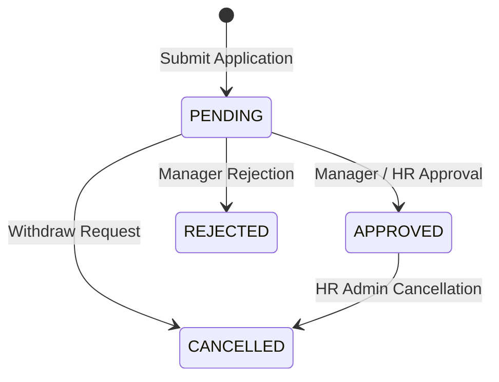

# Employee Self-Service

<div class="storyline-breadcrumb">Employee Experience &amp; Workforce Portal for the <strong>Hire to Retire (H2R)</strong> &amp; <strong>Payroll Operations</strong> Storylines</div>

> The dedicated employee portal in TenArm BES, providing every team member with direct, confidential access to their personal leave entitlements, daily attendance history, published payslips, and submitted expense claims under **Me**.

Employee Self-Service consolidates personal workforce records across **HR**, **Payroll**, and **Finance** into a unified, secure workspace. The portal operates on a strict zero-leak personal boundary: every screen is scoped server-side to the authenticated employee's profile. Employees cannot view or modify another team member's records, while managers and HR administrators retain separate administrative oversight tools in the core management modules.

---

## Workspace Ergonomics

The Employee Self-Service workspace is engineered for clarity, speed, and dispute-free record tracking:

- **Multi-Tab Desk**: Employees can operate across up to 3 workspace tabs simultaneously (for example, keeping **My Attendance** open to review monthly logs while drafting a time-off application in **My Leave** and checking net pay on **My Payslips**). Switching tabs preserves active table filters, search queries, and modal states without reloading.
- **Draft Auto-Save**: Uncommitted form inputs in the **Apply for Leave** modal (`leaveType`, `startDate`, `endDate`, `reason`) are continuously saved to local browser storage (`hr_self_leave_apply`). If you accidentally close the modal or switch views, your inputs remain intact when you reopen it. The active tab header displays a dirty dot indicator (`•`) until the request is submitted or dismissed.
- **Quick-Peek Slide-Out Drawer**: Clicking **Peek** on any payslip in **My Payslips** slides open a detailed breakdown drawer from the right edge of the screen. You can review earnings components, statutory deductions, and tax withholdings alongside an immediate **Download PDF** button without losing your place in the payslip history.
- **Optimistic Concurrency Control (OCC)**: Inline actions—such as withdrawing a pending leave request—pass version tokens. If another administrative action updates the request simultaneously, the system guards against duplicate or contradictory state changes.

---

## Account Linkage & Unlinked Profile Recovery

Self-service records require your user login to be linked to an active employee record in the organization's HR directory:

```
Me → My Leave | My Attendance | My Payslips | My Expenses
```

### The Unlinked Profile Banner
If a new user account has been created by an administrator but has not yet been assigned to an employee profile in **HR → Employees**, the self-service screens display an recovery banner:

```
┌────────────────────────────────────────────────────────────────────────┐
│ [UserX]  Employee Profile Not Linked                                   │
│          Your user account is not connected to an active employee      │
│          record in this organisation. Accessing self-service features  │
│          requires a linked directory profile.                          │
│                                                                        │
│          [Action Required: Contact HR Administrator]                   │
│          Ask your HR admin or manager to assign your user account to   │
│          your employee record in the Employee Directory.               │
└────────────────────────────────────────────────────────────────────────┘
```

### How to Resolve an Unlinked Profile
1. Notify your **HR Administrator** or manager that your user account requires linking.
2. The HR Administrator navigates to **HR → Employees** (`/hr/employees`).
3. The administrator opens your employee record, edits the profile, and selects your login from the **Linked User Account** dropdown.
4. Once saved, refresh your browser. Your leave balances, attendance logs, and payslips will immediately populate.

---

## My Leave

**What it does** — Displays your real-time leave entitlement balances, past leave history, and active application statuses, allowing you to request time off or withdraw pending applications.

```
/self-service/leave
```

### Leave Lifecycle & State Machine

Every leave application moves through a structured governance lifecycle:



| Lifecycle Status | What It Means | Allowed Employee Action |
|---|---|---|
| `PENDING` | Application submitted and waiting for manager or HR review. | Click **Withdraw** on the row to cancel the application immediately and restore your balance. |
| `APPROVED` | Request confirmed and approved. Days are deducted from your balance and recorded on your attendance register. | Contact HR or your reporting manager if you need to cancel an approved leave. |
| `REJECTED` | Request turned down by the approver. The reviewer's reason is displayed directly in the **Reason / Remarks** column. | Inspect the reviewer note, adjust requested dates, and reapply if appropriate. |
| `CANCELLED` | Application withdrawn by you while pending, or cancelled by an HR administrator after approval. | Entitled leave balance is restored. No further action needed. |

### Leave Balances & Pulse Entitlement Gauges
At the top of the **My Leave** screen, the **Leave Balances** pulse grid displays an entitlement card for every policy type configured for your role (e.g., *Annual Leave*, *Sick Leave*, *Casual Leave*):

- **Days Left Gauge**: Displays your exact remaining allowance (e.g., `14.5 days left`). If your balance reaches zero or is in deficit, the figure is highlighted in red.
- **Visual Progress Bar**: Shows the percentage of your entitlement consumed (`taken_days` / `entitled_days`).
- **Entitlement Subtitle**: Displays the exact tally: `X taken · Y entitled`.

### How to Apply for Leave
1. Navigate to **Me → My Leave** (`/self-service/leave`).
2. Click **+ Apply for Leave** in the page header or empty state.
3. In the **Apply for Leave** modal:
   - **Select Leave Type**: Click one of the interactive leave type chips (e.g., `ANNUAL`, `SICK`). Each chip displays your current remaining days.
   - **Start Date & End Date**: Pick your desired time-off dates.
   - **Duration Requested**: The system automatically computes working days, excluding weekend rest days and configured organization holidays.
   - **Remaining After Approval**: Inspect the projected balance preview. If the request exceeds your available days, a warning banner appears (`Exceeds current balance by X days · Subject to manager special approval`).
   - **Reason / Remarks**: Enter optional notes explaining your request (e.g., *Family vacation*, *Medical appointment*).
4. Click **Submit Application**. A success toast confirms submission (`Leave request submitted successfully`), and your request appears as `PENDING` in the history table.

### How to Withdraw a Pending Leave Request
1. Locate the pending request in the **Leave Request History** table.
2. In the **Actions** column, click **Withdraw**.
3. In the **Withdraw Leave Request** confirmation dialog, review the prompt (`Withdraw your leave request for YYYY-MM-DD – YYYY-MM-DD (Xd)? Your [Type] entitlement will be restored immediately`).
4. Click **Withdraw Request**. The application status updates to `CANCELLED`, and your remaining leave balance is immediately refunded.

### Leave Rules & Business Guards
- **Working Days Calculation**: Leave calculations respect the organization's configured working week and public holidays. Weekends and official non-working days are automatically deducted from the total request duration.
- **Zero Working Days Guard**: Submitting a leave request spanning only non-working days (e.g., a weekend or company holiday) is blocked with the error message: `Selected leave period contains no working days`.
- **Overlap Prevention**: The system prevents submitting duplicate requests overlapping an existing `PENDING` or `APPROVED` leave period (`Employee already has an active or pending leave request overlapping [dates]`).
- **Date Chronology**: The end date cannot precede the start date.

---

## My Attendance

**What it does** — Provides a read-only historical register of your daily attendance, check-in and check-out timestamps, working hours, and presence statuses as recorded by the organization.

```
/self-service/attendance
```

> [!NOTE]
> The **My Attendance** desk is strictly read-only for employees. Attendance updates, time corrections, and biometric sync exceptions are administered by managers and HR staff via **HR → Attendance**.

### Today's Presence Cockpit
The top card highlights your attendance status for the current calendar date:
- **Presence Status Badge**: Displays your active status (`PRESENT`, `WFH`, `HALF_DAY`, `ON_LEAVE`, `ABSENT`).
- **Check In & Logged Hours**: Shows your registered check-in timestamp (`In: 09:15`) and cumulative logged working time (`8.5h logged`).
- **Unlogged Indicator**: If attendance has not yet been recorded for today, the card shows a `Not Logged Yet` badge.

### Attendance Summary Pulse Bar
Four summary pulse cards calculate your attendance metrics for the selected time window:
- **Days Logged**: Total calendar days with logged activity during the selected period.
- **Present (In Office)**: Count of on-premise workdays, including percentage of total logged attendance.
- **Remote (WFH)**: Count of approved remote workdays and percentage of total attendance.
- **Total Hours Logged**: Cumulative working hours recorded, alongside the average hours logged per working day.

### Date Filter Toolbar & Quick Presets
The filter toolbar allows you to isolate specific pay cycles or historical quarters:
- **Preset Buttons**: Click **This Month**, **Last Month**, or **All Time** to instantly adjust the filter range.
- **Custom Range**: Enter specific dates in the **date_from** and **date_to** inputs to inspect any custom historical window.

### Daily Attendance Register Table

| Column | What It Displays |
|---|---|
| **Date** | Calendar date paired with the abbreviated weekday name (e.g., `2026-11-11 · Wed`). |
| **Status** | Status badge indicating work mode: `PRESENT` (green), `WFH` (blue), `HALF_DAY` (amber), `ON_LEAVE` (purple), `ABSENT` (red). |
| **Check In** | Recorded start time (e.g., `09:05 AM`) or an em-dash (`—`) if unrecorded. |
| **Check Out** | Recorded departure time (e.g., `06:15 PM`) or an em-dash (`—`). |
| **Hours** | Total net working hours, color-coded for quick scanning: Green (8+ hours full day), Amber (4–8 hours half day), Red (< 4 hours partial day). |
| **Notes** | Contextual notes logged by HR or automated shift systems (e.g., *Approved WFH*, *On approved Annual Leave*). |

---

## My Payslips

**What it does** — Lists all official payslips issued to you across completed payroll runs, offering itemized earnings and tax deduction breakdowns, instant CSV exports, and official PDF downloads.

```
/self-service/payslips
```

> [!IMPORTANT]
> Payslips are generated and published only after HR and Finance finalize and post a pay run in **Payroll → Pay Runs**. Unposted draft runs do not appear in employee self-service.

### Personal Financial Pulse Bar
The summary pulse bar aggregates your cumulative compensation history:
- **Issued Payslips**: Total number of finalized pay statements available in your archive.
- **Lifetime Gross**: Cumulative gross earnings across all issued payslips.
- **Total Deductions**: Cumulative withholdings, including provident fund, income tax (TDS), insurance, and statutory welfare dues.
- **Lifetime Net Paid**: Cumulative net take-home pay deposited to your salary account.

### How to Search and Filter Payslips
- Use the **Search payslip #, date, amount...** toolbar to locate specific statements by payslip number (e.g., `1042`), year/month (e.g., `Nov 2026`), or net amount.
- Click **Reset** to clear active filters and view your complete archive.

### How to View & Download PDF Payslips
1. Navigate to **Me → My Payslips** (`/self-service/payslips`).
2. Locate the desired statement in the register.
3. Click **View PDF** in the **Actions** column. The official PDF document opens directly in your browser's PDF viewer for printing or saving.
4. Alternatively, click **Peek** to open the slide-out inspection drawer and click **Download PDF** from the drawer footer.

### The Payslip Quick-Peek Drawer (`MyPayslipDrawer`)
Clicking **Peek** opens a comprehensive financial slide-out drawer detailing every element of your compensation:

```
┌────────────────────────────────────────────────────────────────────────┐
│ Payslip #1042  [Net: ₹85,450.00]                                     X │
│ Pay Date: Nov 30, 2026 · Pay Run #12                                   │
├────────────────────────────────────────────────────────────────────────┤
│ Base Salary       Gross Earnings    Total Deductions   Net Take-Home   │
│ ₹75,000.00        ₹95,000.00        ₹9,550.00          ₹85,450.00      │
├────────────────────────────────────────────────────────────────────────┤
│ Earnings & Allowances                                                  │
│ • Basic Salary (BASIC)                                     +₹75,000.00 │
│ • House Rent Allowance (HRA)                               +₹15,000.00 │
│ • Special Allowance (SPL_ALLOW)                             +₹5,000.00 │
│                                                                        │
│ Standard Deductions                                                    │
│ • Professional Tax (PTAX)                                     -₹200.00 │
│ • Health Insurance Premium (MEDICLAIM)                      -₹1,500.00 │
│                                                                        │
│ Statutory & Tax Contributions                                          │
│ • Employee Provident Fund (EPF)                             -₹1,800.00 │
│ • Tax Deducted at Source (TDS)                              -₹6,050.00 │
│                                                                        │
│ Unpaid Leave Adjustment                                                │
│ • Unpaid Leave (1 days)                                       -₹2,500.00 │
├────────────────────────────────────────────────────────────────────────┤
│ [Close]                                                 [Download PDF] │
└────────────────────────────────────────────────────────────────────────┘
```

### How to Export Payslip Statements to CSV
1. Filter the register to your desired statements (or leave the search empty to export all records).
2. Click **Export CSV** in the page header.
3. The browser downloads `my_payslips.csv` containing the following columns:
   - `Payslip #`
   - `Date`
   - `Base Salary`
   - `Gross Pay`
   - `Total Deductions`
   - `Net Pay`

---

## My Expenses

**What it does** — Displays a tracking register of your personal expense claims and reimbursement requests, including their real-time review status across Finance audit stages.

```
/self-service/expenses
```

### Expense Claims Register Table

| Column | What It Displays |
|---|---|
| **Expense #** | The official document identifier (e.g., `EXP-2026-000042`). |
| **Date** | Incurred expense date or submission date. |
| **Total** | Total claim amount formatted in the organization's primary currency. |
| **Status** | Status badge indicating approval and reimbursement stage: `DRAFT`, `SUBMITTED`, `APPROVED`, `REJECTED`, `PAID`, `CANCELLED`. |

### How Expenses Work with Finance
- **Claim Submission**: New expense reports, receipt image uploads, and mileage claims are submitted through **Finance → Expenses** (`/finance/expenses`). Submitting claims requires the Finance expense permission (`finance.expense.create`).
- **Claim Visibility**: The **My Expenses** screen provides employees with read-only visibility into their submitted claims without granting broad access to company-wide financial accounts.
- **Approval & Reimbursement**: Once reviewed and approved by the finance department, expense payments are posted directly or bundled into payroll disbursements.

---

## Integrations

Employee Self-Service acts as the personal presentation layer for three core operational engines:

| Module | What Self-Service Consumes | Business Impact |
|---|---|---|
| **HR** | Master employee directory, linked user profiles, leave policy groups, entitlement balances, and attendance logs. | Drives real-time leave validation, automatic working-day calculations, and read-only presence history. |
| **Payroll** | Finalized pay runs, individual payslip statements, compensation components, and tax withholdings. | Delivers secure PDF payslips, personal income trends, and itemized earnings transparency. |
| **Finance** | Expense claim records, approval statuses, and reimbursement tallies. | Provides status tracking for out-of-pocket expenses and business travel claims. |
| **Core Platform** | Unified approval workflows, optimistic concurrency versioning, and email notifications. | Routes pending leave applications to designated managers and alerts employees upon approval. |

> [!TIP]
> **Modular Licensing & Optional Features**: Payroll and Finance are optional applications. If your organization does not license or enable **Payroll**, the **My Payslips** view is automatically omitted from your workspace navigation. If **Finance** is disabled, the **My Expenses** tab is hidden. The **My Leave** and **My Attendance** features remain active as long as **HR** is enabled.

---

## Roles & Permissions

Access to Employee Self-Service is governed by a unified master grant designed for minimal administrative overhead:

| Permission | Scope & Purpose | Implied Capabilities Granted |
|---|---|---|
| `self_service.access` | Universal employee portal grant assigned to standard staff roles. Scopes all records strictly to the caller's linked employee profile. | • `leave.own` (`leave.own.list`, `leave.own.get`, `leave.own.request`, `leave.own.cancel`, `leave.own.balances`)<br>• `attendance.own` (`attendance.own.list`)<br>• `payslip.own` (`payslip.own.list`, `payslip.own.get`, `payslip.own.pdf`)<br>• `finance.expense.own` (`finance.expense.own.list`) |

---

## If Something Goes Wrong (Common Validation & Guard Errors)

The following table translates system guards, validation alerts, and UI error toasts into practical resolution steps:

| What You See (Toast / Alert / Banner) | Why It Happens | How to Fix It in the Workspace |
|---|---|---|
| **Employee Profile Not Linked** *(Yellow warning card)* | Your login credentials are not connected to a profile in the HR Employee Directory. | Contact your HR Administrator or manager. Request that they open **HR → Employees**, edit your record, and link your user account in the profile settings. |
| **Selected leave period contains no working days** | The chosen start and end dates fall entirely on weekends or registered company public holidays. | Adjust your date range to include at least one official working day, or consult your organization's holiday calendar in **HR Settings**. |
| **Employee already has an active or pending leave request overlapping [dates]** | You have already submitted a leave request covering one or more days in the selected date range. | Inspect your **Leave Request History**. If you need to change dates, withdraw the existing `PENDING` request first, or ask HR to cancel an existing `APPROVED` request before reapplying. |
| **End date cannot be earlier than start date** | The date picker end date was set to a date before the selected start date. | Select an end date that matches or occurs after your selected start date. |
| **Exceeds current balance by X days · Subject to manager special approval** *(Inline form warning)* | The requested working days exceed your remaining balance for the selected leave type. | You may still submit the application if organizational policy allows negative balances or unpaid leave; your manager will be notified to review the discretionary deficit. Alternatively, choose a different leave type (e.g., *Unpaid Leave*). |
| **Only PENDING leave requests can be cancelled via self-service** | You attempted to cancel a request that has already been approved, rejected, or previously cancelled. | Self-service withdrawal is restricted to unapproved `PENDING` requests. To modify or cancel an approved vacation, contact HR directly to process an administrative cancellation. |
| **No leave entitlements configured for your account yet** | Your employee profile has not been assigned to a Leave Policy Group in HR. | Contact HR Operations. An administrator must assign your employee profile to a Leave Policy Group under **HR → Leave Balances** and click **Sync Group Balances**. |
| **Failed to open payslip** *(Toast error)* | The requested payslip file is temporarily unavailable or your network session was interrupted. | Refresh your browser tab. If the issue persists, verify with HR that the underlying pay run was posted successfully. |
| **No expense claims yet** *(Empty state card)* | You have not submitted any out-of-pocket expense claims under your linked profile. | To submit a business reimbursement, navigate to **Finance → Expenses** and click **Create Expense** (requires Finance expense submission permissions). |
