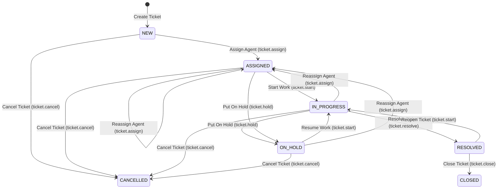

# Service

Part of the <strong>Order to Cash (O2C)</strong> Storyline: Step 6 of 6 (Customer Service &amp; After-Sales Support)

> The central customer support and technical service command center of TenArm BES, orchestrating ticket intake, technician dispatch, task checklists, threaded incident discussions, SLA fulfillment monitoring, and root-cause resolution.

The Service module manages the post-sales customer lifecycle, incident reporting, and maintenance requests. Whether an issue originates from a phone call, customer email, or self-service portal submission, Service routes each request through a structured, stage-gated lifecycle: from initial intake and technician dispatch to hands-on investigation, task execution, client communication, and verified resolution.

---

## Workspace Ergonomics

The Service desk is built for rapid dispatch, uninterrupted incident triage, and zero lost context:

- **Multi-Tab Desk**: Support leads and service technicians can keep up to 3 active service tabs open simultaneously (e.g. keeping the **Service Desk** queue open while inspecting a ticket on the **Support Tickets** registry, viewing customer profiles in a **Customer Directory** tab, or tracking metrics on the **Service Dashboard**). Switching between tabs preserves table searches, owner and status filters, scroll offsets, and active forms without reloading.
- **Draft Auto-Save**: In-progress ticket drafts (`new_service_ticket`), technician reassignments, checklist additions, and resolution summaries (`service_ticket_resolve_<number>`) are continuously preserved locally. The active tab header displays a dirty dot indicator (`•`) until the record is saved or discarded.
- **Quick-Peek Slide-Out**: Clicking any linked ticket number (`TK-XXXX-XXXX`), customer counterparty, or assigned user opens a contextual slide-over inspection drawer without navigating away or losing unsaved inputs on the primary desk.
- **Real-Time Live Updates & Concurrency Guard**: Real-time event subscriptions automatically refresh the ticket storyline and queue when team members make updates, while Optimistic Concurrency Control (OCC) guards protect against conflicting edits by displaying a side-by-side conflict resolution drawer if a record changes concurrently.

---

## Executive Pulse HUD & SLA Management

The Service Desk header features a real-time **Executive Pulse HUD** that provides instant visibility into operational workload and service commitments:

| Metric Card | What It Displays | Operational Focus |
|---|---|---|
| **Open Queue** | Count of all tickets currently in `NEW`, `ASSIGNED`, `IN_PROGRESS`, or `ON_HOLD` status. | Total active support workload awaiting final resolution and closure. |
| **In Progress** | Count of tickets currently in active technical investigation (`IN_PROGRESS`). | Work actively being performed by support technicians. |
| **SLA Attention** | Count of active tickets with target due dates expiring within 24 hours or already breached. | Urgent incidents requiring priority escalation or immediate dispatch. |
| **Resolved Today** | Count of tickets transitioned to `RESOLVED` or `CLOSED` on the current calendar day. | Daily team throughput and operational accomplishment. |

### SLA Countdown & Overdue Tagging

Every ticket with a configured **Target Due Date (SLA)** dynamically calculates its time-to-breach against the clock:

- **Urgent SLA Attention (`soon`)**: Displayed with an amber clock badge (e.g. `14h left`) when the remaining resolution window drops below 24 hours.
- **Breached SLA (`breached`)**: Displayed with a prominent red badge (e.g. `3h overdue` or `2d overdue`) as soon as the target due date has lapsed without ticket resolution.
- **Completed SLA**: Automatically cleared when the ticket enters `RESOLVED`, `CLOSED`, or `CANCELLED` status.

### Incident Priority Levels

| Priority Level | Visual Badge | Target Handling Window | Typical Scenario |
|---|:---:|---|---|
| `URGENT` | Red (`danger`) | Immediate dispatch; continuous focus | Production halt, critical safety hazard, or system-wide customer blockage. |
| `HIGH` | Amber (`warning`) | Same-day response and action | Core feature non-operational; significant productivity degradation without workaround. |
| `NORMAL` | Blue (`info`) | Standard 24–48 hour turnaround | General service requests, component replacements, or non-blocking defects. |
| `LOW` | Slate (`default`) | Scheduled / Best effort | Cosmetic questions, routine maintenance suggestions, or minor documentation inquiries. |

---

## Ticket Lifecycle & State Machine

Every service ticket follows a disciplined, audit-logged lifecycle:

### Lifecycle Stage Definitions

| Stage | Meaning & Operational Context | Available Next Actions |
|---|---|---|
| `NEW` | Fresh ticket intake; unassigned and awaiting dispatcher review. | **Assign Agent**, **Cancel Ticket** |
| `ASSIGNED` | Ticket dispatched to a specific technician or support representative. | **Start Work**, **Reassign Agent**, **Put On Hold**, **Cancel Ticket** |
| `IN_PROGRESS` | Technician is actively diagnosing, troubleshooting, or repairing the issue. | **Resolve Ticket**, **Put On Hold**, **Reassign Agent**, **Cancel Ticket** |
| `ON_HOLD` | Work paused pending customer response, spare parts delivery, or vendor escalation. | **Resume Work**, **Reassign Agent**, **Cancel Ticket** |
| `RESOLVED` | Root cause eliminated, solution verified, and resolution summary documented. | **Close Ticket**, **Reopen Ticket** |
| `CLOSED` | Customer sign-off verified; ticket archived and locked against further edits. | Archived record (Historical audit log preserved) |
| `CANCELLED` | Ticket identified as duplicate, invalid, or withdrawn by the requester. | Final state (Terminal audit record preserved) |

---

## Key Screens & Features

### 1. Service Desk (`/service`)

**What it does** — The central dispatch split-desk interface combining a real-time filterable ticket queue on the left with an active ticket storyline inspector canvas on the right.

#### Left Pane: Filterable Queue
- **Status Filter Pills**: Instant one-click toggle across `All Tickets`, `OPEN`, `NEW`, `ASSIGNED`, `IN PROGRESS`, `ON HOLD`, `RESOLVED`, and `CLOSED`.
- **Priority Selector**: Dropdown filter to isolate `Urgent`, `High`, `Normal`, or `Low` priority tickets.
- **Search Bar**: Real-time filtering matching ticket document numbers (`TK-XXXX`), issue titles, requester names, or categories.
- **Queue Cards**: Displays ticket identifier, priority tag, current status badge, subject title, requester contact, and dynamic SLA pill indicator.
- **Customer Directory Shortcut**: The **View Customers** header button opens the Customer Directory (`/sales/customers`) in a dedicated tab to cross-reference warranty contracts and account contacts.

#### Right Pane: Ticket Storyline Inspector
- Selecting any ticket from the queue immediately loads its full interactive storyline in the right pane without leaving the page.
- Displays the 5-stage lifecycle stepper (`NEW` › `ASSIGNED` › `IN PROGRESS` › `RESOLVED` › `CLOSED`).
- Provides one-click action buttons to assign, start, hold, resolve, close, or cancel tickets.
- Features multi-tab inspection: **Details**, **Checklist**, **Discussion**, **Attachments**, and **Timeline**.

---

### 2. Support Tickets Registry (`/service/tickets`)

**What it does** — A high-density tabular view designed for bulk tracking, team-wide queue audits, and quick status transitions directly from table rows.

**Columns**
- **Ticket #**: Official document number (e.g. `TK-2026-0001`), supporting slide-over Quick-Peek inspection.
- **title**: Summary subject of the service request.
- **priority**: Visual badge indicating urgency (`LOW`, `NORMAL`, `HIGH`, `URGENT`).
- **status**: Current lifecycle state badge (`NEW`, `ASSIGNED`, `IN_PROGRESS`, `ON_HOLD`, `RESOLVED`, `CLOSED`, `CANCELLED`).
- **Actions**:
  - **Open**: Navigates to the full dedicated Ticket Detail page (`/service/tickets/:ticketId`).
  - **Contextual Transition Buttons**: Direct inline buttons based on the ticket's current status:
    - On `NEW`: **Cancel**
    - On `ASSIGNED`: **Start**, **Cancel**
    - On `IN_PROGRESS`: **Hold**, **Cancel**
    - On `ON_HOLD`: **Resume**, **Cancel**
    - On `RESOLVED`: **Reopen**, **Close**

---

### 3. Ticket Storyline & Detail Page (`/service/tickets/:ticketId`)

**What it does** — Comprehensive single-ticket command center featuring complete incident context, work checklists, team discussions, file attachments, and audit history.

#### Storyline Header & Action Bar
- **Header Badges**: Ticket document number, optimistic version badge, status pill, priority indicator, and SLA countdown tag.
- **Action Buttons**:
  - `Assign Agent` / `Reassign Agent`: Dispatches or transfers ownership to an active organization user.
  - `Start Work`: Moves ticket from `ASSIGNED` to `IN_PROGRESS`.
  - `Resume Work`: Restores ticket from `ON_HOLD` back to `IN_PROGRESS`.
  - `Reopen Ticket`: Returns a `RESOLVED` ticket back to `IN_PROGRESS` if the client reports recurring symptoms.
  - `Put On Hold`: Suspends work temporarily when awaiting customer feedback or external parts.
  - `Resolve Ticket`: Opens the resolution modal requiring root-cause documentation.
  - `Close Ticket`: Formally closes and archives a verified ticket.
  - `Cancel Ticket`: Safely voids an open ticket with confirmation.

#### Storyline Tabs

##### Details Tab
- **Resolution Confirmed Banner**: Highlighted callout displayed on resolved and closed tickets showing the verified resolution summary and fix applied.
- **Ticket Description**: Full multiline problem statement and reproduction context provided during ticket logging.
- **Overview Grid**: 4-card metadata panel presenting:
  - **Requester**: Contact name and email address.
  - **Category**: Functional area (e.g. Hardware, Network, Software, Billing).
  - **Target Due Date**: Configured SLA resolution deadline.
  - **Assigned Agent**: Assigned technician or "Unassigned".

##### Checklist Tab
- **Visual Progress Bar**: Displays percentage and completion ratio (e.g. `Tasks Completed: 2 / 3 (67%)`).
- **Interactive Checkboxes**: Click any task checkbox to instantly toggle completion status, automatically stamping the completion timestamp.
- **Add Checklist Task**: Input field with **Add** button (`+ Add`) to append action items (e.g. *Inspect power cabling*, *Run diagnostic memory test*, *Verify client sign-off*).
- **Task Deletion**: Remove obsolete checklist items via the trash icon.

##### Discussion Tab
- **Threaded Communication**: Chronological feed of internal technician notes and customer communications.
- **Comment Header**: Stamped with author name/ID and exact timestamp.
- **Post Comment**: Form with multiline textarea and **Post Comment** button. Automatically auto-saves unposted notes if switching tabs.

##### Attachments Tab
- Powered by the central document repository (`AttachmentPanel`).
- Upload diagnostic logs, error screenshots, diagnostic telemetry exports, and signed delivery or repair slips.

##### Timeline Tab
- Audit trail listing all lifecycle domain events (`TicketCreated`, `TicketAssigned`, `TicketStarted`, `TicketHeld`, `TicketResolved`, `TicketClosed`, `TicketCancelled`, `TicketCommented`) with chronological timestamps.

---

### 4. Service Dashboard (`/service/dashboard`)

**What it does** — Real-time performance analytics, resolution throughput monitoring, and historical volume trends.

#### Period Selector
Filter metrics by calendar month across the past 24 months (e.g. `Nov 2026`).

#### Pulse KPI Grid
- **New Tickets**: Total service tickets created within the selected period.
- **Open**: Current count of unresolved tickets created during the period.
- **Resolved**: Tickets marked resolved, accompanied by a dynamic resolution percentage rate (`X.X% resolution`).
- **Closed**: Total tickets formally closed and confirmed.
- **Cancelled**: Count of tickets voided or withdrawn.

#### Visual Analytics
- **Status Breakdown**: Horizontal bar chart visualizing relative distribution across Open, Resolved, Closed, and Cancelled volumes.
- **Created vs Resolved Trend**: 6-month historical area chart comparing monthly ticket intake against team resolution velocity.
- **Historical Trend Table**: Tabular breakdown providing exact numerical values for `Period`, `Created`, `Resolved`, and `Closed`.

---

## How to Use

### Logging a New Support Ticket

1. Navigate to **Service → Service Desk** (`/service`) or **Support Tickets** (`/service/tickets`).
2. Click **New Ticket** in the page header.
3. In the **Log New Service Ticket** dialog, complete the required fields:
   - **Subject / Issue Summary \***: Enter a clear, concise headline (e.g. *Production CNC machine failing spindle calibration*).
   - **Priority Level**: Select `Low Priority`, `Normal Priority`, `High Priority`, or `Urgent Priority` (defaults to Normal).
   - **Category**: Enter the operational classification (e.g. *Hardware*, *Electrical*, *Software*).
   - **Requester Name**: Enter the contact person's full name.
   - **Requester Email**: Enter the customer's email address (validated for RFC email format).
   - **Target Due Date (SLA)**: Select the contractual completion target date and time.
   - **Detailed Description**: Provide background details, error codes, and steps to reproduce.
4. Click **Create Ticket**.
5. The ticket is immediately generated with a sequential document number (`TK-XXXX`), placed in `NEW` status, and opened in the active storyline.

---

### Assigning a Technician

1. Open the ticket on the **Service Desk** or **Support Tickets** page.
2. In the ticket action bar, click **Assign Agent** (or **Reassign Agent** if already assigned).
3. In the **Assign Technician** dialog:
   - Select the designated technician from the **Assigned Technician \*** dropdown menu (lists all active users with their full names and emails).
4. Click **Assign Agent**.
5. The ticket advances to `ASSIGNED` status, the assignee is stamped in the overview card, and a `TicketAssigned` event is logged in the timeline.

---

### Working a Ticket & Managing Checklists

1. On an `ASSIGNED` ticket, click **Start Work**.
2. The ticket transitions to `IN_PROGRESS`.
3. Switch to the **Checklist** tab:
   - Enter a task title in the input box (e.g. *Inspect voltage regulator*).
   - Click **Add**.
   - As diagnostic steps are executed, click the checkbox beside each item to mark it complete.
4. Switch to the **Discussion** tab:
   - Enter progress updates or customer communication summaries.
   - Click **Post Comment**.
5. (Optional) Switch to the **Attachments** tab to upload diagnostic photos or diagnostic log files.

---

### Putting a Ticket On Hold and Resuming Work

1. If work cannot proceed while waiting for customer feedback or spare parts delivery:
   - Click **Put On Hold** in the action bar.
   - The ticket transitions to `ON_HOLD`.
2. To document the reason, add a note in the **Discussion** tab explaining what parts or customer feedback are awaited.
3. Once the customer responds or parts arrive:
   - Click **Resume Work**.
   - The ticket returns to `IN_PROGRESS`.

---

### Resolving a Ticket

1. When technical investigation and repairs are complete and verified:
   - On an `IN_PROGRESS` ticket, click **Resolve Ticket**.
2. In the **Resolve Ticket** modal (`Resolve Ticket [number]`):
   - In the **Resolution Summary \*** textarea, enter the root cause and corrective action taken (e.g. *Replaced damaged sensor cable and re-calibrated spindle encoder. Full test run executed with zero errors.*).
3. Click **Confirm Resolution**.
4. The ticket transitions to `RESOLVED`, the **Resolution Confirmed** banner displays on the Details tab, and the resolution timestamp is recorded.

---

### Closing or Reopening a Ticket

#### Closing a Verified Ticket
1. Review the resolved ticket with the customer or quality lead.
2. Click **Close Ticket**.
3. The ticket enters `CLOSED` status. The record is permanently locked against further operational changes.

#### Reopening a Ticket
1. If the customer reports recurring symptoms after resolution:
2. On a `RESOLVED` ticket, click **Reopen Ticket**.
3. The ticket immediately reverts to `IN_PROGRESS`, allowing technicians to log further comments, add new checklist items, and continue work.

---

### Cancelling a Ticket

1. If a ticket was logged in error, identified as a duplicate, or withdrawn by the requester:
2. On any open ticket (`NEW`, `ASSIGNED`, `IN_PROGRESS`, `ON_HOLD`), click **Cancel Ticket**.
3. In the **Cancel Ticket** confirmation dialog, review the warning: *"Are you sure you want to cancel ticket `[ticket_number]`? This action cannot be reversed."*
4. Click **Yes, Cancel Ticket**.
5. The ticket moves to `CANCELLED` status and is retired from the active queue.

---

## If Something Goes Wrong (Common Validation & Guard Errors)

| What You See (Toast / Dialog) | Why It Happens | How to Resolve It in the Workspace |
|---|---|---|
| `"Assignee user not found or inactive in organization"` | The selected technician account is marked inactive or has been disabled in tenant user settings. | Navigate to **Tenant Administration → Users**, ensure the technician is marked active, or pick another active technician from the dropdown. |
| `"assignee_id is required to assign a ticket"` | The assignment form was submitted without selecting a technician from the dropdown list. | Open the **Assign Technician** dialog, choose an agent from the dropdown menu, and click **Assign Agent**. |
| `"Resolution Summary * is required"` / Disabled Confirm button | The **Confirm Resolution** button was clicked while the resolution summary box was empty. | Enter a description of the fix, root cause, or diagnostic outcome in the resolution summary box before confirming. |
| `"Cannot transition ticket from [status] to [status]"` | An illegal lifecycle jump was attempted (e.g. attempting to resolve a ticket directly from `NEW` without starting work). | Follow the stage-gated lifecycle: assign the ticket, click **Start Work** to enter `IN_PROGRESS`, and then proceed to **Resolve Ticket**. |
| `"Concurrent modification detected (409 Conflict)"` | Another dispatcher or technician updated the ticket status or assigned agent while you had the form open. | Review the **Conflict Resolution Drawer** that slides out on the right, compare your local draft with the server version, and click **Reload / Accept** to update. |
| `"Requester email must be a valid email address"` | The email address entered contains typographic syntax errors (e.g. missing `@` or domain). | Correct the requester email format (e.g. `client@company.com`) or clear the field if unknown. |
| `"Subject / Issue Summary is required"` | The ticket creation form was submitted with a blank title. | Enter a concise headline describing the problem in the **Subject / Issue Summary** field before clicking **Create Ticket**. |
| `"Task title cannot be blank"` | Attempted to add an empty checklist item. | Type a descriptive task title (e.g. *Verify power supply voltage*) before clicking the **Add** button. |

---

## Cross-Module Integrations

| Module | Integration Workflow |
|---|---|
| **CRM** | Customer accounts in CRM link directly to service tickets. Clicking **View Customers** on the Service Desk opens the customer directory. In CRM, the **Customer 360** inspector displays logged service tickets alongside customer commercial agreements. |
| **Sales** | Warranty and after-sales service requests reference original customer sales orders and equipment deliveries. |
| **Customer Portal** | External clients can submit service tickets, monitor resolution progress, read technician updates, and confirm ticket closure via the self-service portal (`/portal`). |
| **Core Platform & Event Store** | All ticket lifecycle transitions, checklist updates, and comments emit event-sourced records (`TicketCreated`, `TicketAssigned`, `TicketStarted`, `TicketHeld`, `TicketResolved`, `TicketClosed`, `TicketCancelled`, `TicketCommented`), establishing an immutable audit history. |
| **Workboard & My Day** | Service tickets approaching SLA deadlines or assigned to the current user automatically surface on the personal **Workboard Pulse** summary. |

---

## Permissions Reference

| Permission Code | Display Name | What It Grants |
|---|---|---|
| `ticket.view` | View Tickets | Read-only access to browse the Service Desk, support tickets table, comments feed, attachments, and Service Dashboard. |
| `ticket.create` | Create Ticket | Permission to open the **New Ticket** modal and log new service requests. |
| `ticket.assign` | Assign Ticket | Permission to dispatch, assign, or reassign tickets to technicians and support agents. |
| `ticket.start` | Start Work / Reopen | Permission to move tickets from `ASSIGNED`, `ON_HOLD`, or `RESOLVED` into `IN_PROGRESS`. |
| `ticket.hold` | Put On Hold | Permission to pause tickets from `ASSIGNED` or `IN_PROGRESS` into `ON_HOLD`. |
| `ticket.resolve` | Resolve Ticket | Permission to enter resolution notes and advance `IN_PROGRESS` tickets to `RESOLVED`. |
| `ticket.close` | Close Ticket | Permission to formally close and archive `RESOLVED` tickets. |
| `ticket.cancel` | Cancel Ticket | Permission to void and cancel open tickets. |
| `ticket.comment` | Post Comment | Permission to add internal discussion notes and customer communication records. |
| `ticket.task` | Manage Checklist | Permission to add, complete, uncheck, and delete ticket checklist tasks. |
