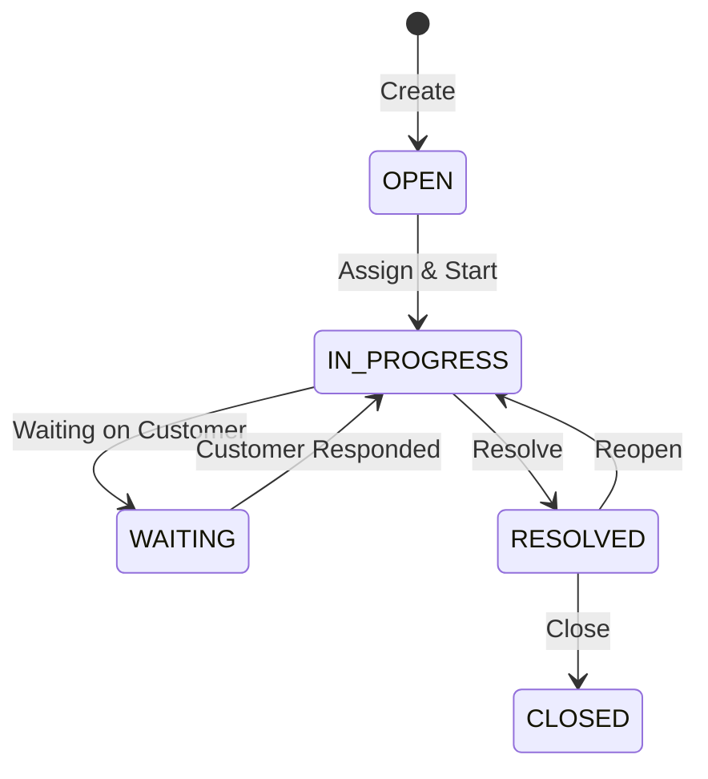

# Service

The Service module handles service requests and support tickets — from intake through resolution.

## Key Features

### Service Tickets

Create and manage service requests:
- Log customer issues with descriptions and priority
- Categorize by service type
- Assign to support agents
- Track time-to-resolution

### Ticket Workflow

1. **Create** — Log the service request (from phone, email, or portal)
2. **Assign** — Route to the appropriate support agent
3. **Work** — Agent investigates and resolves
4. **Resolve** — Mark as resolved with resolution notes
5. **Close** — Confirm with customer and close

### Service Desk
The Service Desk provides a command-desk view:
- Left panel: ticket list with status filters and search
- Right panel: ticket detail with full conversation history and actions

### Priority Levels

| Priority | Response Target |
|----------|:---------------:|
| **Urgent** | Immediate |
| **High** | Same day |
| **Medium** | 1-2 business days |
| **Low** | Best effort |

## Navigation

| Page | Path | Permission |
|------|------|-----------|
| Service Desk | `/service` | `ticket.view` |
| Tickets | `/service/tickets` | `ticket.view` |
| Dashboard | `/service/dashboard` | `ticket.view` |

## Cross-Module Integration

| Integration | How It Works |
|------------|-------------|
| **CRM** | Tickets linked to customer accounts |
| **Portal** | Customers can submit and track tickets via the portal |

## Permissions

| Permission | Description |
|-----------|-------------|
| `ticket.view` | View tickets |
| `ticket.create` | Create tickets |
| `ticket.assign` | Assign tickets to agents |
| `ticket.resolve` | Resolve tickets |
| `ticket.close` | Close resolved tickets |
