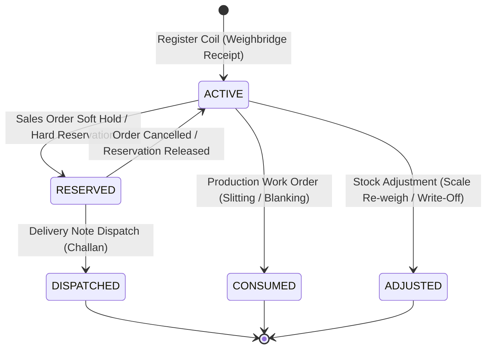

# Steel

<div class="storyline-breadcrumb">Part of the <strong>Make to Order (M2O)</strong> &amp; <strong>Procure to Pay (P2P)</strong> Storylines: Metallurgical Receipt &amp; Catch-Weight Allocation</div>

> The metallurgical tracking and catch-weight allocation engine of TenArm BES, orchestrating discrete steel coil registration, mill heat pedigree tracking, certified chemical grades, dimensional envelopes, and automated dual-unit knapsack allocation for customer orders and processing centers.

The Steel Industry Pack extends the core Inventory and Sales modules with capabilities tailored for steel mills, service centers, traders, and coil processing facilities. Unlike discrete manufactured products where nominal weights match standard catalog items, steel coils, plates, and structural profiles are indivisible units with non-uniform physical scale weights (catch-weight).

When the Steel pack is enabled by your administrator, TenArm BES activates dual-unit inventory accounting (discrete pieces + verified scale tonnage in Metric Tons), metallurgical attribute tracking (heat numbers, steel grades, thickness, and width), and an automated combinatorial allocation solver that fulfills customer orders within strict commercial tolerance bounds ($\pm \%$) and single-heat specifications.

---

## Workspace Ergonomics

The Steel workspace is designed for yard superintendents, material planners, and commercial sales representatives managing high-value, heavy industrial lots:

- **Multi-Tab Desk**: Operators can keep up to 3 workspace tabs open concurrently (for instance, maintaining the **Steel Desk** active for simulation while referencing the **Coil Register** and inspecting related purchase orders or stock balances). Switching tabs preserves active grade filters, heat queries, simulation inputs, and pagination offsets without reloading.
- **Draft Auto-Save**: Uncommitted form inputs—including incomplete coil entries in the **Register Steel Coil** modal (`steel:register-coil`)—are continuously preserved locally. The active tab header displays a dirty dot indicator (`•`) until the coil is formally received or the entry is cancelled.
- **Quick-Peek Slide-Out**: Clicking linked lot identifiers, product SKU codes, or warehouse facility chips opens a contextual inspection drawer from the right edge of the screen, allowing users to verify storage bays, physical balances, or customer commitments without leaving the primary screen.

---

## Core Steel Concepts

### 1. Dual-Unit Catch-Weight Tracking
Steel products operate under a two-dimensional unit model:
- **Primary Unit (Pieces / `pc`)**: Represents the discrete, indivisible physical unit (e.g. 1 hot rolled coil or 1 master bundle).
- **Secondary Unit (Metric Tons / `MT`)**: Represents the exact scale weight certified by weighbridge measurement, recorded down to milligram precision (`0.001 MT`).

All movements, reservations, dispatches, and transfers simultaneously track both unit dimensions. When a 21.450 MT coil is received into stock, the system books `1 pc` and `21.450 MT`. When that coil is reserved or dispatched, both units decrement in unison, preventing fractional piece errors or phantom tonnage drift.

### 2. Metallurgical Pedigree & Mill Traceability
Every received coil captures four essential metallurgical dimensions that travel with the material across its entire operational lifecycle:
- **Heat Number**: The unique metallurgical melt/batch identifier assigned at the steelmaking furnace. Essential for structural and pressure-grade traceability.
- **Steel Grade**: The standardized alloy specification (e.g. `IS2062`, `SS304`, `CR4`, `ASTM A36`, `SA516 Gr 70`).
- **Gauge / Thickness (mm)**: Caliper measurement specified to hundredths of a millimeter (`0.01 mm`).
- **Width (mm)**: Slit or coil mill width specified to tenths of a millimeter (`0.1 mm`).
- **Mill Test Certificate (MTC)**: Mill certificate identifier (`MTC-2026-X1`) validating chemical composition (Carbon, Manganese, Silicon, Sulfur, Phosphorus) and mechanical properties (yield point, tensile strength, elongation).

### 3. Catch-Weight Allocation Solver (Subset-Sum Knapsack)
In commercial steel transactions, customers order target weights with an agreed delivery tolerance (for example: *50 MT $\pm 10\%$*). Because mother coils cannot be split in a warehouse yard without incurring slitting loss and machine setup expense, finding the right combination of discrete available coils is a combinatorial challenge.

The Steel Allocation Solver runs a specialized branch-and-bound subset-sum algorithm across available yard inventory:
1. Filters candidate coils by requested product, warehouse, grade, heat, and gauge/width boundaries.
2. Evaluates all valid subsets of candidate coils against the customer's target tonnage.
3. Selects the combination that minimizes variance against the target while remaining strictly within the allowable tolerance range ($\pm \%$).
4. If no exact combination satisfies the tolerance window, the engine displays the nearest possible approximation with an `Outside Tolerance Bounds` notice, enabling sales teams to seek commercial approval or order fresh material.

### 4. Strict Single-Heat Melt Integrity
Engineering and high-pressure fabrications often stipulate that an entire shipment must originate from the exact same furnace melt to guarantee uniform weldability and thermal expansion. Toggling **Require Strict Single Heat** forces the allocation engine to evaluate candidate pools on an individual heat-by-heat basis. It guarantees that all suggested coils share identical heat numbers.

### 5. Automated Sales & Inventory Order Override
The Steel pack seamlessly overrides the standard stock suggestion pipeline in TenArm BES. When a sales order or reservation requires secondary catch-weight tonnage (`target_secondary`) or specifies steel attributes (grade, heat, thickness, width), the inventory engine automatically engages the Steel Catch-Weight Solver instead of standard FIFO/FEFO picklists.

---

## Core Screens & Workflows

### 1. Coil Register (`/steel/coils`)

**What it does** — Provides a centralized register of all active steel coils in inventory, displays certified metallurgical attributes, and receives new coils into warehouse yards.

```
┌──────────────────────────────────────────────────────────────────────────────────────────────┐
│ Coil Register  Metallurgical lot tracking & catch-weight inventory       [+ Register Coil]   │
├──────────────────────────────────────────────────────────────────────────────────────────────┤
│ [ Filter by Grade (e.g. IS2062)... ]  [ Filter by Heat #... ]           [ ⟳ Refresh ]        │
├──────────────────────────────────────────────────────────────────────────────────────────────┤
│ COIL / LOT #   HEAT #    STEEL GRADE  DIMENSIONS (T × W)  CATCH WEIGHT  PIECES  MTC #    STATUS  │
│ 🔘 COIL-2026-01  HT-8849   IS2062       2.50 mm × 1250.0 mm  18.500 MT     1 pc    MTC-X1   ACTIVE  │
│ 🔘 COIL-2026-02  HT-8849   IS2062       2.50 mm × 1250.0 mm  19.220 MT     1 pc    MTC-X1   ACTIVE  │
│ 🔘 COIL-2026-03  HT-9102   SS304        3.00 mm × 1500.0 mm  22.100 MT     1 pc    MTC-X2   ACTIVE  │
└──────────────────────────────────────────────────────────────────────────────────────────────┘
```

#### How to Receive and Register a Steel Coil
1. Navigate to **Steel → Coil Register** (`/steel/coils`).
2. Click **Register Coil** (or click **Register Coil** on the empty state banner if no coils exist yet).
3. In the **Register Steel Coil** modal, enter the physical coil and metallurgical attributes:

| Field Label | Required | Validation & Values | Business Purpose |
|---|:---:|---|---|
| **Coil / Lot Number \*** | ✅ | Clean text, e.g. `COIL-2026-001` | Unique coil identifier stamped on the physical coil or barcode tag. |
| **Heat Number \*** | ✅ | Clean text, e.g. `HT-8849` | Mill melt batch number stamped on the coil and certificate. |
| **Steel Grade \*** | ✅ | Clean text, e.g. `IS2062`, `SS304` | Material specification and chemical grade. Automatically converted to uppercase. |
| **Catch Weight (Metric Tons) \*** | ✅ | Positive decimal (`0.001 MT` step), e.g. `18.500` | Exact gross scale weight verified upon weighbridge receipt. Must be $> 0$. |
| **Gauge / Thickness (mm) \*** | ✅ | Positive decimal (`0.01 mm` step), e.g. `2.50` | Measured thickness of the sheet or strip. Must be $> 0$. |
| **Width (mm) \*** | ✅ | Positive decimal (`0.1 mm` step), e.g. `1250.0` | Outer width of the coil across the strip face. Must be $> 0$. |
| **Steel Product / SKU \*** | ✅ | Dropdown selection from active products | The catalog product linking the coil to inventory and valuation. |
| **Receiving Warehouse \*** | ✅ | Dropdown selection from active warehouses | Storage yard or raw materials bay receiving the physical unit. |
| **Pieces** | Optional | Positive integer (defaults to `1`) | Discrete piece count. Standard coils are single pieces (`1`). |
| **Mill Certificate #** | Optional | Clean text, e.g. `MTC-2026-X1` | Manufacturer test certificate reference accompanying the consignment. |
| **Notes / Metallurgy Remarks** | Optional | Multi-line text | Coil surface condition, edge quality (mill edge vs sheared edge), supplier remarks. |

4. Click **Register Coil** in the modal footer.
5. A confirmation toast displays: `Coil <number> registered successfully`. The coil appears in the table with `ACTIVE` status and is instantly available in the receiving warehouse for allocation.

#### Register Grid Columns

| Column Header | Alignment | Description |
|---|---|---|
| **Coil / Lot #** | Left | The unique lot number accompanied by the coil disc icon. |
| **Heat #** | Left | Neutral badge showing the mill heat identifier. Displays `—` if unspecified. |
| **Steel Grade** | Left | Medium-weight text indicating the alloy classification. |
| **Dimensions (T × W)** | Left | Numeric thickness and width formatted as `0.00 mm × 0.0 mm`. |
| **Catch Weight** | Right | Bold numeric metric tonnage formatted to 3 decimal places (`0.000 MT`). |
| **Pieces** | Center | Tabular count displaying discrete quantity (e.g. `1 pc`). |
| **Mill Cert #** | Left | Mill test certificate code or `—`. |
| **Status** | Center | Green `ACTIVE` status badge confirming on-hand warehouse availability. |

#### Filtering & Refreshing
- **Filter by Grade**: Enter grade keywords (e.g. `IS2062` or `SS304`) to narrow the list. Filter parameters persist in the browser URL (`?grade=IS2062`).
- **Filter by Heat #**: Enter heat numbers (e.g. `HT-8849`) to view all coils belonging to a single melt. URL updates with `?heat_number=HT-8849`.
- **Refresh**: Click **Refresh** to reload live lot balances directly from the warehouse registry.

---

### 2. Steel Desk (`/steel/desk`)

**What it does** — The operations command center for steel inventory. Displays real-time metallurgical KPI metrics across all warehouses and houses the **Catch-Weight Allocation Simulator**.

```
┌──────────────────────────────────────────────────────────────────────────────────────────────┐
│ Steel Desk  Catch-weight allocation, coil workbench & metallurgical operations [⟳ Refresh] [Open Coil Register] │
├──────────────────────────────────────────────────────────────────────────────────────────────┤
│ 🔘 42 ACTIVE COILS   │ 📦 824.50 MT TONNAGE   │ 🏷️ 6 DISTINCT GRADES   │ 🔥 14 HEATS TRACKED │
├──────────────────────────────────────────────────────────────────────────────────────────────┤
│ CATCH-WEIGHT ALLOCATION SIMULATOR                             Strategy: Subset-Sum Knapsack  │
│ Simulate dual-unit subset matching for sales orders and slitting requirements                │
│                                                                                              │
│ Item / Product ID *: [ 104 ]         Warehouse ID: [ 1 ]        Target Weight (MT) *: [ 50.0 ]│
│ Max Tolerance (± %): [ 10.0 ]        Preferred Grade: [ IS2062 ] Preferred Heat #: [        ]│
│ Min Gauge (mm): [ 2.00 ]             Max Gauge (mm): [ 3.00 ]   [✓] Require Strict Single Heat│
│                                                                                              │
│                                                                       [ ⚖ Simulate Allocation ]│
└──────────────────────────────────────────────────────────────────────────────────────────────┘
```

#### Executive KPI Cards
The top banner calculates instant metallurgical inventory metrics:
- **Active Coils**: Total count of indivisible on-hand steel lots currently available for assignment.
- **Total Tonnage**: Total cumulative physical weight across all active coils, formatted to two decimal places (`MT`).
- **Distinct Grades**: Total count of unique steel grades currently stored across warehouses.
- **Heats Tracked**: Total count of distinct mill heat batches represented in the yard.

#### Using the Catch-Weight Allocation Simulator
Use the simulator during sales order entry, contract bidding, or production job scheduling to test whether customer tonnage and specifications can be fulfilled from existing yard inventory.

1. Navigate to **Steel → Steel Desk** (`/steel/desk`).
2. Complete the simulator criteria:
   - **Item / Product ID \***: Product ID for the steel coil SKU (e.g. `1`).
   - **Warehouse ID**: Optional warehouse filter. When left blank, searches across all active storage locations.
   - **Target Weight (MT) \***: Total tonnage required by the customer or work order (e.g. `50.0`).
   - **Max Tolerance (± %)**: Allowable delivery tolerance percentage (defaults to `10.0%`).
   - **Preferred Grade**: Optional alloy grade constraint (e.g. `IS2062`).
   - **Preferred Heat #**: Optional heat number constraint when matching an existing shipment batch.
   - **Min Gauge (mm)**: Optional minimum acceptable thickness floor.
   - **Max Gauge (mm)**: Optional maximum acceptable thickness ceiling.
   - **Require Strict Single Heat**: Toggle to enforce that all selected coils must share the exact same heat number.
3. Click **Simulate Allocation**.
4. Review the **Simulation Results** panel:

```
┌──────────────────────────────────────────────────────────────────────────────────────────────┐
│ Simulation Results  [✓ Within Tolerance]  [Single Heat Matched]               [Clear Results]│
├──────────────────────────────────────────────────────────────────────────────────────────────┤
│ Target Tonnage: 50.000 MT  Allocated Tonnage: 51.240 MT  Variance: +1.240 MT (+2.48%)  3 pcs │
├──────────────────────────────────────────────────────────────────────────────────────────────┤
│ ALLOCATED COIL #   HEAT #   GRADE   DIMENSIONS           SCALE WEIGHT   MILL CERT #          │
│ 🔘 COIL-2026-004    HT-8849  IS2062  2.50 mm × 1250.0 mm  17.140 MT      MTC-2026-X1          │
│ 🔘 COIL-2026-007    HT-8849  IS2062  2.50 mm × 1250.0 mm  16.900 MT      MTC-2026-X1          │
│ 🔘 COIL-2026-011    HT-8849  IS2062  2.50 mm × 1250.0 mm  17.200 MT      MTC-2026-X1          │
└──────────────────────────────────────────────────────────────────────────────────────────────┘
```

#### Interpreting Simulation Results
- **Status Badges**:
  - `Within Tolerance` (green): An optimal subset was found whose combined scale weight falls inside `Target Weight ± Max Tolerance %`. A success toast confirms: `Optimal allocation found: X coils (Y MT)`.
  - `Outside Tolerance Bounds` (amber): No subset falls strictly within the configured tolerance band. The engine displays the closest possible approximation and triggers an informational toast: `No combination fell within tolerance; best approximation shown`.
  - `Single Heat Matched` (neutral): Confirms that 100% of the allocated coils belong to one single heat.
- **Metric Highlights**:
  - **Target Tonnage**: Requested requirement (`MT`).
  - **Allocated Tonnage**: Sum of scale weights across all chosen coils (`MT`).
  - **Variance**: Difference between allocated and target tonnage, shown with directional sign (`+` or `-`) and percentage variance (`%`). Green indicates positive allocation within tolerance; red/amber indicates shortfall.
  - **Selected Coils**: Discrete count of individual coils selected.
- **Action**: Click **Clear Results** to reset the simulation panel.

---

## Entity Lifecycle & States

Every steel coil is registered as an inventory lot carrying metallurgical custom attributes. The diagram below illustrates its state progression through the facility:



| Lifecycle State | Business Meaning | Next Permitted Actions |
|---|---|---|
| **`ACTIVE`** | Coil is verified in the warehouse yard and physically available for sale or processing. | Allocate to sales orders, reserve for slitting, transfer between yards, or re-weigh. |
| **`RESERVED`** | Coil is locked to a specific approved sales order or production run. Cannot be chosen by any other order. | Dispatch on Goods Delivery Note (Challan) or release reservation back to active yard stock. |
| **`DISPATCHED`** | Coil has physically exited the yard gate accompanied by a Delivery Note and weighbridge slip. | Invoiced in Finance; archived in shipment history. |
| **`CONSUMED`** | Master mother coil has been fed into a slitting or cut-to-length line to generate daughter slit coils or cut sheets. | Daughter coils are registered as new child lots with their own catch weights; parent lot is closed. |
| **`ADJUSTED`** | Coil scale weight has been corrected or written off due to surface damage, cropping, or scrap reconciliation. | Audit history preserved in stock adjustment ledger. |

---

## If Something Goes Wrong (Common Validation & Guard Errors)

The table below translates UI validation errors, system toast notices, and guard conditions into immediate operational remedies:

| What you see (Toast / Banner) | Business Cause | How to fix it in the workspace |
|---|---|---|
| **"Coil number is required"** | Attempted to register a coil with an empty **Coil / Lot Number** field. | Enter the unique mill coil number or internal yard barcode before saving. |
| **"Heat number is required"** | The **Heat Number** field was left blank. | Enter the mill furnace melt identifier stamped on the coil or listed on the packing slip. |
| **"Steel grade is required"** | The **Steel Grade** field was left blank. | Specify the metallurgical specification (e.g. `IS2062`, `SS304`, `CR4`). |
| **"Valid gauge thickness in mm is required"** | Gauge thickness was empty, non-numeric, or $\le 0$. | Enter a positive thickness value in millimeters (e.g. `2.50`). |
| **"Valid width in mm is required"** | Coil width was empty, non-numeric, or $\le 0$. | Enter a positive width value in millimeters (e.g. `1250.0`). |
| **"Valid weight in MT is required"** | Catch weight was empty, non-numeric, or $\le 0$. | Enter the verified physical scale weight in Metric Tons (e.g. `18.500`). |
| **"Please enter a valid target weight in MT (> 0)"** | Simulator was submitted with an empty or zero target tonnage. | Enter the customer's required tonnage in the **Target Weight (MT)** field. |
| **"No combination fell within tolerance; best approximation shown"** | Available yard inventory cannot meet the target weight within the specified tolerance (e.g. $\pm 10\%$). | Increase the **Max Tolerance (± %)**, uncheck **Require Strict Single Heat**, expand the gauge range, or procure additional coils. |
| **"Failed to load coils"** | Network connectivity issue or temporary backend query timeout. | Click **Refresh** on the filter bar to re-fetch the coil register. |
| **"Failed to register coil: Lot already exists"** | A coil with the identical lot number already exists in active inventory for this product and warehouse. | Check the existing register using **Filter by Heat #** or search; ensure coil numbers are unique across receiving consignments. |
| **"Product is not configured for dual-unit catch-weight"** | The chosen SKU in inventory does not have a secondary unit of measure enabled. | Contact your administrator or open **Inventory → Products** to assign Metric Tons (`MT`) as the secondary measurement unit. |

---

## Cross-Module Integrations

The Steel Industry Pack integrates natively with other TenArm BES modules:

| Integrated Module | Trigger Point | Operational Outcome |
|---|---|---|
| **Inventory** | Coil Registration (`/steel/coils`) | Automatically creates an inventory lot record with primary unit (`1 pc`) and secondary catch-weight (`MT`), storing metallurgical attributes in lot metadata. |
| **Inventory** | Stock Suggestion (`stock.suggest_allocation`) | When orders request steel items or catch-weight attributes, Steel's subset-sum algorithm overrides standard picklists to suggest discrete coil combinations. |
| **Sales** | Quotations & Sales Orders | Commercial sales reps can specify required grades, thickness, and target tonnages with tolerances. Allocated coils lock against competing orders upon order approval. |
| **Procurement** | Purchase Order Receipts | When receiving steel consignments, warehouse teams record supplier heat numbers and certified scale weights directly into the coil register. |
| **Manufacturing** | Work Orders & Slitting Lines | Work orders consume master coils by lot identifier and generate daughter slit coils or cut sheets, preserving heat number pedigree across production steps. |
| **Logistics** | Goods Delivery Notes (Challan) | Dispatches print the physical coil number, heat number, certified grade, and scale weight on transport documents and weighbridge gate passes. |
| **Finance** | Landed Costing & Billing | Purchase bills and sales invoices calculate inventory valuation and line totals using verified catch-weight scale tonnage rather than nominal catalog weights. |

---

## Role-Based Access Control & Permissions

Access to steel operations is governed by three specific security permissions:

| Permission Key | Role Description | Capabilities Unlocked |
|---|---|---|
| `steel.coil.view` | Steel Operations Viewer | View the **Coil Register** (`/steel/coils`), inspect coil metadata, view KPI metrics, and run simulations on the **Steel Desk** (`/steel/desk`). |
| `steel.coil.create` | Yard Receiving Lead | Open the **Register Steel Coil** modal and receive new metallurgical lots into warehouse inventory. |
| `steel.allocation.manage` | Steel Material Planner | Execute catch-weight allocation simulations, adjust tolerance parameters, and commit coil allocation overrides. |
