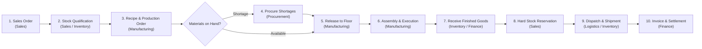
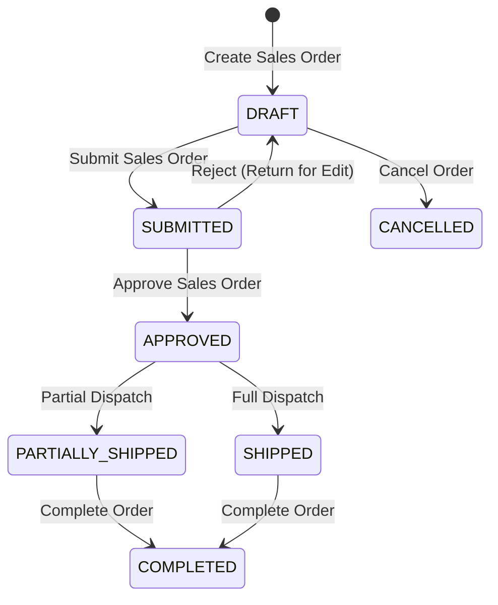
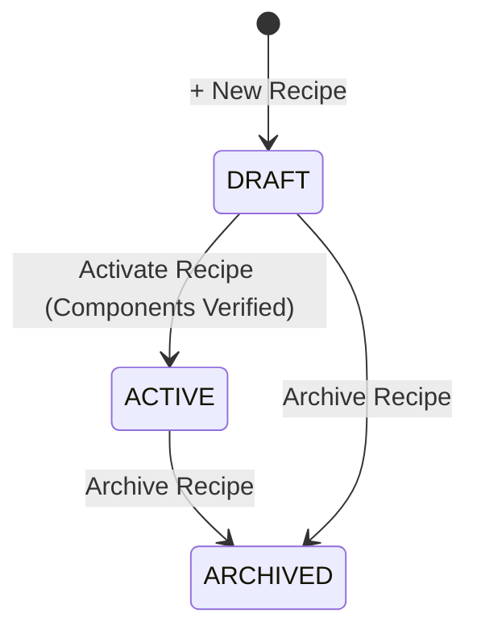
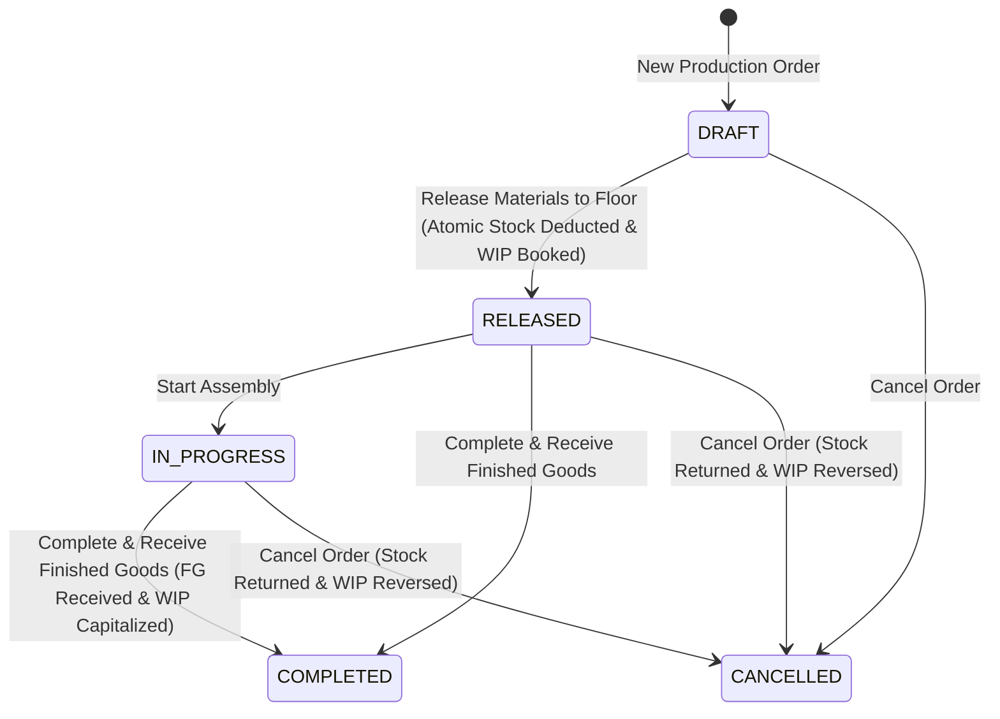

# Make to Order (M2O)

> From customer order commitment to finished product delivery — the production-driven fulfillment flow across Sales, Manufacturing, Inventory, Procurement, Logistics, and Finance.

The **Make to Order (M2O)** storyline governs operations where products are manufactured specifically to satisfy confirmed customer sales orders, rather than dispatched from pre-existing warehouse inventory. It powers custom engineering, assemble-to-order manufacturing, fabrication, and industrial processing (including catch-weight steel coils).

This storyline orchestrates six core modules into a synchronized, audit-guaranteed operational chain:
1. **Sales**: Captures customer demand, qualifies stock availability, identifies production requirements, and locks commercial commitments.
2. **Manufacturing**: Maintains engineering recipe blueprints (Bills of Materials), scales batch component requirements, executes atomic shop floor material dispatches, and tracks live Work-in-Progress (WIP).
3. **Inventory**: Manages raw material stores, tracks unreserved stock balances, generates deterministic lots and unit serial numbers, and safeguards finished goods.
4. **Procurement**: Sourcing rails automatically trigger replenishment purchase orders whenever ingredient shortfalls block production release.
5. **Logistics**: Directs carrier staging, weighbridge gross/tare/net weight verification, delivery challans, and customer dispatch.
6. **Finance**: Automatically posts double-entry accounting journals for WIP capitalization, Cost of Goods Sold (COGS), statutory tax invoicing, and receivables settlement.

Every state transition updates operational cockpits and financial ledgers automatically through system event propagation — eliminating double entry, preventing conflicting inventory claims, and ensuring that physical shop floor throughput always matches corporate financial statements.

---

## The Flow at a Glance

---

## Workspace Ergonomics in M2O

The TenArm BES workspace is purpose-built for fast-paced coordination between sales desks, industrial shop floors, and accounting teams:

- **Multi-Tab Desk**: Plant managers, sales leads, and controllers can keep up to 3 open workspace tabs concurrently (for example, keeping **Sales Orders** in Tab 1, the **Manufacturing Desk** in Tab 2, and **Stock Balances** in Tab 3). Switching between tabs preserves all table search filters, selected work order focus, scroll positions, and uncommitted form entries without page reloads.
- **Draft Auto-Save**: Uncommitted form inputs — such as custom recipe component lines (`mfg_bom_recipe`), new production order parameters (`mfg_new_work_order`), delivery tracking details, or manual payment receipts — are preserved continuously in local workspace drafts. Active tabs display a dirty dot indicator (`•`) until the record is saved or discarded.
- **Quick-Peek Slide-Out**: Clicking linked reference IDs (such as Sales Order #, Work Order #, Recipe Code, SKU, Customer Account, or Journal Entry #) opens a contextual slide-over drawer from the right edge of the screen, allowing operators to verify BOM specifications, customer credit limits, or lot histories without losing their active flow.
- **Optimistic Concurrency Control (OCC)**: Every commercial order, engineering recipe, and work order record is version-guarded (`v1`, `v2`, etc.). If another supervisor or engineer modifies a work order or recipe concurrently, the **Conflict Resolution Drawer** immediately displays side-by-side field diffs to prevent accidental overwrites.

---

## Step 1: Customer Order Commitment (Sales)

Every Make to Order flow originates when a customer commits to purchasing manufactured items or custom-configured goods.

### 1. Ingest or Create the Sales Order
1. Navigate to **Sales → Sales Orders** (`/sales/orders`).
2. Click **Create Sales Order** (or convert an approved quotation from `/sales/quotations`).
3. Select the **Customer** from the counterparty master.
4. Add line items for the manufactured products:
   - Select the output finished product SKU (e.g. `PROD-CHAIR` or custom fabricated items).
   - Enter ordered quantity and agreed unit selling price.
   - Configure required delivery dates.
5. Click **Save** — the order initializes in `DRAFT` status with a sequential identifier (e.g. `SO-2026-0104`).

### 2. Submit the Order for Commercial Governance
1. Review order pricing, line tax codes, and customer credit exposure.
2. Click **Submit Sales Order** — the order moves to `SUBMITTED`.

### 3. Order Approval & Segregation of Duties
1. A commercial manager or authorized sales lead reviews the order.
2. Click **Approve Sales Order** — the order moves to `APPROVED`.
3. To uphold strict Segregation of Duties (SoD), the user who submitted the order cannot authorize its approval.

---

## Step 2: Stock Qualification & Sourcing Rails (Sales & Inventory)

Once an order is approved, the system evaluates available warehouse inventory to determine whether lines can be fulfilled immediately or must trigger manufacturing.

### 1. Inspect Availability via Stock Qualification
1. On the **Sales Order Storyline** (`/sales/orders`), click **Validate & Qualify Stock**.
2. The **Stock Qualification Modal** evaluates on-hand balances across fulfilling warehouses:
   - **On Hand**: Physical inventory present in warehouse locations.
   - **Committed**: Inventory reserved for other confirmed customer orders.
   - **Available to Promise (ATP)**: Uncommitted balance eligible for allocation.

### 2. Identify Production Requirement & Backorders
In a pure Make to Order workflow, on-hand finished goods inventory is insufficient (or zero by design):
- The qualification engine flags line items as `BACKORDERED` or requires production scheduling.
- Click **Approve & Lock Stock** (or **Acknowledge Backorders**) to confirm demand.
- The order lines register a reservation status of `BACKORDERED`.

::: tip Ambient Intelligence: Splitting Partial Orders
If an order contains both in-stock standard catalog items and manufactured items, click **Split Partial Sales Order** (`SplitOrderModal`). The system splits the order into:
- **Parent Order**: Retains in-stock lines for immediate dispatch to the customer.
- **Child Order**: Carries the backordered manufactured lines, isolating production lead times without holding up accessible revenue.
:::

---

## Step 3: Authoring & Verifying the Recipe Blueprint (BOM) (Manufacturing)

Before launching a production run, ensure an active engineering recipe (Bill of Materials) is registered for the output product.

### 1. Open Bills of Materials
1. Navigate to **Manufacturing → Bills of Materials** (`/manufacturing/boms`).
2. Search for the output product to verify that an **Active** recipe exists.
3. If a new recipe or custom engineering formulation is needed, click **+ New Recipe**.

### 2. Configure Recipe Parameters
1. Enter the recipe specifications:
   - **BOM Code**: Sequential identifier (e.g. `BOM-0004`) or custom code.
   - **Recipe Name**: Clear engineering description (e.g. *Executive Swivel Chair Standard Assembly*).
   - **Output Finished Product**: Select the manufactured item from the inventory catalog.
   - **Output Batch Qty**: Standard batch yield produced by one execution (e.g. `1` unit or `100` pcs).
   - **Assembly Notes / Routing Instructions**: Tooling parameters, machine specifications, or shop floor instructions.
2. In the **Recipe Ingredients & Bill of Materials** grid, add required raw materials and subassemblies:
   - **Component**: Raw material or component SKU.
   - **Required Qty**: Baseline quantity consumed per batch yield.
   - **Unit Standard Cost**: Baseline purchasing cost per unit.
   - **Scrap % (Allowance)**: Planned machining fallout or cutting waste (e.g. `2.5%`).
3. Monitor the live cost rollup:
   $$\text{Unit Estimated Cost} = \frac{\sum (\text{Component Qty} \times \text{Standard Cost})}{\text{Output Batch Qty}}$$
4. Click **Create Recipe** — the recipe saves in `DRAFT` status.

### 3. Activate the Recipe
1. Locate the draft recipe in the table.
2. Click the green checkmark (**Activate Recipe**) on the row.
3. The recipe status transitions to `ACTIVE`. Only active recipes can back production orders on the shop floor.

---

## Step 4: Schedule the Production Order (Manufacturing)

With commercial demand confirmed and an active recipe verified, the plant scheduler launches the manufacturing run.

### 1. Launch the New Production Order Modal
1. Navigate to **Manufacturing → Manufacturing Desk** (`/manufacturing`) or **Work Orders** (`/manufacturing/orders`).
2. Click **+ New Production Order** (or click **New WO** directly from any active recipe in Bills of Materials).

### 2. Enter Production Parameters
1. **Recipe (Active BOM)**: Select the verified blueprint. The modal immediately renders the **Live Recipe Blueprint & Component Preview**, showing standard yield, estimated unit cost, and scaled ingredients.
2. **Production Quantity**: Enter the target batch size to fulfill the sales order demand (e.g. `50` units).
3. **Target Warehouse / Plant**: Select the fulfilling manufacturing facility or assembly warehouse.
4. **Planned Execution Date**: Select the target production date (past dates are permitted for retroactive operational logging).
5. **Shop Floor Routing Instructions**: Reference customer PO numbers or specific assembly tolerances.
6. Click **Create Production Order** — the system generates the work order in `DRAFT` status (e.g. `MO-2026-0042`) and loads it onto the Manufacturing Desk.

---

## Step 5: Check Material Availability & Procure Shortages (Inventory & Procurement)

The work order snapshot automatically calculates total component requirements proportional to the scheduled batch size:

$$\text{Scale Factor} = \frac{\text{Work Order Qty}}{\text{BOM Standard Output Qty}}$$
$$\text{Required Qty} = \text{BOM Component Qty} \times \text{Scale Factor} \times \left(1 + \frac{\text{Scrap Pct}}{100}\right)$$

### 1. Evaluate Ingredient Balances
Select the order on the **Manufacturing Desk** and inspect **Stage 2: Material Picklist & WIP Consumption**:

| Scenario | Operational Condition | Action Required |
|---|---|---|
| **Full Stock On Hand** | All required ingredients have sufficient unreserved inventory in the plant warehouse. | Proceed immediately to **Step 6: Release Materials to Floor**. |
| **Material Shortage** | One or more ingredients lack sufficient unreserved on-hand balances. | Sourcing rails trigger shortage replenishment via **Procurement** or warehouse transfer. |

### 2. Sourcing Shortages via Procurement (When Short)
If raw materials are deficient:
1. Navigate to **Procurement → Purchase Orders** (`/procurement/orders`).
2. Click **+ New Purchase Order** / **Create Purchase Order**.
3. Select the qualified raw materials **Supplier**.
4. Add line items for the short components, required replenishment quantities, agreed unit rates, and tax codes.
5. Click **Submit Purchase Order**, followed by **Approve Purchase Order**.
6. When the supplier delivers goods to the plant:
   - Click **Receive Purchase Order**.
   - Confirm received quantities against the delivery challan.
   - Raw material stock balances immediately increase in the plant warehouse.
7. Return to the **Manufacturing Desk** to continue the work order.

---

## Step 6: Release Materials to the Floor & Capitalize WIP (Manufacturing & Finance)

Releasing a work order executes an immediate, atomic inventory consumption and financial accounting transaction.

### 1. Release the Work Order
1. Select the draft work order on the **Manufacturing Desk** (`/manufacturing`).
2. In **Stage 3: Shop Floor Execution**, click **Release Materials to Floor** (or click **Release** on `/manufacturing/orders`).
3. The system executes atomic validations:
   - Verifies that the linked BOM recipe remains `ACTIVE`.
   - Confirms that every component is physically on hand in the fulfilling warehouse.
   - If any component is short, the release aborts cleanly with zero balance drift.

### 2. What Happens Automatically Upon Release
- **Component Freeze**: Recipe component quantities and standard costs are permanently frozen into the work order snapshot. Subsequent BOM blueprint updates will not alter this active run.
- **Atomic Stock Deduction**: Required raw materials are deducted from warehouse inventory balances (`stock.balances`).
- **WIP Ledger Capitalization**: The system auto-posts a double-entry general ledger journal:
  - **Debit**: Work-in-Progress (WIP) Asset Account
  - **Credit**: Raw Materials Inventory Asset Account
- **Status Advance**: The work order status transitions from `DRAFT` to `RELEASED`.

---

## Step 7: Shop Floor Assembly & Execution (Manufacturing)

With materials issued to the shop floor, physical assembly, machining, fabrication, or mixing commences.

### 1. Start Assembly
1. On the **Manufacturing Desk**, locate the work order under the `RELEASED` filter.
2. In **Stage 3**, click **Start Assembly** (or click **Start** in the tabular orders view).
3. The order advances from `RELEASED` to `IN_PROGRESS`.

### 2. Real-Time Telemetry Tracking
Plant supervisors monitor progress via the **Executive Pulse HUD**:
- **Floor WIP**: Count of active production runs currently undergoing assembly.
- **Active WIP Capital**: Cumulative dollar valuation of raw materials committed to the floor.
- **Manufacturing Dashboard** (`/manufacturing/dashboard`): Monthly trends comparing scheduled work orders against completed throughput.

---

## Step 8: Complete Run, Yield Recording & Finished Goods Receipt (Manufacturing, Inventory & Finance)

When physical production concludes, the plant superintendent records actual output, receipts finished goods into stock, and capitalizes WIP.

### 1. Launch the Completion Dialog
1. Select the active work order (`RELEASED` or `IN_PROGRESS`) on the **Manufacturing Desk**.
2. In **Stage 3**, click **Complete & Receive Finished Goods**.

### 2. Record Actual Yield & Scrutinize Variances
1. In the **Complete & Receive Work Order** dialog:
   - **Target Planned Batch Size**: Displays the original scheduled quantity (e.g. `50` units).
   - **Actual Good Quantity Produced**: Enter the net count of quality-approved units produced (e.g. `49` units if 1 unit was lost to machining defect).
   - Review the financial summary card displaying:
     - **Total WIP Capital to Capitalize**: Cumulative material cost released to this order.
     - **Resulting Unit Cost**: Finalized unit cost computed as:
       $$\text{Finalized Unit Cost} = \frac{\text{Total WIP Cost}}{\text{Actual Completed Qty}}$$
     - **Yield Variance**: Net difference between planned batch size and actual yield (e.g. `-1` unit).
2. Click **Complete Run & Receive Goods**.

### 3. What Happens Automatically Upon Completion
- **Batch / Lot Assignment**: An inventory lot is automatically generated with the lot number matching the Work Order number (`wo_number`).
- **Serial Number Generation**: If the output product is configured as serialized, the system automatically assigns sequential unit serial numbers (`{wo_number}-0001`, `{wo_number}-0002`, etc.).
- **Inventory Receipt**: The finished goods are received into the target warehouse stock ledger (`/inventory/movements`).
- **WIP Capitalization GL Posting**: The general ledger automatically books:
  - **Debit**: Finished Goods Inventory Asset Account
  - **Credit**: Work-in-Progress (WIP) Asset Account
- **Status Advance**: The work order transitions permanently to `COMPLETED`.

---

## Step 9: Hard Stock Reservation on the Sales Order (Sales & Inventory)

With finished goods physically on hand in warehouse inventory, return to the commercial sales order to lock the stock.

### 1. Reserve Manufactured Goods
1. Navigate to **Sales → Sales Orders** (`/sales/orders`) and select the customer order.
2. In the **Order Storyline**, click **Validate & Qualify Stock** (or **Reserve Sales Order Stock**).
3. The qualification engine verifies that freshly produced finished goods are available to promise.
4. Click **Approve & Lock Stock**:
   - The line reservation status transitions from `BACKORDERED` to `RESERVED`.
   - The specific inventory lot and serialized units are locked to this customer order, preventing any competing sales order from claiming them.

---

## Step 10: Dispatch, Weighbridge & Customer Delivery (Logistics & Inventory)

With commercial reservations locked, warehouse and logistics operators coordinate physical fulfillment and customer delivery.

### 1. Create Shipment & Delivery Challan
1. From the Sales Order Storyline, click **Dispatch & Issue Delivery Note** (or open **Logistics → Logistics Desk** at `/logistics`).
2. Configure shipping parameters:
   - **Carrier & Vehicle**: Assign logistics transporter and commercial vehicle registration number.
   - **Driver & E-Way Bill**: Record driver contact and statutory transport e-way bill details.
   - **Line Items**: Verify dispatch quantities and allocated batch/serial numbers.

### 2. Capture Weighbridge Metrics (For Bulk & Catch-Weight Cargo)
For heavy industrial goods, structural steel, or bulk commodities:
1. Record **Gross Weight** when the loaded vehicle passes the weighbridge.
2. Record **Tare Weight** of the empty truck.
3. The system strictly enforces the statutory net balance:
   $$\text{Net Weight} = \text{Gross Weight} - \text{Tare Weight}$$

### 3. Dispatch & Automatic COGS Recognition
1. Click **Dispatch Shipment** (or **Ship Sales Order**).
2. The shipment advances to `DISPATCHED`.
3. **Inventory Balance Impact**: Finished goods stock is immediately decremented from the warehouse.
4. **Automatic COGS Journal**: The system automatically posts the Cost of Goods Sold journal:
   - **Debit**: Cost of Goods Sold (COGS) Expense Account
   - **Credit**: Finished Goods Inventory Asset Account
5. The Sales Order status updates to `SHIPPED` (or `PARTIALLY_SHIPPED`).

---

## Step 11: Invoicing, Customer Payment & Order Closure (Finance & Sales)

The final stage converts physical fulfillment into recognized corporate revenue and settled cash.

### 1. Issue Customer Tax Invoice
1. Navigate to **Finance → Customer Invoices** (`/finance/invoices`) or click **Invoice Dispatch** directly from the Sales Order Storyline.
2. The invoice lines automatically populate from the dispatched shipment lines.
3. Click **Post Invoice to GL**:
   - The invoice transitions from `DRAFT` to `POSTED`.
   - The system automatically posts the double-entry revenue journal:
     - **Debit**: Accounts Receivable (Customer Account)
     - **Credit**: Sales Revenue Account
     - **Credit**: Output Tax / GST Liability Accounts

### 2. Record Customer Payment Receipt
1. When customer payment arrives via bank transfer, check, or cash:
2. Open **Finance → Payments** (`/finance/payments`) or click **Record Customer Payment** from the invoice.
3. Enter payment parameters: payment date, bank ledger account, reference transaction number, and allocated receipt amount.
4. Click **Record Payment**:
   - The invoice status transitions to `PAID`.
   - The system posts the cash settlement journal:
     - **Debit**: Bank / Cash Asset Account
     - **Credit**: Accounts Receivable (Customer Account)

### 3. Complete the Sales Order & Inspect Document Lineage
1. Return to **Sales → Sales Orders** (`/sales/orders`) and select the order.
2. Click **Complete Order** — the order transitions to its terminal `COMPLETED` state.
3. Review the **Document Lifecycle Panel** at the foot of the storyline:
   - Provides full 360° traceability across every linked artifact generated throughout the lifecycle:
     $$\text{Quotation (QT)} \longrightarrow \text{Sales Order (SO)} \longrightarrow \text{Work Order (WO)} \longrightarrow \text{PO (Shortages)} \longrightarrow \text{Lot / Serials} \longrightarrow \text{Delivery Note (DN)} \longrightarrow \text{Invoice (INV)} \longrightarrow \text{Payment (PAY)} \longrightarrow \text{GL Journals (JE)}$$
   - Every user timestamp, OCC version bump, and financial transaction ID is immutably documented.

---

## Industry Pack Highlight: Steel & Catch-Weight in M2O

When the **Steel Industry Pack** (`steel`) is enabled, the Make to Order storyline incorporates metallurgical lot attributes and catch-weight allocation logic:

- **Coil Register (`/steel/coils`)**: Raw steel coils are received as metallurgical lots tracked by heat number, certified grade (e.g. `IS2062`, `SS304`), gauge thickness (mm), width (mm), and verified catch-weight tonnage.
- **Steel Desk Allocation Simulator (`/steel/desk`)**: When a custom sales order demands exact tonnage, the simulation engine calculates optimal coil combinations within configured tolerance bounds ($\pm \%$) and enforces single-heat integrity constraints before releasing materials to fabrication work orders.

---

## Automated Cross-Module Coordination

Throughout the Make to Order storyline, system event propagation automates cross-module coordination without manual data re-entry:

| When this happens... | The system automatically... | Involved Modules |
|---|---|---|
| **Sales Order Approved** | Evaluates ATP stock, identifies manufactured requirements, and marks lines as `BACKORDERED`. | Sales & Inventory |
| **Work Order Created** | Scales component ingredient requirements proportional to target batch size and scrap allowances. | Manufacturing |
| **Work Order Released** | Atomically decrements raw material inventory and posts WIP journal (`Dr WIP / Cr Raw Materials`). | Manufacturing, Inventory & Finance |
| **Work Order Started** | Advances floor state to `IN_PROGRESS` and updates executive WIP metrics. | Manufacturing |
| **Work Order Completed** | Receives finished goods into stock, generates lot and unit serial numbers, and capitalizes WIP (`Dr Finished Goods / Cr WIP`). | Manufacturing, Inventory & Finance |
| **Stock Locked on Order** | Converts ATP balances into immutable sales reservations (`RESERVED`), shielding goods from competing quotes. | Sales & Inventory |
| **Shipment Dispatched** | Decrements finished goods inventory and auto-posts COGS journal (`Dr COGS / Cr Finished Goods`). | Logistics, Inventory & Finance |
| **Customer Invoice Posted** | Recognizes sales revenue and posts accounts receivable (`Dr AR / Cr Revenue / Cr Tax`). | Finance |
| **Payment Recorded** | Settle customer receivables and updates cash balance (`Dr Bank / Cr AR`). | Finance |
| **Order Completed** | Closes reservation records and permanently archives end-to-end document lineage. | Sales & Core |

---

## User Roles & Operational Responsibilities

In enterprise manufacturing operations, responsibilities are cleanly demarcated across operational roles:

| Role | Operational Scope | Key Screens & Primary Actions |
|---|---|---|
| **Sales Representative** | Customer requirements intake, quotation authoring, and sales order creation | `/sales/orders`, `/sales/desk`, `/sales/quotations` (`Create Sales Order`, `Submit Sales Order`, `Lock & Create Quote`) |
| **Sales Manager** | Commercial governance, margin review, and order authorization | `/sales/orders` (`Approve Sales Order`, `Validate & Qualify Stock`, `Split Partial Sales Order`, `Reject Sales Order`) |
| **Production Planner / Industrial Engineer** | Recipe definition, BOM costing, scrap allowances, and work order scheduling | `/manufacturing/boms`, `/manufacturing/orders` (`+ New Recipe`, `Create Recipe`, `Activate Recipe`, `+ New Production Order`) |
| **Shop Floor Superintendent** | Floor material dispatches, assembly tracking, yield recording, and scrap audits | `/manufacturing`, `/manufacturing/orders` (`Release Materials to Floor`, `Start Assembly`, `Complete & Receive Finished Goods`, `Cancel Order`) |
| **Procurement Specialist** | Raw material replenishment and shortage purchase orders | `/procurement/orders`, `/procurement/desk` (`Create Purchase Order`, `Approve Purchase Order`, `Receive Purchase Order`) |
| **Warehouse & Logistics Lead** | Finished goods staging, serial verification, weighbridge capture, and customer dispatch | `/logistics`, `/logistics/shipments`, `/inventory/balances` (`Dispatch Shipment`, `Create Shipment`, `Transfer Stock`) |
| **Billing & Financial Accountant** | Invoicing, statutory tax compliance, payment collections, and WIP ledger reconciliation | `/finance/invoices`, `/finance/payments`, `/finance/journal` (`Create Customer Invoice`, `Post Invoice to GL`, `Record Customer Payment`) |

---

## If Something Goes Wrong (Common Validation & Guard Errors)

The table below translates system validation guards, error toasts, and alert banners into plain business causes and step-by-step resolution actions:

| What you see on screen (Toast / Banner) | Business cause | How to fix it in the workspace |
|---|---|---|
| `"Cannot release work order MO-XXXX: BOM BOM-YYYY is 'DRAFT' (must be ACTIVE)"` | The engineering recipe selected for the work order is still in draft state and has not been formally approved. | Navigate to **Manufacturing → Bills of Materials** (`/manufacturing/boms`), locate recipe `BOM-YYYY`, and click the green checkmark (**Activate Recipe**). Then return to the Manufacturing Desk and re-click **Release Materials to Floor**. |
| `"Cannot release MO-XXXX: stock issue failed (Insufficient stock available)"` | One or more required raw materials do not have enough unreserved on-hand inventory in the plant warehouse. | Inspect Stage 2 (**Material Picklist**) on the Manufacturing Desk to identify deficient components. Go to **Procurement → Purchase Orders** to expedite purchase receipts, or execute a warehouse transfer from another facility via `/inventory/adjustments`. |
| `"The person who submitted the order may not approve it"` | Strict Segregation of Duties (SoD) governance prevents order authors from approving their own commercial sales orders. | Forward the sales order reference to an authorized sales manager or commercial controller holding approval permissions to review and click **Approve Sales Order**. |
| `"Cannot modify an ARCHIVED bill of materials"` | Attempted to edit or activate a recipe that has been formally retired. | Archived recipes are immutable historical records. Click **+ New Recipe** to author a new recipe revision with updated ingredients and a new code. |
| `"Cannot activate a BOM with no components"` | The recipe has zero ingredient lines defined. | Edit the recipe and add at least one component product with required quantity and standard cost before clicking **Activate Recipe**. |
| `"Output product cannot be used as an input component"` | The recipe attempts to consume the exact finished item it produces, creating an illegal circular bill of materials. | Edit the recipe in **Bills of Materials** and remove the circular component. Ensure only raw materials, packaging, or intermediate subassemblies are listed as ingredients. |
| `"Duplicate component product selected in recipe. Each component must be unique."` | The same raw material product was added across multiple rows in the recipe ingredients table. | Consolidate the rows into a single component line item with the combined required quantity and scrap allowance. |
| `"Production quantity must be greater than zero"` | Target batch size was entered as `0` or a negative value during production order creation. | Enter a valid positive number in the **Production Quantity** field (e.g. `50`). |
| `"Completed quantity must be greater than zero"` | Attempted to complete a work order with `0` or negative finished goods yield. | Enter the actual positive count of good units produced in the completion dialog. If the entire batch was scrapped with zero usable output, click **Cancel Order** instead (which automatically returns any unconsumed stock to inventory). |
| `"Weighbridge net weight must equal gross minus tare"` | In Logistics dispatch, entered weighbridge readings fail mathematical validation: $\text{Net} = \text{Gross} - \text{Tare}$. | Verify the physical weighbridge scale ticket and adjust **Gross Weight** or **Tare Weight** so their difference exactly matches recorded **Net Weight**. |
| `"Cannot void invoice with recorded payments"` | The customer invoice has registered cash collections or advance deposits allocated to it. | Navigate to **Finance → Payments**, unallocate or refund the linked payment receipt, and then return to the invoice to click **Void Invoice**. |
| `"Document was modified by another user (OCC Conflict)"` | Another user saved modifications to the work order, sales order, or recipe while your screen was open. | The **Conflict Resolution Drawer** appears automatically. Review side-by-side field diffs, choose whether to preserve your local changes or adopt the server version, and re-submit. |

---

## Related Documentation

- **[Manufacturing Module Guide](../modules/manufacturing.md)** — In-depth guide to Bills of Materials, scrap scaling, and shop floor command desk operations.
- **[Sales Module Guide](../modules/sales.md)** — Commercial quotation negotiation, margin protection, sales order governance, and order splitting.
- **[Inventory Module Guide](../modules/inventory.md)** — Multi-warehouse stock balances, lot/serial traceability, and ATP calculations.
- **[Procurement Module Guide](../modules/procurement.md)** — Purchase orders, shortage replenishment, supplier management, and goods receipt notes.
- **[Logistics Module Guide](../modules/logistics.md)** — Shipment scheduling, carrier management, weighbridge catch-weight metrics, and delivery tracking.
- **[Finance Module Guide](../modules/finance.md)** — General ledger posting, WIP accounting, customer invoicing, and cash collections.
- **[Steel Industry Pack Guide](../modules/steel.md)** — Metallurgical tracking, catch-weight coil allocation, and heat number management.
- **[Order to Cash (O2C) Storyline](./order-to-cash.md)** — Standard commercial revenue flow fulfilled from existing warehouse inventory.
- **[Procure to Pay (P2P) Storyline](./procure-to-pay.md)** — Upstream purchasing lifecycle for inventory replenishment and vendor settlement.
