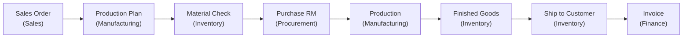

# Make to Order (M2O)

> From customer order to finished product — the production-driven fulfillment flow across Sales, Manufacturing, Inventory, and Finance.

The Make to Order storyline covers scenarios where products are manufactured after a customer order is received, rather than fulfilled from existing stock.

## The Flow at a Glance

---

## Step 1: Receive the Sales Order (Sales)

1. Create a **Sales Order** for the customer
2. The ordered product is a manufactured item (has a BOM)
3. Submit and approve the order
4. Stock check reveals insufficient finished goods

---

## Step 2: Create a Production Order (Manufacturing)

1. Navigate to **Manufacturing → Manufacturing Desk**
2. Click **New Work Order** linked to the sales order
3. Select the **Bill of Materials** for the ordered product
4. Set the production quantity to match the order

---

## Step 3: Check Material Availability (Inventory)

The system calculates material requirements from the BOM:

| If... | Then... |
|-------|---------|
| All raw materials in stock | Proceed to production |
| Some materials short | Create purchase orders for shortages |

---

## Step 4: Procure Raw Materials (Procurement)

If materials are short:
1. Create **Purchase Orders** for the required raw materials
2. Receive goods into the raw materials warehouse
3. Materials are now available for production

---

## Step 5: Produce (Manufacturing)

1. **Plan** the work order — allocate materials and work centres
2. **Start Production** — raw materials are consumed from inventory
3. Track production progress through work centre operations
4. **Complete Production** — finished goods are received into inventory

### What Happens Automatically
- Raw material stock decreases (consumed)
- Finished goods stock increases (produced)
- WIP costs tracked (material + labour + overhead)

---

## Step 6: Ship to Customer (Inventory)

1. Pick and pack the finished goods
2. **Ship** from the finished goods warehouse
3. Sales Order moves to `SHIPPED`

### What Happens Automatically
- COGS journal auto-posted (Dr COGS / Cr Inventory)
- Stock balances decrease

---

## Step 7: Invoice & Collect (Finance)

1. Create an **Invoice** linked to the sales order
2. **Issue** the invoice
3. Collect **Payment** when the customer pays

---

## Cross-Module Event Flow

| Step | Event | Reacting Module | What Happens |
|------|-------|-----------------|-------------|
| Order approved | `OrderApproved` | — | Triggers production planning |
| Production started | `ProductionStarted` | Inventory | Raw materials consumed |
| Production completed | `ProductionCompleted` | Inventory | Finished goods received |
| Stock shipped | `StockShipped` | Finance | COGS posted |
| Invoice issued | `InvoiceIssued` | — | AR updated |

---

## Required Permissions

| Module | Key Permissions |
|--------|----------------|
| **Sales** | `order.create`, `order.approve` |
| **Manufacturing** | `workorder.create`, `workorder.plan`, `workorder.start`, `workorder.complete` |
| **Procurement** | `po.create`, `po.approve` (if materials need purchasing) |
| **Inventory** | `stock.receive`, `stock.ship` |
| **Finance** | `finance.invoice.create`, `finance.payment.create` |

---

## Related Guides

- **[Sales Module](../modules/sales)** — Order management
- **[Manufacturing Module](../modules/manufacturing)** — BOMs and work orders
- **[Inventory Module](../modules/inventory)** — Stock operations
- **[Order to Cash (O2C)](./order-to-cash)** — Standard fulfillment flow
- **[Procure to Pay (P2P)](./procure-to-pay)** — Purchasing flow
