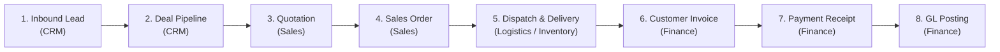
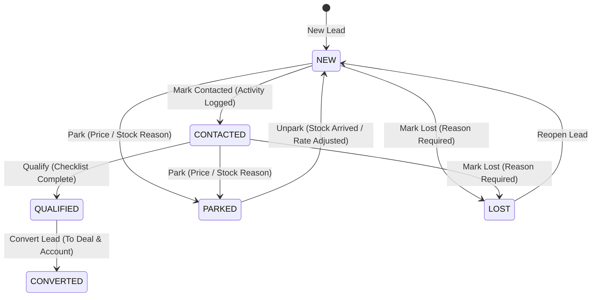
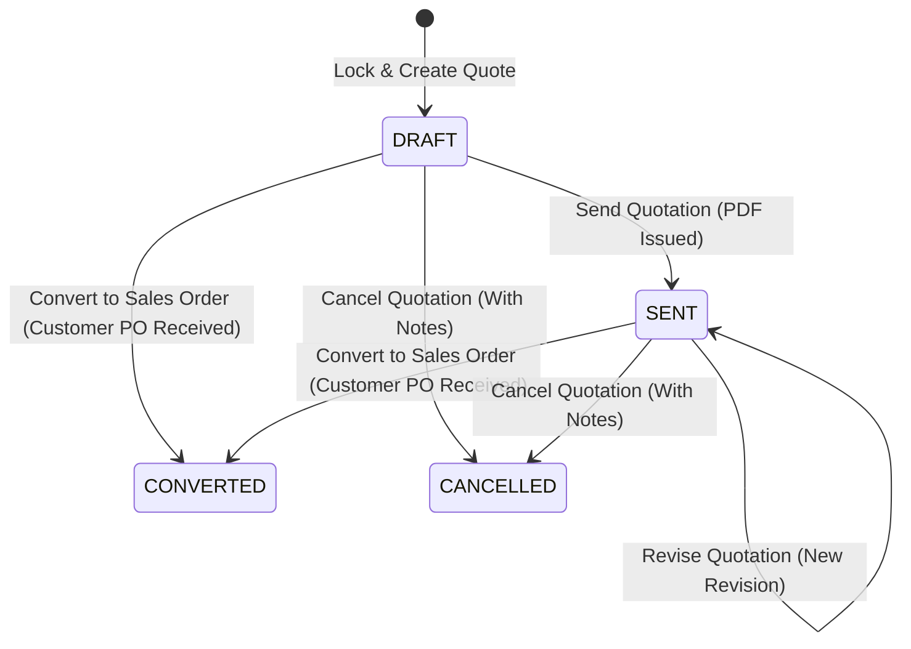
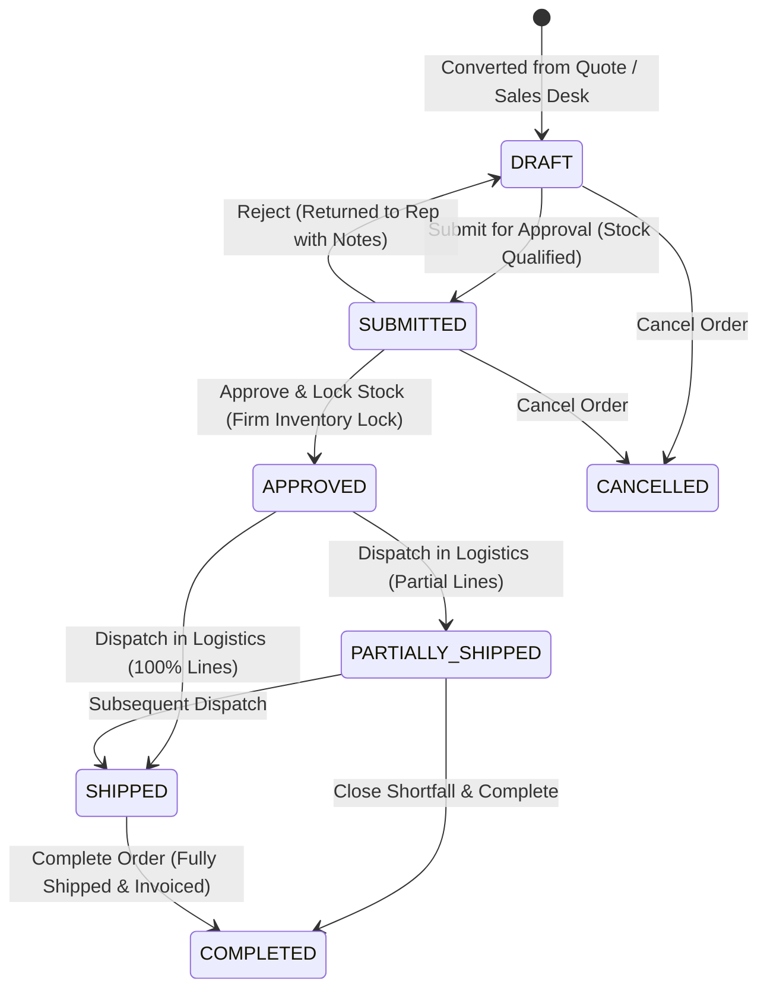
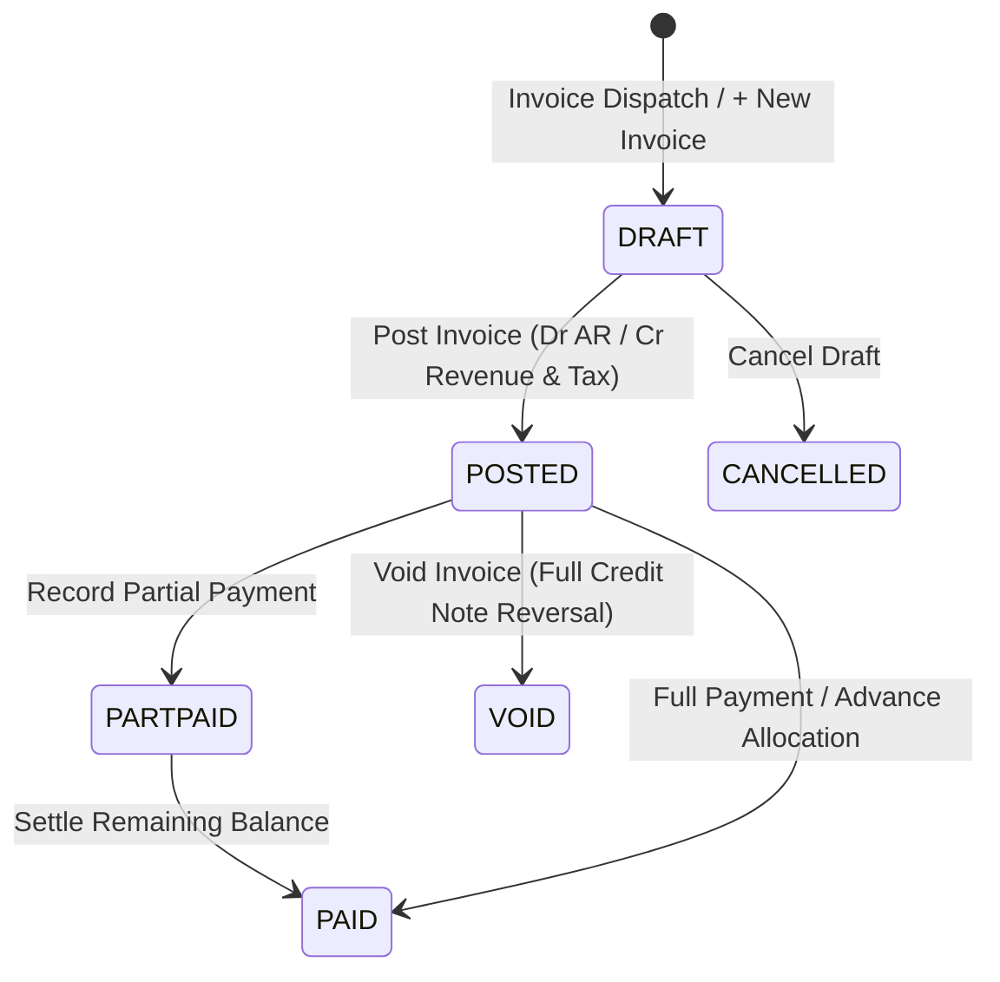

# Order to Cash (O2C)

> From prospective buyer outreach to cash settlement and general ledger posting — the end-to-end revenue lifecycle across CRM, Sales, Logistics, Inventory, and Finance.

The **Order to Cash (O2C)** storyline is the core revenue and fulfillment engine of TenArm BES. It connects five foundational modules into a continuous, audit-backed operational pipeline:
1. **CRM**: Ingests prospect inquiries, tracks sales touchpoints, enforces qualification standards, and converts viable opportunities into commercial accounts and deals.
2. **Sales**: Prices deals dynamically with real-time margin visibility, monitors competing quote demand, locks firm stock commitments, and governs customer credit limits.
3. **Logistics & Inventory**: Reserves warehouse inventory, coordinates carrier staging and weighbridge catch-weight metrics, generates statutory delivery notes, and executes customer dispatches.
4. **Finance**: Automatically posts Cost of Goods Sold (COGS), issues customer tax invoices, reports GST e-invoices, settles receivables through cash and bank receipts, and reconciles the General Ledger (GL).

Every transaction in this lifecycle updates operational dashboards and financial ledgers automatically through system event propagation — eliminating redundant data entry, preventing conflicting inventory claims, and guaranteeing that physical dispatches always match accounting statements.

---

## The Flow at a Glance



---

## Workspace Ergonomics in O2C

The TenArm BES workspace is tailored for rapid commercial turnaround, multi-party coordination, and zero lost transaction context:

- **Multi-Tab Desk**: The workspace maintains up to 3 open tabs simultaneously (e.g. keeping **Sales Desk** in Tab 1, an active **Sales Order Storyline** in Tab 2, and the **Customer 360** credit drawer in Tab 3). Switching between tabs preserves all table search filters, scroll positions, and uncommitted line entries without triggering full page reloads.
- **Draft Auto-Save**: Uncommitted form inputs — such as lead intakes, price configurations on the Sales Desk, dispatch vehicle numbers, and manual receipt details — are preserved continuously in local workspace drafts. Active tabs display a dirty dot indicator (`•`) until the record is saved or discarded.
- **Quick-Peek Slide-Out**: Clicking linked reference IDs (such as Customer Name, Sales Order #, Delivery Challan #, or Journal Entry #) opens a slide-over inspection drawer from the right edge of the screen, allowing users to verify credit positions or stock levels without navigating away from their active workflow.
- **Optimistic Concurrency Control (OCC)**: Every commercial and financial record is version-guarded (`v1`, `v2`, etc.). If another team member modifies an order or quotation while you are reviewing it, the **Conflict Resolution Drawer** immediately displays side-by-side field changes to prevent accidental overwrites.

---

## Step 1: Inbound Lead Intake & Qualification (CRM)

Every deal originates with an inbound inquiry, marketing lead, or outbound prospecting contact.

### 1. Ingest the Lead
1. Navigate to **CRM → Leads** (`/crm/leads`).
2. Toggle between **Command Desk** (split view with a live queue and Lead 360 inspector) and **Table** view.
3. Click **New Lead** to open the intake modal.
4. Enter prospective buyer details:
   - **Lead Title** (required): Brief opportunity summary (e.g. `Bulk Structural Steel Inbound`).
   - **Company / Contact**: Prospective business name, contact person, email, and phone.
   - **Source**: Channel origin (e.g. `Website`, `Referral`, `Trade Show`).
   - **Estimated Value**: Anticipated deal magnitude.
   - **Assigned Owner**: Defaults to the creating user, or select another sales representative.
5. Click **Create Lead** — the lead initializes in `NEW` status with a sequential reference (e.g. `LD-2024-0001`).

### 2. Log Outreach & Move to Contacted
To maintain audit integrity, leads cannot advance to qualified status without documented interactions:
1. Select the lead in the queue to open the **Lead 360 Inspector**.
2. Click **Log Activity** to record an interaction (e.g. `Phone Call`, `Site Meeting`, `Email`).
3. Click **Mark Contacted** (or **Contact →** in table view) — the lead advances from `NEW` to `CONTACTED`.

### 3. Systematic Qualification Standards
To prevent unvetted prospects from polluting commercial forecasting, leads must pass organizational qualification checks:
1. In the Lead 360 drawer, review the **Qualification Checklist** (configured in **CRM → Settings**).
2. Check off mandatory criteria (e.g. *Budget Verified*, *Decision Maker Engaged*, *Delivery Logistics Feasible*, *Product Grade Available*).
3. Click **Qualify** — the lead transitions to `QUALIFIED`.



::: tip Ambient Intelligence: Parked Backlog & Callbacks
If a qualified lead cannot buy immediately due to inventory shortfalls or price expectations, do not discard it as lost. Click **Park** and select a reason:
- **Stock Unavailable (`STOCK_UNAVAILABLE`)**: The customer wants a specific grade or dimension currently out of stock.
- **Price Not Matching (`PRICE_NOT_MATCHING`)**: The prospect requested a rate below current catalog prices.

When replenishment arrives in Inventory or benchmark pricing drops, the system automatically surfaces the prospect on the **Ready to Call Back** board (`LeadCallbacksCard`), prompting reps to re-engage with zero manual monitoring.
:::

---

## Step 2: Convert to Account, Contact & Pipeline Deal (CRM)

Once a lead is qualified, convert it into formal commercial records:

1. In the Lead Inspector or table row, click **Convert →** to open the **Convert Lead · &lt;Lead Number&gt;** dialog.
2. Choose account assignment:
   - **Create New Customer Account**: Generates a new commercial account using the lead's company name.
   - **Attach to Existing Account**: Select an existing customer if the lead represents a new branch or project for a known client.
3. Configure deal parameters:
   - **Contact Name**: Auto-split into First and Last names for the primary contact.
   - **Deal Name**: Auto-populated from the lead title.
   - **Target Close Date**: Expected order commitment date.
4. Click **Convert to Pipeline Deal →**:
   - The lead status permanently transitions to `CONVERTED`.
   - The system creates a **Customer Account** in CRM and master counterparties.
   - The system creates a **Contact** associated with the account.
   - The system creates an active **Opportunity (Deal)** in the `PROPOSAL` stage of your sales pipeline.
   - Any interested product items and estimated quantities recorded on the lead copy directly to the opportunity line items.

### Managing the Pipeline
Navigate to **CRM → Pipeline** (`/crm/pipeline`) to view deals on the interactive Kanban board across stages (`Discovery` → `Proposal` → `Negotiation` → `Closed`). Clicking any card opens the **Deal 360** drawer:
- **Build Quotation**: Generates a formal sales quotation carrying over opportunity products and customer details.
- **Advance Stage**: Progresses the deal as commercial terms solidify.
- **Mark Lost / Win Deal**: Records deal outcome with standardized business loss reasons.

---

## Step 3: Negotiate, Price & Issue Quotation (Sales)

Formal pricing and quotation management occurs in the **Sales** module. Quotations can be initiated from the CRM Opportunity (**Build Quotation**) or directly through the high-speed **Sales Desk**.

### 1. High-Speed Pricing on the Sales Desk
1. Navigate to **Sales → Sales Desk** (`/sales/desk`).
2. Search and select the **Customer**. The desk immediately displays the customer's historical price memory, payment terms, and live credit limit.
3. Search products from the catalog and add them to the deal cart.
4. Enter quantities, negotiated rates, and fulfilling warehouses:
   - **Live Margin Monitor**: As unit rates are entered, the desk calculates gross margin percentage against the moving average cost (`avg_cost`) from Inventory in real time.
   - **Live Demand Radar**: If other sales reps are currently quoting the same SKUs, an ambient warning appears:
     ```
     Live Quoted Demand Radar: 3 active competing quotations across these SKUs (1,200 units). Close promptly to protect inventory!
     ```
   - **Pricing Style Compliance**: Operates in accordance with your organization's sales settings (`RATE_PER_DEAL` clean rates or `LIST_PRICE_WITH_DISCOUNT` standard discounts).
5. Click **Lock & Create Quote** — generates a numbered quotation (e.g. `QT-2024-0001`) in `DRAFT` status.

### 2. Quotation Lifecycle & Customer PO Conversion
Navigate to **Sales → Quotations** (`/sales/quotations`) or view the record in **Quotation Storyline**:



1. **Review & Issue**: Click **PDF** to download a printable quotation, or click **Send Quotation** (`SendQuotationModal`) to record that the proposal was delivered to the client. The status moves to `SENT`.
2. **Convert to Sales Order**: When the customer accepts and issues their purchase order, click **Convert to Sales Order** (`ConvertQuotationModal`):
   - **Customer PO Number** (required): Enter the client's official purchase order reference.
   - **Customer PO Date** (optional): Date specified on the customer's PO.
   - **PO Document Attachment** (optional): Upload a PDF/scan of the customer's PO document (attached directly to the resulting Sales Order).
   - **Delivery Policy**: Choose `Partial allowed` (`PARTIAL_ALLOWED`) or `Ship complete` (`SHIP_COMPLETE`).
3. Click **Convert Quotation**:
   - The quotation status changes to `CONVERTED`.
   - A binding **Sales Order** (e.g. `SO-2024-0001`) is generated automatically.
   - Available-to-Promise (ATP) stock is automatically pre-reserved.
   - The upstream CRM Opportunity is automatically marked as **WON**!

---

## Step 4: Sales Order Commitment & Stock Reservation (Sales)

Navigate to **Sales → Sales Orders** (`/sales/orders`) and select the order to open the **Order Storyline** command desk.



### 1. Stock Qualification & Submission
1. In `DRAFT` status, click **Validate & Qualify Stock** to verify warehouse availability across selected fulfillment locations.
2. If inventory is available, the order is marked `Stock Qualified & Held` (temporary soft hold).
3. Click **Submit for Approval**:
   - **Automated Credit Evaluation**: The system verifies that the customer's total exposure (unpaid invoices + current order) does not exceed their approved commercial credit limit.
   - **Approval Routing**: Orders below tenant threshold values without credit breaches are auto-approved. Orders exceeding thresholds route to authorized approvers.

### 2. Segregation of Duties Approval
To guarantee financial governance, **the user who created/submitted the order cannot approve it**. An independent sales manager or commercial controller reviews the order and takes action:
- **Approve & Lock Stock**: Authorizes the order. The system immediately converts soft holds into **firm, hard-allocated warehouse reservations** (`RESERVED`). Firm reserved inventory cannot be allocated or shipped to any other customer.
- **Reject**: Enters rejection notes and returns the order to `DRAFT` status for line or rate amendments.

### 3. Handling Shortfalls & Backorders
If stock is insufficient to fulfill every line item:
- Line items with stock deficits automatically flag as `BACKORDERED`.
- If the order has `Partial allowed` delivery policy, click **Split Order** (`SplitOrderModal`). This extracts backordered lines into a separate linked child order (e.g. `#SO-2024-0042-1`), freeing immediately available goods for immediate dispatch without delaying customer deliveries.
- As warehouse replenishments arrive, click **Reserve Stock** to lock newly landed goods to remaining backordered lines.

---

## Step 5: Warehouse Allocation, Delivery Note & Dispatch (Logistics & Inventory)

Physical fulfillment is coordinated between **Logistics** and **Inventory**.

### 1. Initiating the Dispatch
Fulfillment can be initiated from two locations:
- **From Sales Order Storyline**: In the **Fulfillment** section, click **Dispatch in Logistics**.
- **From Logistics Desk**: Navigate to **Logistics → Logistics Desk** (`/logistics`) where open approved orders appear in the **Pending Dispatch Queue**.

### 2. Create the Delivery Note
In the **New Dispatch Order** modal (`NewDispatchModal`):
1. **Verify Line Quantities**: Confirm quantities being packed and loaded.
2. **Dual-Unit & Catch-Weight Verification**: For industrial or bulk items (such as steel coils, timber, or chemicals), record both discrete counts (`qty`) and certified weighbridge measurements (`Gross Weight`, `Tare Weight`, automatically computing `Net Weight`).
3. **Transport & Carrier Logistics**:
   - Carrier / Transporter Name
   - Vehicle Number (e.g. `MH-12-AB-1234`)
   - Driver Name and Phone Contact
   - Tracking Number and URL
   - Estimated Delivery Date
4. **Statutory Compliance**: If the India country pack is active, enter or auto-generate the statutory **E-Way Bill Number**.
5. Click **Dispatch & Issue Delivery Note**:
   - Generates an official Goods Delivery Note / Challan (e.g. `DN-2024-0001`).
   - Physical warehouse stock balances decrease immediately.
   - The Sales Order status updates to `PARTIALLY_SHIPPED` or `SHIPPED`.
   - Click **Delivery Note PDF** / **Challan PDF** to print physical gate-pass documentation for the driver.

### 3. Automatic Cost of Goods Sold (COGS) Recognition
The instant dispatch occurs, the automated Finance COGS engine posts a balanced double-entry journal entry to the General Ledger:
- **Debit**: Cost of Goods Sold (COGS Account)
- **Credit**: Inventory Asset Account (Warehouse Inventory Valuation)

### 4. Transit Tracking & Proof of Delivery (POD)
Under **Logistics → Shipments** (`/logistics/shipments`):
- Click **Update Tracking** to log intermediate transit checkpoints (`IN_TRANSIT`, `OUT_FOR_DELIVERY`).
- When the vehicle reaches the destination, click **Confirm Delivery** (`ProofOfDeliveryModal`) to record the delivery timestamp, receiving agent name, and signed POD notes. The shipment enters terminal `DELIVERED` status.

---

## Step 6: Customer Invoicing, Statutory E-Invoice & GL Posting (Finance)

Once goods are dispatched, issue a formal tax invoice in **Finance**.



### 1. Generating the Invoice
Invoicing can be executed through two efficient paths:
- **Method A (Direct Dispatch Invoicing)**: On the Sales Order Storyline under **Fulfillment**, click **Invoice Dispatch** on the specific delivery note row. This instantly pre-populates an invoice matching exactly what was loaded onto that vehicle.
- **Method B (Billing Candidates Queue)**: Navigate to **Finance → Customer Tax Invoices** (`/finance/invoices`), select the **Ready to Invoice** tab, choose the pending order candidate, and click **Create Invoice** (or batch-select multiple orders for batch invoicing).

### 2. Reviewing the Invoice Storyline
Opening the invoice displays the **Invoice Storyline**:
1. Verify billed line items, unit rates, freight additions, and calculated state/inter-state tax allocations (CGST/SGST or IGST).
2. If further dispatches occurred while drafting, click **Re-sync from Order** to pull updated quantities.
3. Click **Peek GL Impact** to inspect the double-entry accounting distribution before posting:
   - **Debit**: Accounts Receivable (Customer Party Control Account)
   - **Credit**: Sales Revenue Account
   - **Credit**: Tax Output Accounts (e.g. Output CGST, Output SGST, Output IGST)
4. Click **Post Invoice**:
   - The invoice transitions from `DRAFT` to `POSTED`.
   - The balanced General Ledger journal entry is committed immutably.
   - The customer's Accounts Receivable (AR) balance increases by the invoice total.

### 3. Statutory E-Invoicing (GST / IRN)
If statutory e-invoicing compliance is enabled:
1. In the posted Invoice Storyline, click **Generate E-Invoice**.
2. The system authenticates with the government Invoice Registration Portal (IRP).
3. The official **Invoice Reference Number (IRN)**, digital signature, and 2D QR code are stamped onto the invoice.
4. Click **PDF** to print or export the compliant legal tax invoice.

---

## Step 7: Cash Receipt, Advance Allocation & Settlement (Finance)

The final financial step is recording customer payment and settling outstanding receivables.

### Scenario A: Applying Pre-Payments & Order Advances
If the customer deposited cash or an advance prior to dispatch:
1. Advances recorded from the Sales Order (**Record Advance**) exist as unapplied customer credit in Finance.
2. In the posted **Invoice Storyline**, review the **Advance Payment Panel**.
3. The system highlights available unapplied deposits for that customer.
4. Click **Apply Advance** — the system allocates the deposit against the invoice balance without generating new bank entries.

### Scenario B: Recording Direct Customer Payment
When payment arrives via wire transfer, check, or digital settlement:
1. In the posted **Invoice Storyline**, click **Collect Payment** to open the payment modal (`RecordPaymentModal`).
   - *(Alternatively, navigate to **Finance → Payments & Cash Settlements** (`/finance/payments`) and click **Record Advance / Payment**).*
2. Enter settlement parameters:
   - **Payment Amount**: Defaults to the full remaining `balance_due` (or enter partial amounts).
   - **Payment Method**: Select `Bank Transfer`, `Check`, or `Cash`.
   - **Deposit Bank Account**: Select the destination ledger account (e.g. `HDFC Bank Operating Account`).
   - **Reference / UTR**: Enter the banking transaction reference or check number.
3. Click **Record Payment**:
   - The General Ledger immediately records the receipt:
     - **Debit**: Bank / Cash Account
     - **Credit**: Accounts Receivable (Customer Control Account)
   - The invoice balance due decreases.
   - If the balance reaches ₹0.00, the invoice transitions to **PAID**.

---

## Step 8: Order Completion & Document Lifecycle Audit

With physical dispatch fulfilled, legal invoices issued, and cash collected:

1. Return to **Sales → Sales Orders** (`/sales/orders`) and select the order.
2. Under the **Order Storyline Header**, click **Complete Order**:
   - The Sales Order transitions to its terminal `COMPLETED` state.
   - All line item reservation locks are formally closed.
3. Review the **Document Lifecycle Panel** at the foot of the storyline:
   - Displays full 360° traceability across every linked artifact:
     `Lead (LD)` → `Deal (OPP)` → `Quotation (QT)` → `Sales Order (SO)` → `Delivery Note (DN)` → `Invoice (INV)` → `Payment (PAY)` → `GL Journals (JE)`.
   - Every state transition, user stamp, and timestamp is immutably recorded.

---

## Automated Cross-Module Coordination

Throughout the Order to Cash storyline, background system automation keeps modules aligned without manual intervention:

| When this happens... | The system automatically... | Involving Module |
|---|---|---|
| **Lead Qualified** | Checks qualification checklist and verifies activity history | CRM |
| **Lead Converted** | Creates Customer Account, Contact, and Pipeline Opportunity with product lines | CRM |
| **Quotation Converted** | Creates Sales Order, records Customer PO, soft-reserves warehouse stock, and marks Opportunity as **WON** | Sales & CRM |
| **Sales Order Approved** | Converts soft holds into hard, immutable inventory reservations (`RESERVED`) | Sales & Inventory |
| **Delivery Note Dispatched** | Deducts warehouse stock balances, advances order status, and posts COGS journal (`Dr COGS / Cr Inventory`) | Logistics, Inventory & Finance |
| **Invoice Posted** | Posts legal double-entry ledger impact (`Dr AR / Cr Revenue / Cr Tax`) and updates customer aging | Finance |
| **Payment Recorded** | Decreases customer AR exposure, posts bank ledger entry (`Dr Bank / Cr AR`), and marks invoice **PAID** | Finance |
| **Order Completed** | Retires reservation records and commits full document audit lineage | Sales & Core |

---

## User Roles & Operational Responsibilities

In standard enterprise environments, responsibilities are partitioned across operational roles:

| Role | Operational Scope | Key Screens & Actions |
|---|---|---|
| **Sales Representative** | Prospecting, lead qualification, deal progression, and quotation authoring | `/crm/leads`, `/crm/pipeline`, `/sales/desk`, `/sales/quotations` (`New Lead`, `Qualify`, `Lock & Create Quote`, `Send Quotation`) |
| **Sales Manager** | Commercial governance, credit review, and order approval | `/sales/orders` (`Validate & Qualify Stock`, `Approve & Lock Stock`, `Reject`, `Split Order`) |
| **Warehouse & Logistics Lead** | Stock allocation, packing, weighbridge capture, carrier coordination, and dispatches | `/logistics`, `/logistics/shipments`, `/inventory/balances` (`Dispatch & Issue Delivery Note`, `Update Tracking`, `Confirm Delivery`) |
| **Billing Specialist** | Tax invoicing, statutory e-invoicing compliance, and credit notes | `/finance/invoices` (`+ New Invoice`, `Invoice Dispatch`, `Post Invoice`, `Generate E-Invoice`) |
| **Credit & Cash Accountant** | Deposit matching, bank reconciliation, payment collection, and receivables aging | `/finance/payments`, `/finance/invoices` (`Record Advance / Payment`, `Collect Payment`, `Apply Advance`) |

---

## If Something Goes Wrong (Common Validation & Guard Errors)

The table below translates UI notifications, guard alerts, and system toasts into clear business causes and step-by-step resolution actions:

| What you see on screen (Toast / Alert) | Business cause | How to fix it in the workspace |
|---|---|---|
| `"Customer has overdue tasks or no logged activity"` | CRM governance requires at least one recorded touchpoint and zero overdue follow-up tasks before contacting or qualifying a lead. | In the Lead 360 inspector, click **Log Activity** to record an interaction, or reschedule/complete overdue tasks before clicking **Mark Contacted** or **Qualify**. |
| `"Mandatory qualification criteria incomplete"` | One or more tenant-mandatory qualification checklist criteria have not been marked as verified. | In the lead drawer, expand the **Qualification Checklist**, verify mandatory conditions (e.g. budget, decision-maker, logistics), check them off, and retry **Qualify**. |
| `"Live Quoted Demand Radar: competing quotations detected"` | Multiple sales representatives are quoting the same warehouse stock simultaneously to different clients. | Review the competing volume banner on the Quotation Storyline or Sales Desk. Expedite client PO acquisition to convert the quote before competing orders claim available stock. |
| `"Credit limit exceeded"` | The customer's total outstanding invoices plus the proposed order value exceeds their approved commercial credit ceiling. | Click the Customer name to open the **Customer 360** credit drawer. Have Finance grant a temporary credit override, or request the customer settle overdue invoices before resubmitting. |
| `"The person who submitted the order may not approve it"` | Strict Segregation of Duties (SoD) governance prevents order submitters from authorizing their own sales orders. | Forward the order reference to an authorized sales manager or commercial lead holding approval permissions to review and click **Approve & Lock Stock**. |
| `"Insufficient stock available" / "Line backordered"` | Warehouse Available-to-Promise (ATP) inventory is below requested quantities. | If partial shipment is acceptable, click **Split Order** to move backordered items to a child order so available lines ship immediately. Sourcing rails will procure or transfer the remaining balance. |
| `"Weighbridge net weight must equal gross minus tare"` | In Logistics dispatch, entered weighbridge readings fail the mathematical validation: `Net = Gross - Tare`. | Verify the physical weighbridge slip and adjust `Gross Weight` or `Tare Weight` so their difference equals the recorded `Net Weight`. |
| `"Cannot cancel delivered shipment"` | Physical custody has transferred to the customer and delivery has been confirmed (`DELIVERED`). | Shipped goods cannot be deleted or cancelled. Process a formal customer return (RMA) in Sales/Inventory and issue an authorized Credit Note in Finance. |
| `"Accounting period is closed"` | The invoice posting date or payment date falls within an archived or closed financial period. | Change the document date to a date within the current open accounting period, or contact the Finance controller to re-open the period. |
| `"Cannot void invoice with recorded payments"` | The posted invoice already has customer cash collections or advances allocated to it. | Go to **Finance → Payments**, unallocate or refund the linked payment receipt, and then click **Void Invoice** (which generates an automatic reversal credit note). |
| `"Document was modified by another user (OCC Conflict)"` | Another user saved edits to the order, quote, or invoice while your screen was open. | The **Conflict Resolution Drawer** appears automatically. Review side-by-side field diffs, choose whether to preserve your local changes or adopt the server version, and re-submit. |

---

## Related Documentation

- **[CRM Module Guide](../modules/crm.md)** — Lead intake, qualification checklists, contact management, and pipeline stages.
- **[Sales Module Guide](../modules/sales.md)** — Sales Desk negotiation, margin protection, quotation builder, and backorder handling.
- **[Logistics Module Guide](../modules/logistics.md)** — Shipment queues, weighbridge catch-weight metrics, and delivery tracking.
- **[Inventory Module Guide](../modules/inventory.md)** — Multi-warehouse balances, lot/serial traceability, and ATP fulfillment.
- **[Finance Module Guide](../modules/finance.md)** — Chart of Accounts, double-entry invoicing, tax codes, and bank reconciliations.
- **[GST Invoicing & Compliance](../modules/gst-invoicing.md)** — Statutory Indian e-invoicing (IRN), transport e-way bills, and 2D QR codes.
- **[Procure to Pay (P2P) Storyline](./procure-to-pay.md)** — The upstream purchasing counterpart that replenishes inventory for sales orders.
- **[Make to Order (M2O) Storyline](./make-to-order.md)** — Production-driven order fulfillment when goods are manufactured on demand.
