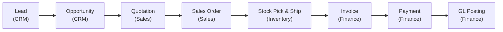
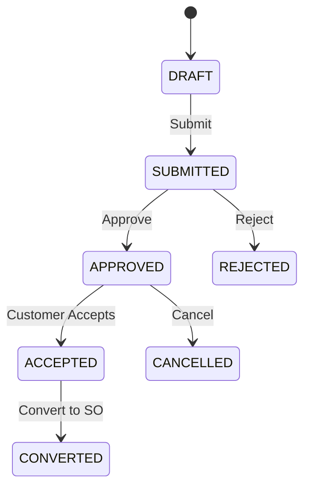
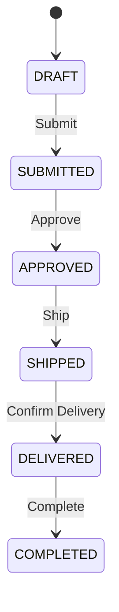

# Order to Cash (O2C)

> From first contact to final payment — the complete revenue lifecycle across four modules.

The Order to Cash storyline is the primary revenue flow in TenArm BES. It spans **CRM**, **Sales**, **Inventory**, and **Finance**, with each module handling its stage of the process automatically through events.

## The Flow at a Glance

---

## Step 1: Capture the Lead (CRM)

Every sale starts with a lead — an inbound inquiry, referral, or cold outreach.

### What to Do

1. Navigate to **CRM → Leads**
2. Click **New Lead**
3. Fill in contact details: name, company, email, phone, source
4. Optionally add **product interests** with estimated quantities and target prices
5. Click **Save** — the lead is created in `NEW` status

### What Happens Automatically
- Lead gets a unique number (e.g., `LD-2024-0001`)
- Owner is assigned (defaults to the creating user)
- Event `LeadCreated` is emitted

### Move the Lead Forward

| Action | Button | Result |
|--------|--------|--------|
| First contact made | **Mark Contacted** | NEW → CONTACTED |
| Lead is qualified | **Qualify** | CONTACTED → QUALIFIED |
| Lead is not viable | **Mark Lost** | Any status → LOST |

::: tip
You can configure **Qualification Criteria** (CRM → Settings) to define what makes a lead qualified — mandatory checkboxes that must be completed before qualification.
:::

---

## Step 2: Convert to Opportunity (CRM)

Once a lead is qualified, convert it into a structured deal.

### What to Do

1. Open the qualified lead
2. Click **Convert Lead**
3. The system creates:
   - A **Customer Account** (if one doesn't exist for this company)
   - A **Contact** linked to the account
   - An **Opportunity** with the lead's product lines and estimated value
4. The lead status changes to `CONVERTED`

### What Happens Automatically
- Event `LeadConverted` emitted
- Opportunity starts in `OPEN` status with a pipeline stage
- Product lines from the lead carry over to the opportunity

### Work the Pipeline

Advance the deal through pipeline stages using the **Advance Stage** button. When the deal is ready to quote:

| Action | Button | Result |
|--------|--------|--------|
| Advance pipeline stage | **Advance** | Updates the stage (Discovery → Proposal → Negotiation → Closed) |
| Deal won | **Win** | OPEN → WON |
| Deal lost | **Lose** | OPEN → LOST (with reason) |

---

## Step 3: Create a Quotation (Sales)

When the deal reaches the proposal stage, create a formal quotation.

### What to Do

1. From the opportunity, click **Convert to Quote** — this creates a Sales quotation with the opportunity's product lines
2. Or navigate to **Sales → Quotations** and click **New Quotation**
3. Review/edit line items:
   - Select products from the catalog
   - Set quantities, unit prices, and discounts
   - Tax codes are applied automatically based on product and customer settings
4. Click **Submit** to send for approval (if required)

### What Happens Automatically
- Quotation gets a unique number (e.g., `QT-2024-0001`)
- Line amounts and taxes are calculated automatically
- If the quotation is linked to an opportunity, the deal's estimated value updates
- Event `QuotationCreated` emitted

### Quotation Lifecycle

When the customer accepts, click **Accept** → then **Convert to Sales Order**.

::: tip
When a quotation is accepted, the CRM projection automatically marks the linked opportunity as **WON**.
:::

---

## Step 4: Sales Order (Sales)

The accepted quotation becomes a Sales Order — the binding commitment to deliver.

### What to Do

1. The converted quotation automatically creates a Sales Order in `DRAFT` status
2. Review the order: customer, shipping address, line items, payment terms
3. Click **Submit** → **Approve** to make it active

### Sales Order Lifecycle

### What Happens Automatically
- Sales Order number generated (e.g., `SO-2024-0001`)
- Stock may be **reserved** in Inventory (if configured)
- Event `OrderApproved` emitted

---

## Step 5: Stock Pick & Ship (Inventory)

Once the order is approved, fulfill it from your warehouse.

### What to Do

1. Navigate to **Inventory → Stock Movements** or process from the Sales Order
2. **Pick** the items from the warehouse
3. Click **Ship** — records the outbound stock movement
4. Enter shipment details: carrier, tracking number, shipped quantities
5. The Sales Order status moves to `SHIPPED`

### What Happens Automatically
- **Stock balances decrease** in the source warehouse
- Event `StockShipped` emitted
- Finance's **COGS Projection** automatically posts a journal entry:
  - Debit: Cost of Goods Sold
  - Credit: Inventory Asset Account
- If all lines are shipped, order moves to `SHIPPED`

::: warning
If you're using **catch-weight** products (dual-unit tracking), the system records both the discrete count (e.g., 10 cases) and the actual measured weight (e.g., 47.3 kg). Pricing uses the measured weight.
:::

---

## Step 6: Invoice the Customer (Finance)

After shipment, issue an invoice for payment.

### What to Do

1. Navigate to **Finance → Invoices** and click **New Invoice**
2. Select the customer and reference the Sales Order
3. Line items, quantities, and prices populate from the order
4. Click **Issue** to finalize the invoice

### What Happens Automatically
- Invoice number generated (e.g., `INV-2024-0001`)
- Journal entry posted automatically:
  - Debit: Accounts Receivable
  - Credit: Revenue
  - Credit/Debit: Tax accounts (per tax code)
- Event `InvoiceIssued` emitted
- If GST Invoicing add-on is enabled, an e-invoice (IRN) can be generated

---

## Step 7: Receive Payment (Finance)

When the customer pays, record the payment.

### What to Do

1. Navigate to **Finance → Payments** (Incoming)
2. Click **New Payment**
3. Select the customer and match to the outstanding invoice
4. Enter payment details: amount, method, reference number, date
5. Click **Save**

### What Happens Automatically
- Journal entry posted:
  - Debit: Bank / Cash Account
  - Credit: Accounts Receivable
- Invoice balance updated — if fully paid, invoice marked as settled
- Event `PaymentReceived` emitted

---

## Step 8: Complete the Order

Once everything is shipped, invoiced, and paid:

1. Navigate to the Sales Order
2. Click **Complete** — order moves to `COMPLETED`
3. The full O2C cycle is done

---

## Cross-Module Event Flow

Here's how the modules communicate automatically through events:

| Step | Event Emitted | Reacting Module | What Happens |
|------|--------------|-----------------|-------------|
| Lead qualified | `LeadQualified` | — | Lead ready for conversion |
| Lead converted | `LeadConverted` | CRM | Account + Contact + Opportunity created |
| Quotation accepted | `QuotationAccepted` | CRM | Linked opportunity auto-wins |
| Order approved | `OrderApproved` | Inventory | Stock reserved (if configured) |
| Stock shipped | `StockShipped` | Finance | COGS journal entry auto-posted |
| Invoice issued | `InvoiceIssued` | — | Accounts receivable updated |
| Payment received | `PaymentReceived` | — | Invoice settlement, bank reconciliation |

---

## Required Permissions

To execute the full O2C flow, a user needs permissions from multiple modules:

| Module | Key Permissions |
|--------|----------------|
| **CRM** | `lead.create`, `lead.contact`, `lead.qualify`, `lead.convert`, `deal.create`, `deal.advance`, `deal.win` |
| **Sales** | `quotation.create`, `quotation.submit`, `quotation.approve`, `order.create`, `order.submit`, `order.approve`, `order.ship` |
| **Inventory** | `stock.ship`, `stock.view`, `warehouse.view` |
| **Finance** | `finance.invoice.create`, `finance.invoice.issue`, `finance.payment.create` |

::: tip
In practice, different people handle different stages. A sales rep manages leads and quotations, a warehouse operator handles shipping, and a finance team member manages invoicing and payments. Each role only needs permissions for their stage.
:::

---

## Related Guides

- **[CRM Module](./modules/crm)** — Lead management and opportunity pipeline
- **[Sales Module](./modules/sales)** — Quotations and order lifecycle
- **[Inventory Module](./modules/inventory)** — Stock operations and warehouses
- **[Finance Module](./modules/finance)** — Invoicing, payments, and GL
- **[Procure to Pay (P2P)](./procure-to-pay)** — The purchasing counterpart to O2C
