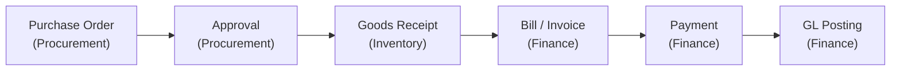
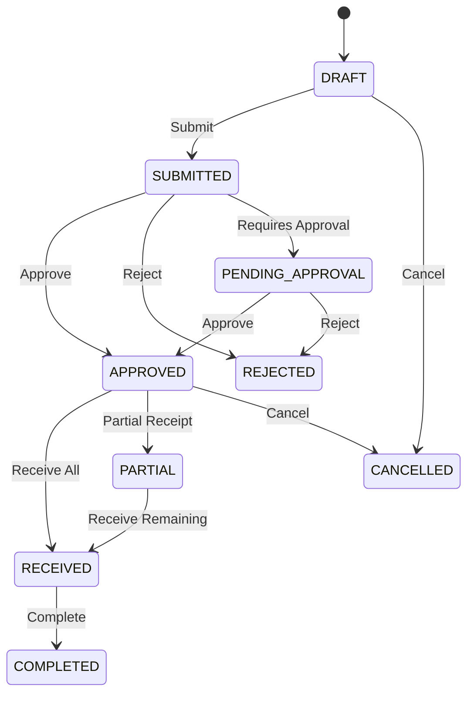

# Procure to Pay (P2P)

> From purchase request to vendor payment — the complete procurement lifecycle across three modules.

The Procure to Pay storyline covers everything from identifying a need for goods or services, through purchasing, receiving, and paying for them. It spans **Procurement**, **Inventory**, and **Finance**.

## The Flow at a Glance

---

## Step 1: Create a Purchase Order (Procurement)

When you need to buy goods or services from a supplier, create a Purchase Order.

### What to Do

1. Navigate to **Procurement → Purchase Orders**
2. Click **New Purchase Order**
3. Select the **Supplier** (from your party master data)
4. Add **line items**:
   - Select products from the catalog
   - Set quantities and unit prices
   - Tax codes are applied automatically based on product and supplier settings
5. Set **delivery date** and any special terms
6. Click **Save** — PO is created in `DRAFT` status

### What Happens Automatically
- PO number generated (e.g., `PO-2024-0001`)
- Line amounts and taxes calculated automatically
- Event `POCreated` emitted

---

## Step 2: Submit & Approve (Procurement)

Purchase Orders require approval before they can be sent to the supplier.

### What to Do

1. Review the PO details
2. Click **Submit** — PO moves to `SUBMITTED`
3. An approver reviews and clicks **Approve** — PO moves to `APPROVED`

### Purchase Order Lifecycle

### Approval Policies

Depending on your organization's configuration:

| Scenario | What Happens |
|----------|-------------|
| PO below threshold | Auto-approved on submit |
| PO above threshold | Routed to a manager for approval |
| PO rejected | Returns to `REJECTED` — can be edited and resubmitted |

::: tip
Approval thresholds and routing are configured by your administrator. If your PO is auto-approved, it skips the `PENDING_APPROVAL` state entirely.
:::

---

## Step 3: Receive Goods (Inventory)

When the supplier delivers the goods, record a Goods Receipt.

### What to Do

1. From the approved PO, click **Receive Goods**
2. Enter the **received quantities** for each line item
   - You can receive all lines at once or partially
   - For catch-weight products, enter both the piece count and measured weight
3. Select the **destination warehouse**
4. Click **Confirm Receipt**

### What Happens Automatically
- **Stock balances increase** in the destination warehouse
- A **Goods Receipt Note (GRN)** is created with a unique number
- If all lines are fully received, PO moves to `RECEIVED`
- If partially received, PO moves to `PARTIAL` (allowing future receipts)
- Event `StockReceived` emitted

### Partial Receipts

You can receive goods in multiple batches:

| Receipt | PO Status | Stock Impact |
|---------|-----------|-------------|
| First delivery (60%) | `PARTIAL` | 60% of ordered qty added to warehouse |
| Second delivery (40%) | `RECEIVED` | Remaining qty added |

::: warning
If a supplier can't fulfill the remaining quantity, you can **Short-Close** the PO — this marks remaining lines as cancelled and moves the PO to `COMPLETED`.
:::

---

## Step 4: Record the Bill (Finance)

After receiving goods, record the supplier's invoice as a Bill.

### What to Do

1. Navigate to **Finance → Bills** and click **New Bill**
2. Select the **Supplier** and reference the **Purchase Order**
3. Line items populate from the PO with received quantities
4. Verify amounts against the supplier's invoice
5. Click **Save** and then **Post**

### What Happens Automatically
- Bill number generated
- Journal entry posted automatically:
  - Debit: Expense / Inventory Asset Account
  - Credit: Accounts Payable
  - Debit/Credit: Tax accounts (per tax code)
- Event `BillPosted` emitted

### Three-Way Matching

When posting a bill, the system validates:
1. **PO** — Does the bill match the purchase order?
2. **GRN** — Were the goods actually received?
3. **Bill** — Do the amounts match?

This prevents paying for goods you didn't order or didn't receive.

---

## Step 5: Pay the Supplier (Finance)

When it's time to pay, record an outgoing payment.

### What to Do

1. Navigate to **Finance → Payments** (Outgoing)
2. Click **New Payment**
3. Select the **Supplier** and match to the outstanding bill
4. Enter payment details: amount, method, reference, date
5. Click **Save**

### What Happens Automatically
- Journal entry posted:
  - Debit: Accounts Payable
  - Credit: Bank / Cash Account
- Bill balance updated — if fully paid, bill marked as settled
- Event `PaymentMade` emitted

---

## Step 6: Complete the PO

Once everything is received, billed, and paid:

1. Navigate to the Purchase Order
2. Click **Complete** — PO moves to `COMPLETED`
3. The full P2P cycle is done

---

## Cross-Module Event Flow

| Step | Event Emitted | Reacting Module | What Happens |
|------|--------------|-----------------|-------------|
| PO approved | `POApproved` | — | PO ready for goods receipt |
| Goods received | `StockReceived` | Inventory | Stock balances updated |
| Bill posted | `BillPosted` | Finance | Accounts payable updated |
| Payment made | `PaymentMade` | Finance | Bank balance updated, bill settled |

---

## Required Permissions

| Module | Key Permissions |
|--------|----------------|
| **Procurement** | `po.create`, `po.submit`, `po.approve`, `po.receive`, `po.cancel` |
| **Inventory** | `stock.receive`, `stock.view`, `warehouse.view` |
| **Finance** | `finance.bill.create`, `finance.bill.post`, `finance.payment.create` |

::: tip
In practice, the procurement team creates and submits POs, a warehouse team receives goods, and the finance team handles billing and payments. Each role only needs permissions for their stage.
:::

---

## Related Guides

- **[Procurement Module](../modules/procurement.md)** — Purchase order management
- **[Inventory Module](../modules/inventory.md)** — Stock operations and warehouses
- **[Finance Module](../modules/finance.md)** — Bills, payments, and GL
- **[Order to Cash (O2C)](./order-to-cash.md)** — The selling counterpart to P2P
