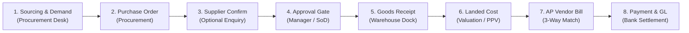
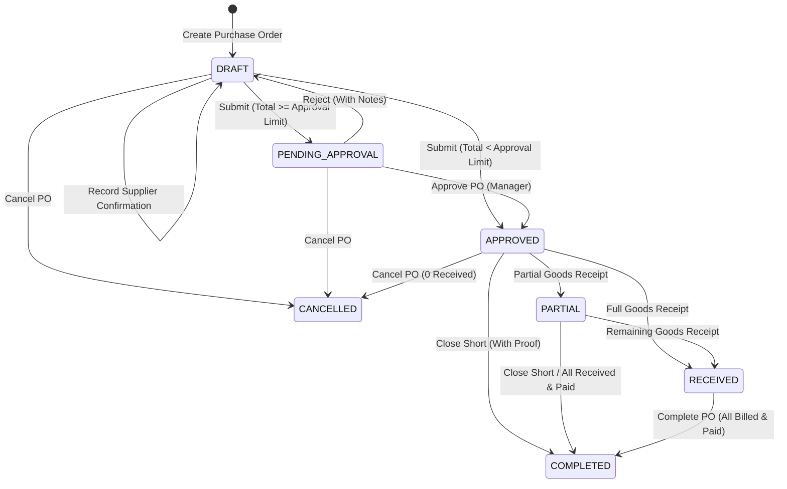

# Procure to Pay (P2P)

> From purchase order requisition to warehouse dock intake, landed cost capitalization, three-way match billing, and bank disbursement — the end-to-end procurement lifecycle across Procurement, Inventory, and Finance.

The **Procure to Pay (P2P)** storyline is the operational replenishment and expenditure spine of TenArm BES. It connects four critical operational domains into a unified, audit-backed commercial pipeline:
1. **Procurement**: Analyzes vendor reliability, surfaces active sales backorder demand, negotiates commercial purchase orders with dual-unit catch-weight pricing, and enforces managerial approval policies.
2. **Inventory & Warehousing**: Inspects incoming carrier shipments at the physical dock, verifies catch-weight piece counts against nominal weights, logs heat numbers and mill test certificates (TC), and creates cost-layered inventory lots.
3. **Landed Cost Accounting**: Apportions inbound freight, customs duties, port tariffs, and transit insurance across inventory lots by weight or value, capitalizing landed costs directly into stock valuation.
4. **Finance & Accounts Payable (AP)**: Enforces three-way matching against purchase orders and dock receipts, posts vendor tax liabilities to the General Ledger (GL), allocates advance disbursements, and settles supplier payments via bank transfers.

Every transaction in this lifecycle updates operational inventory balances and financial ledgers automatically through system event propagation — eliminating double data entry, preventing unauthorized overbilling, and ensuring that physical dock receipts always align with vendor disbursements.

---

## The Flow at a Glance

---

## Workspace Ergonomics in P2P

The TenArm BES workspace is tailored for rapid commercial purchasing, dockside receiving speed, and total operational traceability:

- **Multi-Tab Desk**: The workspace maintains up to 3 open tabs simultaneously (e.g. keeping **Procurement Desk** in Tab 1, an active **Purchase Order Storyline** in Tab 2, and the **Supplier Bills** command desk in Tab 3). Switching between tabs preserves all table search filters, scroll positions, and uncommitted line entries without triggering page reloads.
- **Draft Auto-Save**: Uncommitted form inputs — such as purchase order lines, dock receiving piece weights, invoice references, and landed cost allocations — are preserved continuously in local workspace drafts. Active tabs display a dirty dot indicator (`•`) until the record is committed or discarded.
- **Quick-Peek Slide-Out**: Clicking linked reference IDs (such as Supplier Name, PO #, Bill #, Journal Entry #, or Warehouse Location) opens a contextual slide-over drawer from the right edge of the screen, allowing users to verify supplier reliability or ledger impact without leaving their active transaction.
- **Optimistic Concurrency Control (OCC)**: Every commercial order, dock receipt, and supplier bill is version-guarded (`v1`, `v2`, etc.). If another buyer or receiving clerk updates a purchase order while your screen is open, the **Conflict Resolution Drawer** immediately displays side-by-side field diffs to prevent accidental overwrites.

---

## Step 1: Demand Discovery & Sourcing Intelligence (Procurement)

Procurement begins when inventory replenishment thresholds are breached, customer backorders require fulfillment, or raw material demand is scheduled.

### 1. Ingest Demand on the Procurement Desk
Navigate to **Procurement → Desk** (`/procurement/desk`). The desk acts as an intelligent procurement workbench that consolidates upstream operational needs:
- **Backorder Demand Banner (`BackorderDemandBanner`)**: Surfaces high-priority sales orders waiting for stock fulfillment. Clicking a backordered item populates the product, ordered quantities, customer reference, and destination warehouse directly into your purchase order lines.
- **Awaiting Supplier Banner (`AwaitingSupplierBanner`)**: Displays draft enquiries sent to vendors awaiting formal quotation or proforma confirmation, highlighting overdue follow-ups first.
- **Stock Reorder Alerts**: Identifies catalog products that have breached their minimum inventory safety threshold (`stock.reorder_status.get`).

### 2. Evaluate Vendor Performance & Sourcing Rails
Before selecting a vendor, inspect supplier performance metrics:
1. In the **Vendor Sourcing Intelligence Rail**, review candidate suppliers mapped to the requested product.
2. Evaluate key performance indicators (KPIs) sourced from historical purchase orders:
   - **On-Time In-Full (OTIF) Delivery Rate**: The percentage of historical shipments delivered on or before the promised delivery date.
   - **Average Delivery Delay**: Historical variance between expected delivery date and actual dock intake date.
   - **Short-Ship Weight Variance**: Historical delta between ordered catch-weight tonnage and physical received weight.
   - **Preferred Status**: Contractually negotiated primary suppliers vs secondary market traders.
3. Select the best supplier based on landed economics and delivery lead time.

---

## Step 2: Author the Purchase Order (Procurement Desk)

With the supplier and demand identified, configure the commercial terms of the purchase order on the **Procurement Desk** (`/procurement/desk`):

### 1. Configure Supplier & Commercial Headers
In the **Supplier Sourcing Card** (`SupplierSourcingCard`):
1. **Supplier**: Select the vendor from your active supplier directory. Selecting a vendor auto-populates their registered tax region (GST state), primary contact, and default payment terms.
2. **Supplier Reference**: Enter the vendor's quotation or proforma invoice reference number (if available).
3. **Expected Delivery Date / Horizon**: Set the delivery date or staggered delivery window (e.g. `Due 2026-11-25` or `Staggered Delivery Horizon: Nov 20-30`).
4. **GST Tax Treatment**: Confirms whether the transaction is Intra-State (CGST + SGST) or Inter-State (IGST) based on the supplier's state code and the destination warehouse.

### 2. Configure Line Items & Catch-Weight Specifications
In the **Procurement Lines Section** (`ProcurementLinesSection`):
1. **Product**: Select raw materials, commercial commodities, or consumables from the product catalog.
2. **Receiving Warehouse**: Designate the destination warehouse where physical intake will occur.
3. **Dual-Unit & Catch-Weight Entry**:
   - **Discrete Count (`qty`)**: Enter discrete units, such as number of coils, bundles, sheets, or boxes.
   - **Physical Measure (`qty_secondary`)**: Enter physical weight or measured dimensions (e.g. Metric Tonnes or kilograms).
   - **Pricing Basis (`priced_by`)**: Automatically enforced from the product catalog:
     - `MEASURE`: Price is calculated per secondary unit (e.g. ₹58,000 / MT × 24.50 MT).
     - `COUNT`: Price is calculated per primary unit (e.g. ₹1,200 / Piece × 50 Pieces).
4. **Unit Price**: Enter the negotiated base unit price.

### 3. Review Totals & Commit
In the **Commercial Settlement Summary** (`ProcurementSummaryCard`):
- Review **Base Subtotal**, **Tax Breakdown** (itemized CGST, SGST, IGST parts), and **Total Payable**.
- Review secondary quantity totals (e.g. Total MT).
- Click **Create Purchase Order**:
  - The system creates the purchase order in `DRAFT` status.
  - A unique sequential document number is assigned (e.g. `PO-2026-0042`).
  - The screen redirects to the **Purchase Order Storyline** (`/procurement/orders?open=<id>`).

::: tip Editing Draft Orders
If prices or line items need adjustment before submission, click **Edit PO** on the storyline header. This re-opens the order on the Procurement Desk with all existing lines and OCC revision guards (`v1`, `v2`).
:::

---

## Step 3: Supplier Confirmation & Purchase Enquiry (Optional Sourcing Gate)

In industrial and bulk material purchasing, commercial terms often require supplier sign-off before formal executive approval. TenArm BES supports a dedicated confirmation loop directly within the `DRAFT` status:

### 1. Issue a Purchase Enquiry Document
1. In the **PO Storyline Header**, click **PDF** (`po-pdf-header-btn`).
2. While the order is in `DRAFT` status, the document prints strictly as a **Purchase Enquiry** — clearly branded as a request for quote/proforma, preventing suppliers from mistaking it for an authorized dispatch order.
3. Click **Send for supplier confirmation** (`po-send-supplier-btn`). The system records the dispatch timestamp (`sent_to_supplier_at`) and registers a follow-up target date. The order appears on the **Awaiting Supplier Confirmation** queue.

### 2. Record Supplier Confirmation
When the supplier returns their formal proforma invoice or order acknowledgement:
1. In the **Supplier Confirmation Panel** (`SupplierConfirmationPanel`), click **Record Confirmation**.
2. Enter the supplier's document number in **Supplier Reference** and select the confirmation date.
3. Upload the supplier's signed quotation or proforma PDF as an attachment (`document_type=SUPPLIER_CONFIRMATION`).
4. If line item rates or delivery schedules differ, click **Edit PO** to align the purchase order with the confirmed proforma.

---

## Step 4: Submission & Commercial Approval Governance (Procurement)

To prevent unauthorized company expenditure, purchase orders are governed by automated approval thresholds and Segregation of Duties (SoD).

### 1. Submit the Order
On the PO Storyline Header, click **Submit for Approval** (`po-submit-btn`):
- **Below Approval Threshold**: If the purchase order total is below the tenant's configured threshold (or if approval workflows are disabled), the order transitions immediately to **`APPROVED`** (`po.submit` auto-approves).
- **At or Above Approval Threshold**: The order transitions to **`PENDING_APPROVAL`**. An alert banner appears displaying the approval trigger reason (e.g. *Waiting for approval: order total exceeds ₹5,00,000 threshold*).

### 2. Managerial Approval & Segregation of Duties (SoD)
1. The pending purchase order alerts users holding the `po.approve` permission.
2. **Strict Segregation of Duties (SoD)**: The user who created or submitted the purchase order is strictly barred from approving it. The approval button is suppressed for the submitter with the message: *"Anyone who can approve purchase orders — except the person who submitted it — can approve it."*
3. The authorized manager reviews line items, commercial margins, and supplier terms, then clicks:
   - **Approve PO** (`po-approve-btn`): Transitions the order to **`APPROVED`**. The event `PurchaseOrderApproved` is emitted, enabling warehouse goods intake.
   - **Reject** (`po-reject-btn`): Prompts for a mandatory rejection justification note. Transitions the order back to **`DRAFT`**, notifying the buyer to revise prices or quantities.
   - **Cancel**: Cancels the pending order permanently (`CANCELLED`).

::: tip Authorized Purchase Order PDF
Once a purchase order reaches **`APPROVED`**, clicking **PDF** generates the legally binding **Official Purchase Order** document, complete with authorized company stamps, tax identifiers, and delivery terms.
:::

---

## Step 5: Goods Intake & Receiving at the Warehouse Dock (Inventory)

When the supplier's freight carrier arrives at the physical warehouse dock, receiving clerks inspect and log the delivery.

### 1. Physical Dock Intake vs Service / Drop-Ship Lines
The PO Storyline header inspects line item fulfillment types:
- **Physical Goods**: Lines assigned to a warehouse require physical dock intake via **Goods Received** (`po-receive-header-btn`).
- **Services, Transport & Drop-Ship**: Non-physical lines (consulting, carrier freight, subcontracting, or direct customer drop-shipments) bypass warehouse docks. Click **Confirm Service / POD** (`po-confirm-service-pod-header-btn`) to confirm delivery without generating inventory balance movements.

### 2. Execute Dock Intake via the Goods Received Dialog
Clicking **Goods Received** opens the comprehensive receiving dialog (`ReceiveGoodsDialog`):

#### A. Capture Supplier Delivery Documentation
Expand the **Receipt Invoice & Delivery Challan** section (`ReceiptInvoiceSection`):
- **Vendor Invoice / Challan Ref**: Enter the supplier's delivery challan or commercial invoice number.
- **Invoice Date & Amount**: Record document dates and billed carrier values.
- **Attach Delivery Challan / Invoice**: Upload a digital scan or photo of the physical delivery challan or weighbridge ticket.

#### B. Catch-Weight & Lot/Serial Verification
For each line item on the delivery:
1. **Confirm Receiving Warehouse**: Verify the physical warehouse bay where items are unloaded. (Lines without a warehouse can have one assigned via **Assign Warehouse**).
2. **Bulk Lot Receipt (`BulkLotReceiptSection`)**:
   - **Received Primary Quantity (`qty`)**: Enter physical received count or volume.
   - **Received Secondary Weight (`qty_secondary`)**: For catch-weight products (such as steel coils, bars, or plate packs), enter the actual measured scale weight.
   - **Lot / Batch Number**: Enter the manufacturing lot or melt number.
   - **Heat Number & Mill TC**: Enter the steelmaker heat number and Mill Test Certificate (TC) identifier, and upload the material test certificate PDF.
3. **Itemized Piece Receipt (`ItemizedPieceReceiptSection`)**:
   - For piece-tracked inventory, key in individual piece weights or barcode serials.
   - The dialog computes total pieces and aggregate measured tonnage dynamically.

#### C. Tolerance & Over-Receipt Governance
- If received quantities exceed the purchase order remaining balance but fall within organizational tolerance limits (e.g. ±5%), the line is accepted and tagged with an advisory flag (`OVER_TOLERANCE_RECEIPT`).
- If received quantities exceed permissible tolerance thresholds, the system blocks confirmation until a buyer authorizes an amendment or split order.

### 3. Confirm Receipt & Automatic System Effects
Click **Confirm Receipt**:
1. **Inventory Movements (`stock.receive`)**: An immutable `RECEIVE` movement is recorded in the inventory ledger.
2. **Cost-Layered Lots (`InventoryLot`)**: The system creates a new cost-layered lot for the receipt, capturing the unit purchase cost, receipt date, warehouse location, and source PO reference.
3. **Warehouse Balances**: Physical `on_hand_qty` increases immediately; Available-to-Promise (ATP) calculators reflect new stock.
4. **Goods Receipt Note (GRN)**: A unique GRN document number is generated.
5. **PO Status Progression**:
   - If all lines are fully received: Order status transitions to **`RECEIVED`**.
   - If partial quantities were received: Order status transitions to **`PARTIAL`**, keeping the order open for subsequent deliveries.

::: warning Short-Closing Incomplete Balances
If a supplier cannot deliver the remaining balance on an order (e.g. batch completed, order cancelled, or material discontinued), do not leave the order stuck in `PARTIAL`. Click **Close Short** (`po-close-short-header-btn`) to open the **Close Short** dialog (`CloseShortModal`). Select a standard justification (e.g. *Supplier Cancelled*, *Force Majeure*, *Defective Batch*, *Mutual Cancellation*), upload supplier correspondence proof, and confirm. The unreceived balance is retired, and the PO advances to **`COMPLETED`**.
:::

---

## Step 6: Inbound Landed Cost Capitalization (Procurement & Finance)

In manufacturing and commodity distribution, the true cost of inventory is not merely the vendor's invoice price — it must include inbound freight, port handling, customs duties, clearing tariffs, and transit insurance. TenArm BES includes native landed cost capitalization to ensure accurate inventory valuation and Gross Margin calculation.

### 1. Initiate Landed Cost Allocation
1. From the PO Storyline Header, click **Landed Cost** (`po-allocate-landed-cost-header-btn`).
   *(Alternatively, navigate to **Procurement → Landed Cost Desk** (`/procurement/landed-cost`) and click **+ Allocate Landed Cost**).*
2. The **Allocate Landed Cost** dialog opens (`AllocateLandedCostModal`).

### 2. Select Carrier Bill & Allocation Basis
1. **Link Carrier / Service Bill**: Select the vendor bill representing the third-party transportation or customs duty charge (e.g. `BILL-2026-0089: FastTrack Logistics Freight`).
2. **Allocation Basis (`basis`)**:
   - **`WEIGHT`**: Apportions the freight expense proportionally based on the physical weight (Metric Tonnes / kg) of each received lot. Recommended for steel, bulk commodities, and heavy freight.
   - **`VALUE`**: Apportions the charge proportionally based on the commercial currency value of each lot. Recommended for customs ad-valorem duties, import tariffs, and insurance.
3. **Allocation Amount**: Defaults to the carrier bill amount, or specify a partial freight value.
4. **Target Lots**: Select the specific inventory lots received under this purchase order.

### 3. Capitalize Costs into Inventory
Click **Allocate Landed Cost**:
- **Lot Cost Adjustment (`stock.lot.adjust_cost`)**: The unit cost (`unit_cost`) of each selected inventory lot increases by its apportioned share of freight/customs expenses.
- **Warehouse Moving Average**: The warehouse moving average cost (`avg_cost`) rebalances automatically to reflect the capitalized freight.
- **COGS Accuracy**: When these lots are subsequently dispatched on sales orders, Cost of Goods Sold (COGS) reflects the true landed acquisition cost, protecting gross profit reporting.

::: tip Purchase Price Variance (PPV)
If the final vendor invoice differs from the purchase order estimate after lots have already been partially consumed, navigate to **Finance → Bills** and click **PPV Variance** (`bill-record-variance-btn`) to post the difference directly to the General Ledger Landed Cost Variance account without corrupting historical inventory layers.
:::

---

## Step 7: Accounts Payable Invoicing & 3-Way Matching (Finance)

Once goods or services have been received, the supplier's commercial tax invoice is recorded and verified through Three-Way Matching.

### 1. Raise the Supplier Bill
There are two seamless ways to generate the Accounts Payable bill:
- **Directly from the Purchase Order**: On the PO Storyline Header, click **Raise AP Bill** (`po-create-bill-header-btn`).
- **From the Finance Ready-to-Bill Queue**: Navigate to **Finance → Bills** (`/finance/bills`), select the **Ready to Bill** tab (`BillingCandidatesQueue`), select the purchase order candidate, and click **Create Bill**.

The **Raise AP Bill** modal (`RaiseBillModal`) opens:
1. **Vendor Invoice / Ref #**: Auto-populates from the delivery challan reference captured at the dock, or enter the supplier's legal invoice number.
2. **Bill Date & Due Date**: Set the invoice date and payment due date (calculated automatically from credit terms).
3. **Lines & Quantities**: Line items and unit rates populate automatically from the purchase order, with quantities defaulted to actual received amounts.
4. Click **Create Supplier Bill** — the bill is created in `DRAFT` status and opens in the **Bill Storyline** (`/finance/bills?open=<id>`).

### 2. Enforce the Three-Way Match Invariant
Before an Accounts Payable bill can be posted to the General Ledger, the system enforces the strict **Three-Way Matching Invariant**:

$$\sum \text{Billed Quantity} \le \text{Received Quantity} + \text{Permitted Tolerance}$$

1. **Purchase Order Match**: Verifies that billed unit prices and tax codes match the contracted rates on the approved purchase order.
2. **Goods Receipt Note (GRN) Match**: Verifies that billed quantities do not exceed the cumulative physical dock intake. The system blocks bills where supplier invoicing exceeds delivered goods.
3. **Tax & Currency Match**: Validates statutory tax components (CGST/SGST/IGST) against the vendor's registered tax region.

### 3. Post the Bill to the General Ledger
On the Bill Storyline Header, click **Post Bill** (`bill-post-btn`):
- Verifies that the bill accounting date falls within an **OPEN** accounting period.
- Emits the domain event `BillPosted`.
- Generates and posts the double-entry accounting journal:
  - **Debit**: Inventory Asset / Expense Account (Net Subtotal)
  - **Debit**: Tax Input Account (CGST / SGST / IGST Input Tax Credit)
  - **Credit**: Accounts Payable Control Account (Total Billed Value)
- Updates supplier ledger aging and vendor payable balances.
- Click **Peek GL Impact** (`bill-peek-gl-btn`) at any time to inspect the balanced debit/credit journal lines.

---

## Step 8: Supplier Disbursements, Advance Offsetting & Settlement (Finance)

The final financial stage settles the outstanding vendor liability through advance allocations or bank disbursements.

### Scenario A: Offsetting Against Prior Supplier Advances
If advance payments or deposits were provided to the supplier prior to shipment:
1. In the posted **Bill Storyline**, navigate to the **Advance Payments** panel (`AdvancePaymentPanel`).
2. The panel displays unallocated advances registered for this supplier (`direction="AP"`).
3. Click **Apply Advance**:
   - Specify the amount to apply against the bill's `balance_due`.
   - The system posts an automatic reclassification journal:
     - **Debit**: Accounts Payable Control Account
     - **Credit**: Supplier Advance Account
   - The bill's `balance_due` decreases immediately. If the balance reaches ₹0.00, the bill transitions to **`PAID`**.

### Scenario B: Recording Direct Bank / Cash Disbursements
When issuing payment for outstanding bills:
1. In the posted **Bill Storyline**, click **Pay Supplier** (`bill-record-payment-btn`) to open the payment modal (`RecordPaymentModal`).
   *(Alternatively, navigate to **Finance → Payments & Cash Settlements** (`/finance/payments`) and click **Record Advance / Payment**).*
2. Enter disbursement details:
   - **Payment Amount (₹)**: Defaults to the full remaining `balance_due` (or enter partial amounts).
   - **Disbursement Method**: Select `Bank Transfer (RTGS / NEFT / IMPS)`, `Cheque / DD`, or `Cash`.
   - **Paying Bank Account**: Select the company bank account from which funds are drawn (e.g. `HDFC Bank - Commercial Disbursement A/c`).
   - **Payment Reference / UTR**: Enter the banking transaction reference number or cheque leaf number.
3. Click **Confirm Payment**:
   - The system posts the settlement journal to the General Ledger:
     - **Debit**: Accounts Payable Control Account
     - **Credit**: Bank / Cash Account
   - The bill's `balance_due` decreases.
   - When all balances reach ₹0.00, the bill status permanently updates to **`PAID`**.
   - The PO Storyline updates its commercial fulfillment gauge: `100% Paid`.

---

## Step 9: Purchase Order Completion & Document Lifecycle Audit

With goods received, landed costs capitalized, supplier invoices verified, and disbursements settled:

1. Return to **Procurement → Orders** (`/procurement/orders`) and select the purchase order.
2. Once the order satisfies all three completion conditions:
   - **100% Received** (or remaining balance retired via Close Short)
   - **100% Billed** (`isFullyBilled = true`)
   - **100% Paid** (`isFullyPaid = true`)
3. On the PO Storyline Header, click **Complete PO** (`po-complete-header-btn`).
   - The Purchase Order transitions to its terminal **`COMPLETED`** status.
4. Review the **Document Lifecycle Panel** (`DocumentLifecyclePanel`) at the foot of the storyline:
   - Displays 360° audit lineage connecting every operational artifact:
     `Purchase Enquiry` → `Supplier Confirmation` → `Purchase Order (PO)` → `Goods Receipt Note (GRN)` → `Inventory Lots (LOT)` → `Vendor Bill (BILL)` → `Landed Cost Allocation (LCA)` → `Payment Voucher (PAY)` → `General Ledger Journals (JE)`.
   - Displays immutable timestamps, user IDs, OCC versions, and linked accounting vouchers.

---

## Automated Cross-Module Coordination

Throughout the Procure to Pay lifecycle, system automation coordinates modules through asynchronous domain events without manual intervention:

| When this happens... | The system automatically... | Participating Modules |
|---|---|---|
| **Demand Identified on Backorder** | Surfaces unfulfilled sales orders on the Procurement Desk with line quantities and target warehouses | Sales & Procurement |
| **PO Draft Sent to Supplier** | Sets follow-up target date and surfaces order on the *Awaiting Supplier Confirmation* queue | Procurement |
| **PO Submitted (Above Limit)** | Triggers approval workflow and alerts managers holding approval permissions (barring submitter) | Procurement & Core Platform |
| **PO Approved** | Authorizes official PO PDF generation and permits warehouse dock intake | Procurement & Inventory |
| **Goods Received at Dock** | Deducts remaining PO balance, increases warehouse `on_hand_qty`, creates cost-layered `InventoryLot`, and emits `StockReceived` | Procurement & Inventory |
| **Order Closed Short** | Retires pending unreceived balances with audit reason and allows order to advance toward completion | Procurement & Core |
| **Landed Cost Allocated** | Revalues inventory lot unit cost (`stock.lot.adjust_cost`) and updates warehouse moving average | Procurement & Inventory |
| **AP Bill Posted** | Enforces 3-way match validation, updates AP vendor aging, and posts double-entry GL journal (`Dr Inventory / Cr AP`) | Finance & Procurement |
| **Supplier Payment Confirmed** | Reduces vendor liability, updates bank balance (`Dr AP / Cr Bank`), and marks bill **PAID** | Finance |
| **PO Completed** | Commits full document lifecycle audit lineage and archives commercial commitment | Procurement & Core |

---

## User Roles & Operational Responsibilities

In enterprise manufacturing and distribution operations, Procure to Pay duties are partitioned across specialized functional roles:

| Role | Operational Scope | Key Screens & Primary Actions |
|---|---|---|
| **Purchasing Agent / Buyer** | Vendor discovery, price negotiation, PO authoring, and supplier follow-ups | `/procurement/desk`, `/procurement/orders`, `/procurement/suppliers` (`Create Purchase Order`, `Send for supplier confirmation`, `Record Confirmation`, `Submit for Approval`) |
| **Procurement Manager** | Expenditure authorization, contract approvals, and vendor terms review | `/procurement/orders`, `/core/approvals` (`Approve PO`, `Reject`, `Close Short`) |
| **Receiving Clerk / Dock Lead** | Physical dock intake, catch-weight weighbridge capture, heat/TC verification, and GRN generation | `/procurement/orders`, `/inventory/movements`, `/inventory/balances` (`Goods Received`, `Confirm Service / POD`, `Assign Warehouse`) |
| **Inventory Controller** | Inbound landed cost capitalization, warehouse transfers, and lot valuation | `/procurement/landed-cost`, `/inventory/lots` (`Allocate Landed Cost`, `Inspect Allocation`) |
| **Accounts Payable Specialist** | Three-way matching, vendor invoice verification, and tax liability booking | `/finance/bills` (`+ New Bill`, `Raise AP Bill`, `Post Bill`, `PPV Variance`) |
| **Treasury / Cash Accountant** | Advance disbursement, bank transfer execution, and account reconciliation | `/finance/payments`, `/finance/bills` (`Pay Supplier`, `Record Advance / Payment`, `Apply Advance`) |

---

## If Something Goes Wrong (Common Validation & Guard Errors)

The table below translates UI notifications, guard alerts, and system toasts into clear business causes and step-by-step resolution actions:

| What you see on screen (Toast / Alert) | Business cause | How to fix it in the workspace |
|---|---|---|
| `"The person who submitted the order may not approve it"` | Strict Segregation of Duties (SoD) prevents order submitters from authorizing their own purchase orders. | Forward the PO reference to an independent manager or commercial lead holding `po.approve` permissions to review and click **Approve PO**. |
| `"Cannot cancel purchase order with recorded receipts"` | One or more line items have already been physically received at the warehouse dock (`received_qty > 0`). | Approved orders with physical intake cannot be cancelled. Use **Close Short** (`po-close-short-header-btn`) to retire the unreceived balance, or initiate a formal return to vendor. |
| `"Received quantity exceeds remaining balance tolerance"` | The entered physical receipt quantity exceeds the purchase order balance plus permitted over-receipt tolerance. | Verify physical scale/count slips. If the vendor delivered excess material intentionally, have the buyer click **Edit PO** to raise the line quantity or create an additional purchase order before confirming receipt. |
| `"Line warehouse is required for physical intake"` | A purchase order line item was created without a designated receiving warehouse location. | Click **Assign Warehouse** on the line item in the PO Storyline, select the destination warehouse, and proceed with **Goods Received**. |
| `"Three-way match violation: Billed quantity exceeds received quantity"` | Finance attempted to post an AP bill for quantities greater than what the warehouse dock has physically verified on GRNs. | Verify whether the dock has finished receiving the shipment. If goods have not arrived, adjust the bill line quantity to match the GRN, or hold the bill until receiving confirms intake. |
| `"Document was modified by another user (OCC Conflict)"` | Another user updated the purchase order, dock receipt, or bill while your tab was active. | The **Conflict Resolution Drawer** opens automatically. Review the side-by-side field diffs, choose whether to preserve your edits or accept the server version, and re-commit. |
| `"Accounting period is closed"` | The vendor bill posting date or disbursement date falls within a locked or closed financial accounting period. | Adjust the bill date to the current open fiscal period, or request the Finance Controller reopen the accounting period in **Finance → Settings**. |
| `"Supplier advance has zero remaining unallocated balance"` | The selected advance payment has already been fully applied against other vendor bills. | Check the **Advance Payments** panel for other active advances, or record a new advance/disbursement via **Pay Supplier**. |
| `"Cannot complete PO: unbilled or unpaid balances remain"` | An operator clicked **Complete PO** while unreceived items, unposted bills, or open payable balances still exist. | Ensure all goods are received (or retired via **Close Short**), all vendor bills are posted, and payments are settled (`100% Billed` and `100% Paid`) before completing the order. |
| `"Landed cost allocation must match bill amount or specify partial value"` | The sum of allocated lot amounts does not equal the entered landed cost freight figure. | Review the candidate lot apportionment table. Select **Apportioned by Weight** or **Apportioned by Value** to auto-distribute the freight expense evenly across lots. |

---

## Related Documentation

- **[Procurement Module Guide](../modules/procurement.md)** — Purchase order management, supplier directories, and landed cost desks.
- **[Inventory Module Guide](../modules/inventory.md)** — Multi-warehouse stock tracking, cost-layered lots, and dual-unit catch-weight mechanics.
- **[Finance Module Guide](../modules/finance.md)** — Chart of accounts, double-entry vendor bills, advance payments, and GL posting.
- **[GST Invoicing & Compliance](../modules/gst-invoicing.md)** — Input Tax Credit (ITC) governance, state GST splits, and TDS u/s 194Q.
- **[Steel Module Guide](../modules/steel.md)** — Heat numbers, mill test certificates (TC), and coil receiving.
- **[Order to Cash (O2C) Storyline](./order-to-cash.md)** — The downstream sales and customer fulfillment counterpart to P2P.
- **[Make to Order (M2O) Storyline](./make-to-order.md)** — Production-driven manufacturing pipelines utilizing procured raw materials.
